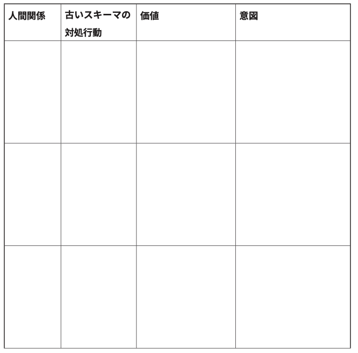
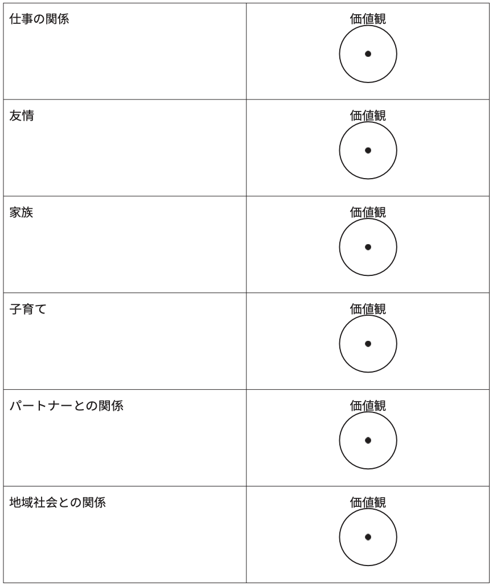
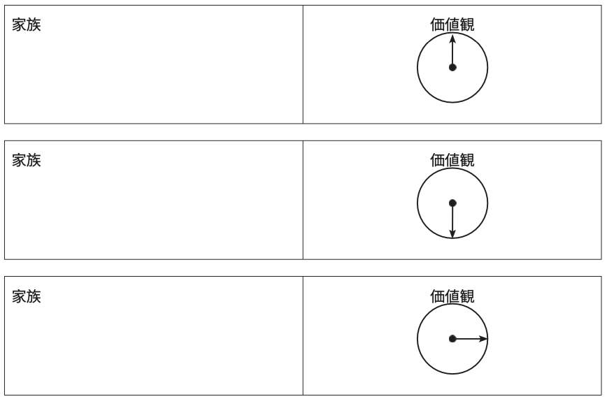
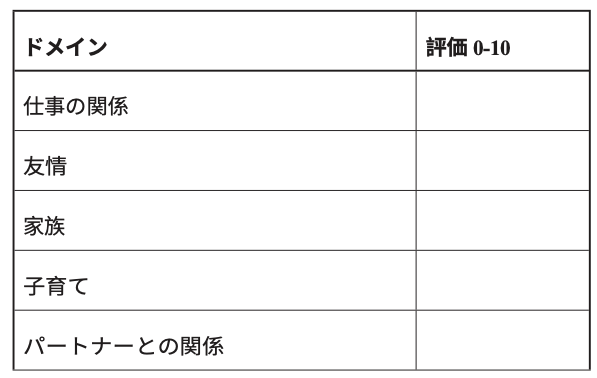

# 人生を破壊する「悪いスキーマ」をチェックしようぜ！ #18「 価値観の羅針盤」

「人生を破壊する『悪いスキーマ』をチェックしようぜ！」の続きでーす([#1](https://daigovideolab.jp/blog/2161566),[#2](https://daigovideolab.jp/blog/2161730),[#3](https://daigovideolab.jp/blog/2163260),[#4](https://daigovideolab.jp/blog/2164192),[#5](https://daigovideolab.jp/blog/2165742),[#6](https://daigovideolab.jp/blog/2165743),[#7](https://daigovideolab.jp/blog/2166125),[#8](https://daigovideolab.jp/blog/2166486),[#9](https://daigovideolab.jp/blog/2166652),[#10](https://daigovideolab.jp/blog/2167417),[#11](https://daigovideolab.jp/blog/2168117),[#12](https://daigovideolab.jp/blog/2168526),[#13](https://daigovideolab.jp/blog/2169057),[#14](https://daigovideolab.jp/blog/2169261),[#15](https://daigovideolab.jp/blog/2170446),[#16](https://daigovideolab.jp/blog/2171935),[#17](https://daigovideolab.jp/blog/2172073))。

---

このシリーズでは、「やるのは大変だけど実践すれば効果は抜群」でおなじみの心理セラピーである「**スキーマ療法**」の基本を述べてまして、現在は「解決編」に入っております。スキーマ対策については、「[自分でできるスキーマ療法ワークブック](https://amzn.to/3Q7AnxB)」という名著が存在しますが、これはガッツリスキーマを正す趣旨で書かれていまして、実践が大変なところもあったりします。

そこでこのシリーズでは、スキーマ療法の研究で有名なマシュー・マッケイ先生らの調査をベースに、もうちょい手軽だけど、十分な効果を見込めるエクササイズをご紹介します。まぁトラウマレベルのスキーマであれば、「[自分でできるスキーマ療法ワークブック](https://amzn.to/3Q7AnxB)」に取り組むべきでしょうが、中程度の対人トラブルや社交不安の方であれば、いい具合に使っていただけるのではないかと。

さて、前回のステップでは、「バリュー・ドメイン・ワークシート」ってトレーニングを紹介しました。あなたの人生におけるいくつかの領域で大事にしている価値観を見極め、それに向かって、どのように具体的に行動していくのかをチェックしてみました。

ということで、今回もまた、スキーマへの対処能力をアップさせるトレーニングを見ていきましょうー。

## **ステップ11. 新しい意図ワークシート**

前回の「バリュー・ドメイン・ワークシート」が終わったら、いったんここまでの情報をまとめておきましょう。「バリュー・ドメイン・ワークシート」や「[スキーマ対処行動ワークシート](https://daigovideolab.jp/blog/2169057)」を参考にしつつ、以下のワークシートに書き込んでください。

- **新しい意図ワークシートの例**
  - **人間関係：**母 **古いスキーマの対処行動：**攻撃 **価値：**愛すること **意図：**母によって私を傷ついたことを丁寧に説明し、母との関係に明確な境界線を定める。
  - **人間関係：**母の家族 **古いスキーマの対処行動：**関係を絶つ **価値：**他者をつながる **意図：**人に興味を持ち、会話に参加し、人に自分のことを質問する。

ワークシートの書き方はご覧のとおりで、左側の2列には、様々な領域におけるあなたのスキーマ対処行動を書き出してください。そして、右側の2つの列を使って、古いスキーマ対処行動に代わる行動に対する、あなたの価値観と意図をまとめます。これによって、自分のどの人間関係で古いスキーマが起動しており、それに立ち向かうには、具体的にどんな価値と意図が必要になるのかがわかりやすくなりますんで。

で、ここまでの作業によりスキーマに立ち向かうための基礎訓練は終了。ここから先は、自分の価値観を実際の行動に移すために、スキーマと戦うモチベーションを養う方法を学んでいきます。

## **ステップ12. 価値観の羅針盤**

ここからのステップでは、古いスキーマに対処する行動のいくつかを、新しい価値観に基づいた適切な行動に置き換えていく作業を進めます。ここまでの作業でつくった「新しくすべき行動」をいろいろと試してみつつ、自分の人間関係がどのように改善していくのかを追跡してみましょう。

とはいえ、スキーマ対策は1日にしてならず。古いスキーマ対処行動をやめようとすると、辛い感情が出てくるって問題が発生するはずなんですよ。それもそのはずで、あなたが持つ古いスキーマ対処行動ってのは、そもそも辛い感情にふたをするためにできあがった仕組みですからね。これを使わなくなったら、抑えつけていたネガティブな感情が蘇るのは当然なんですよ。

そのため、古いスキーマ対処行動を新しい行動に置き換えると、その直後から、あなたは不安、 抑うつ、怒りなどを経験することになるはず。このような辛い感情を完全に取り除く方法はないため、スキーマ対策を本格的にはじめた人ほど、ネガティブな感情の高まりに襲われ、改善のモチベーションが萎えてしまうケースが多めであります。

というわけで、新しい行動のモチベーションを維持するために、まず行うべきが「**価値観の羅針盤**」ってワークです。これは、自分の価値観に基づいた新しい行動を記録する方法のひとつで、このような記録をつけておくことで、スキーマによるネガティブな感情がわきあがったときでも、モチベーションを高めるのに役立ちますんで。

「価値化の羅針盤」は、以下のように行います。

1. 前のステップで確かめた新しい行動（意図）を見直し 、その週に、できるだけ実際に行動してみます。
2. 1週間が終わったら、以下のワークシートを見つつ、あなたの人生の各領域について、あなたが持っている価値観の方向にどれだけ進んでいるかを矢印で示してください。

たとえば、両親との関係において、あなたが意図した新しい行動をすべて実行できたとしたら、まっすぐ上を向いた矢印を描きましょう。逆に新しい行動を取るのに失敗しまくったなら、矢印はまっすぐ下を向き、自分の価値観から遠ざかっていくことになります。半分くらいの確率で成功したなら、矢印は右か左を向くでしょう。

### **羅針盤の記入例**

### **ステップ12のオプション1. 週間レーティング**

「価値の羅針盤」ではいまいち成果が把握しづらいと思ったときは、以下のワークシートのような「週間レーティング」を使ってください。これは、0から10までの単純な尺度で、自分の価値観に適した行動を取ることができたかどうかを採点していきましょう。0はまったく進捗がなかったことを意味し、あらゆる場面で価値観に基づいた行動ができたら10点です。

### **ステップ12のオプション2. コミットメント**

価値に基づいた新しい行動がなかなか実践できないときは、上記2つのワークのいずれかに加えて、「コミットメント」も行ってください。コミットメントってのは、「自分は古いスキーマ対処行動を止めて、価値観に基づいた新しい行動をするのだ！」とあらためて宣言することで、以下のように進めていきます。

1. **宣言文を作る**
   まずは、自分が行いたい新しい行動を、ひとつの文章としてまとめます。その際は、「私は〇〇という人間で、〇〇（新しい行動）という行動を新たに行います。なぜなら、私の〇〇という行動（古いスキー マ対処行動）によって、私には〇〇という感情がわき、そのせいで人間関係を損なっているからであり、私はもうそのような生き方はしたくないからです」のような形にまとめてください。
   **例1**
   私の名前は山田太郎、23歳です。私の新しい行動は、前学期のコンピュータ・グラフィックスの授業で、私が彼女の作品のアイデアをそのまま使ったことを、友人の佐藤さんに伝えることです。私は他人に認められたいという思いが強く、そのような行動に出てしまいました。自分は佐藤さんほど賢くないし勤勉でもなく、自分だけのコンセプトを開発するにはあまりに創造性に欠けているという思考もあった。そのおかげで、私は恥ずかしい感情に悩まされ、さらにそれをすぐに認めなかった ことを後ろめたく思いました。もうそのような事態になるのはこりごりです。
   **例2**
   私の名前は佐藤三郎。63歳だ。会社を引退したあとで、私は妻と対等なパートナーでありたいと思うため、料理や掃除、家計のやりくりを手伝おうとして。しかし、なにか新しい家事をやろうと思うたびに、「年を取った人間が新しいことを学ぶのは無理だ」という思考が襲われ、絶望的な気分になってて断念してしまった。
   その性で、何年もの間、私は週に1回は食事を作ったり、家の周りのものを修理しようと誓ったのに、それらのことを決してやり遂げることができなかった。そのせいで妻との関係は悪くなっており、この問題を修復したい。
2. **宣言文ができたら他人と分かち合う** 上記のような宣言文ができたら、このコミットメントを、誰か他の人と分かち合いましょう。友人、恋人、セラピスト、同僚など、あなたが信頼できる人なら何でも構いません。誰か別の人へ正式に誓約すること で、あなたのコミットメントの効力と成功の可能性は、格段に高まりますんで。

ってことで、今回は、新しい行動を起こす際に必ず起きる問題である「ネガティブな感情のぶり返し」に対処する方法を見てきました。次回もまた、新しい行動を起こす際に立ちはだかる障害を乗り越えるためのワークを見てみましょう。ではまた！
