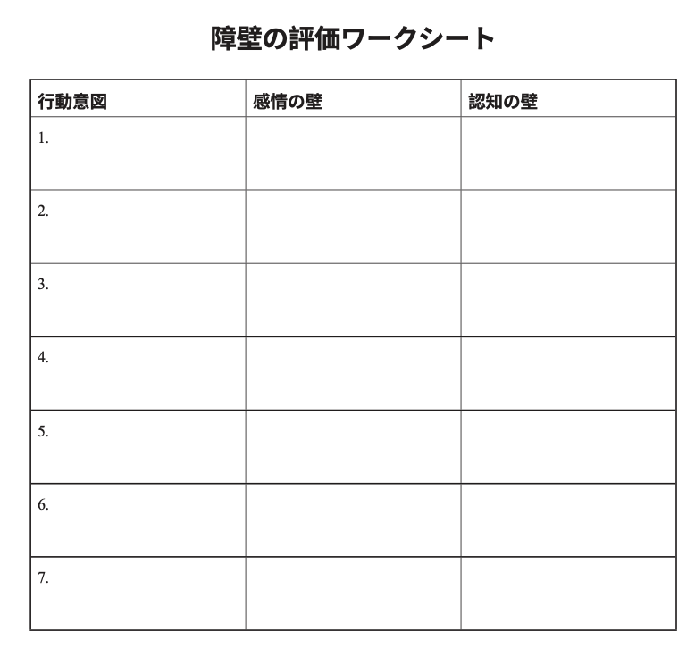

# 人生を破壊する「悪いスキーマ」をチェックしようぜ！ #19「 障壁の評価」

「人生を破壊する『悪いスキーマ』をチェックしようぜ！」の続きでーす([#1](https://daigovideolab.jp/blog/2161566),[#2](https://daigovideolab.jp/blog/2161730),[#3](https://daigovideolab.jp/blog/2163260),[#4](https://daigovideolab.jp/blog/2164192),[#5](https://daigovideolab.jp/blog/2165742),[#6](https://daigovideolab.jp/blog/2165743),[#7](https://daigovideolab.jp/blog/2166125),[#8](https://daigovideolab.jp/blog/2166486),[#9](https://daigovideolab.jp/blog/2166652),[#10](https://daigovideolab.jp/blog/2167417),[#11](https://daigovideolab.jp/blog/2168117),[#12](https://daigovideolab.jp/blog/2168526),[#13](https://daigovideolab.jp/blog/2169057),[#14](https://daigovideolab.jp/blog/2169261),[#15](https://daigovideolab.jp/blog/2170446),[#16](https://daigovideolab.jp/blog/2171935),[#17](https://daigovideolab.jp/blog/2172073),[#18](https://daigovideolab.jp/blog/2173433))。

---

このシリーズでは、「やるのは大変だけど実践すれば効果は抜群」でおなじみの心理セラピーである「**スキーマ療法**」の基本を述べてまして、現在は「解決編」に入っております。スキーマ対策については、「[自分でできるスキーマ療法ワークブック](https://amzn.to/3Q7AnxB)」という名著が存在しますが、これはガッツリスキーマを正す趣旨で書かれていまして、実践が大変なところもあったりします。

そこでこのシリーズでは、スキーマ療法の研究で有名なマシュー・マッケイ先生らの調査をベースに、もうちょい手軽だけど、十分な効果を見込めるエクササイズをご紹介します。まぁトラウマレベルのスキーマであれば、「[自分でできるスキーマ療法ワークブック](https://amzn.to/3Q7AnxB)」に取り組むべきでしょうが、中程度の対人トラブルや社交不安の方であれば、いい具合に使っていただけるのではないかと。

さて、前回のステップでは、「価値観の羅針盤」ってトレーニングを紹介しました。スキーマの問題に立ち向かっていると、ほぼ100％の確率で辛い感情がぶり返してくるものでして、そのせいでスキーマ対策を止めちゃうケースが多いんですよ。

なので、スキーマ対策中にぶり返すであろう辛い感情に対して、前もって対策を立てておき、トレーニングを最後までやり通せるように取りはからいましょう。

ということで、今回もまた、スキーマへの対処能力をアップさせるトレーニングを見ていきましょうー。

## **ステップ13.**障壁の評価

さて、このステップでは、古いスキーマ対処行動を止める際に発生する辛い感情に立ち向かうワークを行います。

くり返しになりますが、古いスキーマ対処行動をやめようとすると、ほぼ確で辛い感情が出て来ます。いままで自分を守ってくれた古いスキーマ対処行動を使わなくなったせいで、抑えつけていたネガティブな感情がぶり返しちゃうんですな。

おそらく、たいていは不安、抑うつ、怒りなどがぶり返しますんで、これを前提としてトレーニングのロードマップを組み立てるのが超大事。そこで、ステップ13では、こういった「ネガティブ感情のぶり返し」を「障壁」に見立て、事前の対策を講じていきます。敵を知り、未来のトラブルを明確にし、分析することで、障壁を克服しやすくしていくんですな。

そのために、ここで使うのが「障壁の評価ワークシート」です。こいつを使って、あなたを困らせる障壁の性質を特定しましょう。

### 障壁の評価ワークシートの例

このワークシートには、これまでのステップで明確にした、あなたが新たに実行したい行動（行動意図）、その行動をジャマしようとする感情（感情の壁）、その行動をジャマしようとする思考（認知の壁）を考えて、書き込んでいきます。

記入の際は、あなたが実際に新しい行動を取っているところを想像し、そこでどんな感情と思考がわき上がってくるかをイメージしてみると良いでしょう。その場面を完全に視覚化し、どんな感情や思考が出てくるかを観察してみてください。

- **例1.**
  - **行動意図**：私たちの新しいソフトウェア・プロジェクトについてどう思うか、正直にやさしく話す。
  - **感情の壁**：変化と失敗への恐れがわくので、いまは反対していた方が安全だ。
  - **認知の壁**：もし失敗しても私が非難されることはないので、黙っていても問題はない。そもそも、このプロジェクトは愚かだ。

- **例2.**
  - **行動意図**：同僚のアイデアを真剣に受け止め、褒めるべきポジティブな面を見つける。
  - **感情の壁**：恥、防衛、劣等感
  - **認知の壁**：同僚は私よりはるかに賢い。彼らを褒めることは、私を一段下に置くことになる。

- **例3.**
  - **行動意図**：母が言ってくることへ反射的に対応するのではなく、電話のたびに、私が母を感謝していることについて述べる。
  - **感情の壁**：怒り
  - **認知の壁**：母はわがままだし、いつも私を萎縮させるようなことを言うから、穏やかに話しても無駄だ。

この作業をやっておくと、自分にとってどんな障壁が強烈にジャマをしているのかに気づくことができるはず。それによって、「改善を妨げていたのは自分自身のネガティブさだったのかー」みたいなことがわかればバッチリであります。

### ステップ13のオプション：バスの中の怪物

障壁の問題に取り組むにあたり、もうひとつ知っておいて損のない技法を紹介しておきます。

ACT（アクセプタンス&コミットメント・セラピー）の考案者であるスティーブン・ヘイズ先生は、新しい行動をジャマする障壁のあり方を説明するのに、「バスの中の怪物」って比喩を好んで使っております(R)。(Hayes,Strosahl,andWilson1999;Hayes2005):

「無（最高の状態）」でも書いたとおり、メタファーってのは、メンタルが遭遇する問題を理解するのに最も有効な手段のひとつ。「スキーマをを改善するために、なんでこんなに苦労しなくちゃいけないんだ！」と思ったら、ぜひとも「バスの中の怪物」のことを思い出してやってくださいませ。

「バスの中の怪物」ってのは、具体的に以下のような内容です。

> あなたが「自分の人生」という名のバスを運転しているところを想像してください。
>
> バスの前面には行き先が書かれた標識がついており、「愛すべき人であること」とか「自分がやると言ったことを実行する」といった、あなたが重要視する価値観が書かれています。
>
> その価値観に向かってバスを走らせると、必ず辛い「感情」や「思考」という名の怪物が現れ、あなたの旅を防ぐ障壁として立ちはだかります。この怪物は非常に力が強いため、彼らがバスの前に立っている間はバスを進めることはできません。
>
> ここで、いつものあなたが取りやすい行動は、いったんバスを止めて、怪物が立ち去るまで何もしないというものです。この対策は、辛い思考や感情に見舞われたせいで、あなたにとって価値ある行動を実践しないことに相当します。残念なことに、立ち止まっただけでは怪物は立ち去ってくれないので、あなたのバスは道端に止まり続けることになります。
>
> さらに、もうひとついつものあなたが取りやすい行動は、バスを止めるのではなく、怪物がいない別の方向を目指して進むパターンです。自分の価値観から遠く離れた別の方向にバスを走らせ、いつものSCBs（スキーマ対処行動）の国へと車を走らせ、どうにか辛い思考や感情を止めようと試みます。しかし、これまでさんざん見てきたとおり、古いSCBsは自ら痛みを生み出す働きがあるため、最終的にはあなたの人間関係は傷つき、破壊されてしまいます。
>
> これを解決する方法はひとつだけ。**怪物をバスに乗せ、旅の道づれにするしかありません**。怪物をバスに乗せると、おそらく彼らは後部座席からヤジを飛ばし始めるでしょう。「そっちの方角は危険だ」「そっちは怖い」「そんな方向に向かうなんて馬鹿だ」「そっちに行くなんて無理だ」などと叫びながら、あなたをSCBsの国へ向かわせようとするのです。
>
> そのために、怪物たちは、あなたを悲しませたり、怖がらせたり、怒らせたりします。それが怪物の仕事だからです。
>
> しかし、あなたの仕事は、自分で選んだ方向にバスを走らせ続けることです。バスを走らせるためには、「自分の価値観を貫くためには、多少の痛みを共にする」という意志が必要です。あなたの価値観が、あなたのモチベーションになるのです。
>
> バスの正面に書かれた目的地に集中することで、怪物が何をしようと、どれだけ感情的に騒ごうと、あなたは走り続けることができます。

って感じで、嫌な感情や思考を「怪物」とみなすと、わりと日々の対処がしやすくなるはず。「自分の価値に向かうジャマをする怪物はなにか？」みたいに考えることで、「あー、自分は『バカにされる』『無能に思われることへの恐れ』って怪物にジャマされてるんだな……」とか、「『不信感』と『猜疑心』が怪物だな……」とか、モニタリングできるようになりますんで。

いったん怪物の存在を認知できれば、「バスの後部座席で怪物『失敗する』『クビになる』『嫌われる』『傷つけられる』と騒いでるなぁ……」みたいに、ある程度までは受け流せるようになりますんで（まぁ完全にそうなるまでは大変なんですけども）。とにかく、一番大事なのは、「怪物を早くバスに乗せるぞ！」と思い切ることでして、怪物と同行することさえ決めちゃえば、行きたいところに行けるようにものですからね。

ということで、今後あなたがすべきことは、以下のようになります。

- 自分の価値観に基づいて行動することを選んだら、何が起こるかをチェックする。
- 恐怖、恥、悲しみ、喪失感、怒りなど、価値観に基づく行動のジャマをする感情的な障壁を観察し、精神的にラベルを貼る。
- 危険に対する考えや、自分自身や他人に対する判断など、認知的な障壁もチェックする。
- 可能な限り自分の価値観に基づいて行動しながらも、どんな考えや感情が湧いてきても、それと一緒に行動するモチベーションを保つ。
- 不快な感情や考えを経験することを嫌がらず、自分の価値観に基づいて行動し続けることを思い出す。

といったところでステップ13は終了です。ではまた！
