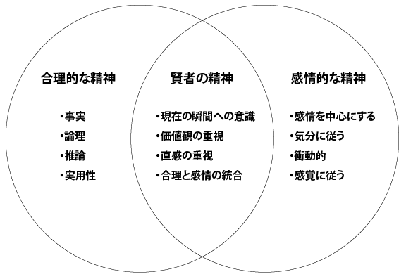

# 「無（最高の状態）」でおなじみ賢者のメンタルを手にする「DBT式チェアワーク」は手軽で良いぞ

こないだ「**空の椅子テクニック**」って技法を、ブログの方で紹介したんですよ。これはゲシュタルト・セラピーの世界で使われる技法で、椅子をメタファーとして使うことで、他人の視点からものごとを見る能力を高め、それによって自分の人間関係に起きる問題を客観的につかもうとするわけですな。

---

この技法は、一般的に「チェアワーク」と呼ばれてまして、いまではゲシュタルト・セラピーだけでなく、現在では[弁証法的行動療法](https://amzn.to/47yt4p1)（DBT）などでも使われてたりします。DBTは認知行動療法（CBT）の一種で、「激しい感情を克服しよう！」って目的で開発された心理療法のひとつ。めっちゃ治療が難しいことで知られる[境界性パーソナリティ障害](https://www.msdmanuals.com/ja-jp/%E3%83%97%E3%83%AD%E3%83%95%E3%82%A7%E3%83%83%E3%82%B7%E3%83%A7%E3%83%8A%E3%83%AB/08-%E7%B2%BE%E7%A5%9E%E9%9A%9C%E5%AE%B3/%E3%83%91%E3%83%BC%E3%82%BD%E3%83%8A%E3%83%AA%E3%83%86%E3%82%A3%E9%9A%9C%E5%AE%B3/%E5%A2%83%E7%95%8C%E6%80%A7%E3%83%91%E3%83%BC%E3%82%BD%E3%83%8A%E3%83%AA%E3%83%86%E3%82%A3%E9%9A%9C%E5%AE%B3-bpd)（BPD）に対してよく使われてまして、「自分の感情をコントロールできない！」みたいな問題に悩む方には、かなり高い効果を望めるのではないかと思うわけです。

たとえば、

- 仕事でミスをして上司に怒られたところ、完全にこちらが悪いのに逆ギレして怒鳴り返してしまう。

- 普段は冷静な態度を保てるのに、親と話すときだけ、いつの間にか大声で叫びあってしまう。

- 恋人に批判されると、たいしたことではないのにメンタルがどん底に落ち込んでしまう。

- 就職や転職の時期に、不安が募って、眠れなくなったり、食欲不振になる。

といった感じですね。ここらへんの問題が必ずしも悪いとは言わないんだけど、対人関係に支障が出るレベルになると、やっぱ困っちゃいますからね。

そこで、この問題を解決するために、DBTでは「**人間には3つの心の状態があるんだよー**」ってポイントを学習します。その3つとは、

- **合理的な精神**：目の前の問題へ知的に取り組み、事実、理由、論理、実用性を中心に思考が展開する。このモードでは、価値観や感情は重要ではない。合理的な精神の例としては、「買い物リストを作る」「新しい目的地までの電車のルートを考える」などが考えられる。

- **感情的な精神**：目の前の問題へ感情で取り組み、気分、感情、衝動、動機を中心に行動が決まる。このモードでは、事実、理性、論理は重要ではない。感情的な精神の例としては、「その場の勢いで愛する人を傷つけるようなことを言う」「結果を顧みずに衝動的に行動したりする」などが挙げられる。

- **賢者の精神**：感情と理性のバランスと調和が取れた状態で、自分の感情を認識し尊重しながら、理性的に対応することができる。賢者の精神の例としては、「口論がはじまったらタイムアウトを取り、ヘンなことを口走らないようにする」「明日の仕事が早いので、楽しい飲み会をそこそこで切り上げる」「ストレスの多い仕事中に瞑想する時間を見つける」などがある。

って感じになります。当然ながら、DBTでは賢者の精神を目指して、自分の行動をよりよく管理するスキルを学んでいきます。3つの精神を図示すると、こんな感じです。

こんな感じで、理性と感情の良いところを取ろうとするのが、賢者の精神の大きなポイント。だいたいの人は、メンタルの状態が合理か感情のどちらかに振れがちなので、その間でバランスを取っておきたいところなんですよ。

３つの精神をさらに詳しく説明しておくと、こんな感じになります。

- **合理的な精神**：
  - キーワード：冷静、合理的、タスク集中
  - 合理的な精神では、あなたは知的に状況に取り組み、感情や価値観ではなく、主に事実と理性に基づいて計画を立て、決断を下します。合理的な思考は非常に有益でで、これれがなければ、家や道路や都市を建設することも、指示に従うことも、論理的な問題を解決することも、科学的な発見をすることも、会議を運営することもできません。
    しかし、合理的な思考に集中しすぎると、人生の選択がほとんど「コンピューターのよう」になり、個人的なニーズや直感（何がベストと感じるか）、自発性がほとんどなくなってしまうのが大きな問題。たとえば、新居を購入するときに合理的な考え方にとらわれていたら、「この家は投資価値があるか」「この家の状態は良いか」といったポイントにばかり意識が向き、「この家でくつろげるか？」「この家で幸せに暮らしている自分を想像できるか？」などの観点がおざなりになるかもしれません。

- **感情的な精神**：
  - キーワード：ホット、気分依存、感情重視
  - 感情的な精神では、あなたは自分がどう感じているかに基づいて状況に対処します。自分の考え方や行動に影響を与えるのは感情のみです。
    この精神が有益なのは言うまでもなく、激しい献身や強い野心は、困難な仕事に粘り強く取り組むのに役立つし、前向きな気分のときに誰かを褒めれば、対人関係を強化できるでしょう。しかし、感情のままに行動をすると否定的な結果が起きやすいのもも事実。たとえば、怒りが原因で誰かを傷つけたり、ポジティブな気分が原因でリスクを取り過ぎたりといった問題で、先述した新居の購入の例で言えば、感情のままに行動して、市場価値から離れた家や、欠陥住宅を買うことになりかねません。

- **賢者の精神**：
  - キーワード：静か、知恵、今この瞬間、中道
  - 賢者の精神では、目の前の状況に対して、頭と心の声に同時に耳を傾けることができます。理性と感情の両方に価値を見出すことができるため、感情に圧倒されることなく、感情とつながることができます。それと同時に、自分が何を感じ、理性の声にも耳を傾けることができ、じっくり観察して知識を得たり、論理的に分析してみたり、身体で体験して新たなことを学んだり（運動的・感覚的体験）といったことも可能であります。新しい家を買う例で言えば、その家についての事実と自分の感情の両方を考慮するってことですね。

ということで、上記の目標を達成するために、DBTではチェアワークを使います。賢者の精神を手に入れる方法については「[無（最高の状態）](https://amzn.to/46toUxe)」でも取り上げてますが、そのなかでもチェアワークは手軽な部類なので、「無の方法は難しすぎる！」と思った方は、こちらをお試しいただくのも良いんじゃないでしょうか。

## **賢者のメンタルを手に入れるためのチェアワーク**

それでは、具体的なチェアワークを進めていきましょう。このエクササイズでは、3種類の精神の違いを体験してもらうのが目的でして、

1. 1つ目の椅子は合理的な精神
2. 2つ目の椅子は感情的な精神
3. 3つ目の椅子は賢者の精神

って感じで、３つの椅子をメタファーとして使います。もちろん、このワークで実際の椅子を3つ用意する必要はなく、脳内にイメージを浮かべていただければOKです。

まー、このタイプの感情ってのは、最初はばかばかしいと感じられることが多いんですが、チェアワークの効果はDBTの世界でも確立されてますんで、恥ずかしがらずにやってみてくださいませ。

### **ステップ1：困難な感情を引き起こす状況や記憶を選ぶ**

まずは、あなたにネガティブな感情を引き起こすような記憶を思い描いてください。たとえば、最近恋人と口論になったとか、職場で叱責されたとか、あなたがネガティブになった状況を思い浮かべます。特定の記憶を選んだら、目を閉じて、しばらくの間、その状況を心の中で詳しくイメージしましょう。

### **ステップ2：合理的な精神を体験する**

続いて、「合理的」と書かれた椅子をイメージし、自分がそこに座っている様子をイメージしてください。その上で、ステップ１で思い描いた困難な状況に対して、合理的な精神を使ったらどうなるか？を考えていきます。具体的には、以下の質問の答えを考えてみてください。

1. この状況についての、厳然たる事実は何か？（パートナーが声を荒げて怒った、私が皿洗いを忘れていた、など）
2. 事実と証拠に基いて、この問題が起きた原因に関する最も合理的な説明は何か？（皿洗いを忘れたことで、私が家事の約束を破ったことへの叱責を受けた。おそらく、パートナーは、自分がバカにされたように感じたのだろう）
3. 私の見解を裏づける証拠は何か？（パートナーの発言のなかに、「いつも私を見下している」とのフレーズがあった、など）
4. どうすればこの問題を解決できるのか？（皿洗いを忘れないように、キッチンに張り紙をしておく）
5. 何が "正しい "と感じるかは別として、最も論理的な行動は何か？（再び同じ問題をくり返さないように対策を講じる、など）

### **ステップ****3：感情的な精神を体験する**

今度は、「感情的」と書かれた椅子をイメージし、自分がそこに座っている様子をイメージしてください。その上で、ステップ１で思い描いた困難な状況に対して、感情的な精神を使ったらどうなるか？を考えていきます。具体的には、以下の質問の答えを考えてみてください。

1. この状況について、どのような感情を抱いていますか？（恥、不安、怒られたことへの怒り、など）
2. その感情は、どれほど不快なものなのか？（最高に不快を100点としたときに70点ぐらい、みたいな）
3. その感情は、どれぐらい激しいものなのか？（最高に激しい状態を100点としたときに60点ぐらい、みたいな）
4. 結果をまったく気にしないとしたら、いま自分は何をしたいと感じる？（パートナーに怒鳴り返す、など）
5. 結果をまったく気にしないとしたら、いま自分は何を言いたいですか？（「小さなミスでそんなに怒るな！」）

### **ステップ****4：賢者の精神を体験する**

最後は、「賢者」と書かれた椅子をイメージし、自分がそこに座っている様子をイメージしてください。その上で、ステップ１で思い描いた困難な状況に対して、賢者の精神を使ったらどうなるか？を考えていきます。具体的には、以下の質問の答えを考えてみてください。その際は、あらためて現在の瞬間に意識を集中し、１分ほど呼吸に集中してみるといいでしょう。

1. 私の感情は、この瞬間に私が最も必要としているものについて、何を教えてくれているのだろうか？（パートナーとの関係を修復したい。しかし、同時に相手の対応にも問題があることも伝えておきたい、みたいな）
2. 今この瞬間の自分のニーズを無視せず、事態を改善するにはどうすればいいだろうか？（自分が「皿洗いごときで怒るな」と思ったことも正直に伝える）
3. 今の問題をもっと引いた視点からみたらどうなるか？（皿洗いを忘れただけで、お互いにこんなネガティブな気分をひきずっているのはバカらしい）
4. この状況について、私の直感は何を告げているのだろうか？（衝動のままに行動したらヤバい）
5. この状況で、私のどのようなスキルや強みを活かせるだろうか？（感情的になっても「声を荒げない」のは上手いので、自分の気持ちを伝えるのには役立つ）
6. この状況から何を学べるのか？（自分の忘れっぽさと説明不足、これにパートナーの感情の問題が合わさって、問題が大きくなっているようだ）
7. どうすれば、自分のありたい姿に沿った形で状況に対応できるのか？（相手の感情を傷つけたことを謝ったうえで、自分が「皿洗いごときで怒るな」と思ったことも正直に伝える）

### **ステップ****5：評価**

ってことで、DBT式のチェアワークは以上です。ここで終わっても問題はないんですが、できれば最後に振り返りの時間を作ってみると良いでしょう。具体的には、以下の質問の答えを考えてみてください。

- 賢者の精神のほうが効果的であるにもかかわらず、合理的な精神を使いがちな状況はあるだろうか？
- 賢者の精神のほうが効果的であるにもかかわらず、感情的な精神を使いがちな状況はあるだろうか？
- 賢者の精神でより多くの時間を過ごすことによって、あなたはどのようなメリットを得られるでしょうか？
- 賢者の精神でより多くの時間を過ごすことによって、あなたの周囲の人々はどのようなメリットを得られるでしょうか？

ということで、すべてのステップは終了です。おそらく、賢者のメンタルを手に入れる方法としては、かなり気軽な部類に入るんじゃないでしょうか。これを定期的に行っておくと、似たようなトラブルが起きた際に、自動で賢者の精神が起動するようになるはずであります。お互いがんばって行きましょう。
