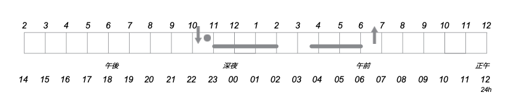
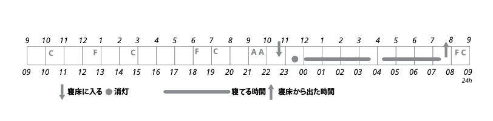
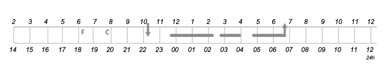

# 「ベストな快眠テクニックって何なの？」を探り出してみようぜ！＃１「覚醒日記」

---

こないだ「[**よく眠るためにやらなくてもいい****こと**](https://daigovideolab.jp/blog/2183403)」を総まとめしましたんで、今回はその続きで「じゃあ不眠の人は何をすればいいの？」ってところを掘り下げていこうと思うわけです。このブロマガでは、快眠のテクニックをいろいろと紹介してきたわけですが、

- そもそも「眠れない！」の原因は一種類ではない

- 眠れない原因によって対策は変わってくる

ってポイントにはあまり触れてこなかったんですよね。不眠と一言で言っても理由は様々で、単に一時的なストレスで眠れなくなる人もいれば、体力のせいで睡眠を維持できなくなってる人もいるだろうし、不安や心配で問題が起きる人もいるだろうしで、とにかく単一の原因ってのは存在しないんですよ。

となれば、各種ある原因によって対策が異なるのも当然のこと。ここらへんを押さえておかないと、あんまり効かない対策を使っちゃって、ドツボに入ってしまうケースもしばしばなんですな。ということで今回からは、

1. 不眠症の原因をちゃんと見極めてみる。
2. その上で、適した対策を考えてみる。

って2ステップをふんだ知識をまとめていきます。「色々と試したけれど、なんだか不眠がぶりかえしたりするなぁ……」とお悩みの方は、このシリーズをぜひ参考になさってくださいませ。

## **そもそも不眠にはどんなパターンがあるのか？**

ってことで、手始めに「**不眠にはどんなパターンがあるのか？**」ってポイントを見てみましょう。とりあえず不眠の原因を知っておいて、自分がどれに当てはまるのかを考えてみてください。具体的な原因の判断法は後でチェックしますんで、まずはざっと読み進めてみてください。

- **短期不眠症**：1年間のうちに、人口の約50%が経験するのが短期不眠であります。短期不眠は数日から数週間続くことがあり 、通常は、一時的な不安や興奮を引き起こすイベントによって発生。たとえば、試験の前、新しい仕事を始める前、結婚式の前、休暇の前など、重要なイベントの前には睡眠時間が短くなっ たり、眠りが浅くなったりするようなケースですね。
  これは、生活の乱れやストレスに対する体の正常な反応なので、まったく心配する必要はなし。たいていは、ストレスとなるような出来事が解決すれば、 睡眠が正常に戻りますんで。
  逆に、ここで不安になってしまう人は、「もっと寝ないと！」と力んだ結果としてベッドで過ごす時間を増やそうとしちゃったりして、そのせいで脳が「これは眠れないのだ！」と学習してしまい、いよいよ眠れなくなってしまったりします。それだったら、眠れない時間を問題の解決に当てたほうが無難でしょう。

- **長期不眠症**：場合によっては、もともとのストレスの原因が消えた後でも、不眠症が長引き、より慢性的な不眠症に発展することもあったりします。これは、一般的には、短期不眠が起きているあいだに、自分の脳が「寝室の環境」と「睡眠不足」を結びつけるのが原因だったりします。
  「寝室の環境」ってのは、ベッド、寝間着、寝室の明度、時間帯、眠るモチベーション、パートナーの存在などのこと。これらの環境が、睡眠やリラックスを促すどころか、不満や不安の引き金になっちゃうわけですな。このような連想が何度も繰り返されるうちに、やがてベッドに入るだけで脳が覚醒してしまうケースが多め。
  たとえば、静かに座ってテレビを見ているときは眠く感じられたのに、ベッドに入ったとたんに目が覚めたように感じ、テレビを見ていたときよりも眠りにつきにくくなっちゃうようなパターンであります。「ベッドに入ったら覚醒しようぜ！」と脳が学習したわけですね。同じような現象は、夜中に目が覚めた後にも起こるのが困ったものです。
  慢性的な不眠症のすべてのパターンには、だいたい同じような原因がありまして、専門的には「学習された不眠」と呼ばれたりします。この問題に直面した人は、しばしば「もっとベッドにいるぞ！」と思ったりするんですが、さらに「ベッド＝不安になる場所」みたいな脳内の結びつきが強まり、不眠症が悪化していくんですよ。

- **睡眠維持不眠症**：これは夜間に眠ったままでいられない状態を意味してまして、言い換えれば、夜間に目覚める時間が長かったり、あるいは回数が多かったりといった話ですね。夜間の覚醒は高齢者だと普通のことなんですが、あまりにも覚醒した時間が長引いてしまい、そのせいで日中に疲労感が出てしまう場合は、睡眠維持性不眠症と判断されます。

- **睡眠導入期不眠症**：これは、寝床に入ったあとでなかなか眠りにつけないような状態を意味します。入眠困難はよくある問題で、上で紹介した「学習された不眠症」の症状であるケースが多め。入眠にはトラブルを感じるのに 、早朝に目覚めるのは問題がない人もいるのがおもしろいところです。このような問題は、体内時計の遅れが問題であるケースが多いですね。

- **早朝覚醒型不眠症**：これは、早朝に目が覚めてしまい、その後で再び眠りには入れない状態を意味します。夜はすんなり眠れるのに、朝早く（午前3時から5時ぐらい）に目が覚めてしまい、そのまま十分な睡眠がとれないようなパターンですね。

## **覚醒日誌をつけようぜ！**

不眠のタイプを押さえたところで、自分がどのタイプに当てはまるのかをチェックしてみましょう。自分の不眠タイプを見極めるには、**「覚醒日誌」を1週間ほどつける**のが重要だったりします。1週間をかけて毎晩と毎朝、睡眠日記を記入することで、自分の実際の睡眠パターンをよりよく認識することができ、夜ごとの睡眠 のばらつきも見えてるし、睡眠の問題を引き起こす日中の行動にも気づけるようになりますんで。

覚醒日記は、以下のようなグラフで記録していきます。

それぞれのグラフは午後2時に始まり、翌日の正午で終わります。なので、たいていの人の睡眠はグラフの中央付近で発生するはず。このグラフでは、以下の記号を使って睡眠を記録しております。

- **日中に記録しておくこと**
  - C＝カフェイン：カフェインを含む飲み物（コーヒー、紅茶、コーラ、レッドブルなど）をグラス1杯飲むごとに「1C」として記録。
  - A＝アルコール：標準的なアルコール飲料を1杯飲むごとに「A」と書いておく。
  - F＝食べ物：食事や間食した時間を記録。
  - E＝エクササイズ：運動をした時間を記録。

- **寝るときに記録しておくこと**
  - P ＝ 睡眠薬を使用した場合は、薬を飲んだ時刻に「P」と書きます。
  - 就寝時刻＝寝た時間は「↓」の矢印で表現します。また、消灯した時間には大きな点を置きましょう。つまり、ベッドで本を読んだりテレビを見たりする人は、就寝時刻を示す「↓」の矢印よりも、大きな●を置く時間は遅くなります。
  - 朝起きたら＝眠った時間は、グラフに横線を引いて表現。起きていたと時間は空白にしておきます。また、ベッドから出た時刻は「↑」の矢印でマークしましょう。

で、この記録をつけておくと、いろいろと判断がつけやすくなるわけです。たとえば、覚醒記録が以下のようになったとしましょう。

ご覧のとおり、ベッドに入ってから就寝までの時間が長く、さらには午前2時ぐらいに再び目が覚めるんだけど、30分ほどでまた就寝。その後も夜中に目を覚ますこともあり、5時間半から6時間しか眠れないような状況です。

このように夜間に何度か覚醒しちゃうような人は、睡眠維持不眠症に悩んでいる状態だと判断できまして、もしかしたら「睡眠時無呼吸症候群」かもしれないし、「周期性四肢運動障害」（後述）が関わっていたりすることもあります。これらの疾患が疑われる場合は検査を受ければいいし、夜間の睡眠力をキープするために就寝時間を制限したり、リラクゼーション法を学んだり、夜間に飲んでいるカフェインを切り替えたりといった手法が有効になるでしょう。

ということで、今回はこれにて終了。次回は、この記録を使いつつ、

- 自分がよく眠れない理由はどのようなものか？

- 自分の不眠によく効くテクニックはどのようものか？

ってのを判断する方法を見ていきます。ではまた！
