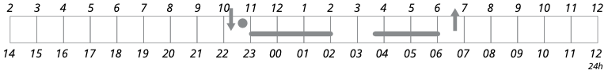
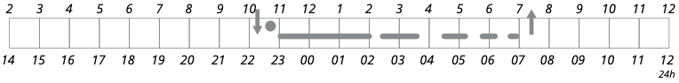
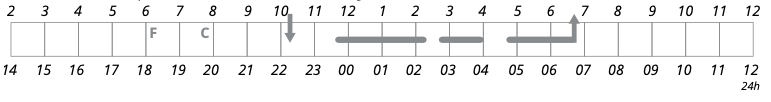
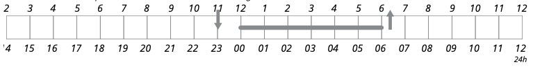

# 「ベストな快眠テクニックって何なの？」を探り出してみようぜ！＃2「自分が眠れない原因をあぶり出せ！」

「**ベストな快眠テクニックって何なの？**」の続きでーす([#1](https://daigovideolab.jp/blog/2183987))。

---

このシリーズでは、「いろんな快眠のテクニックを試したけど、すぐにまた眠れなくなっちゃうなぁ……」とお悩みの方に向けて、

- 自分が眠れない理由をどうやって確かめるか？

- 自分にとってベストな快眠テクニックとはなにか？

ってのを掘り下げる作業を行っていきます。不眠の原因はめっちゃたくさんあるから、自分に適した快眠テクニックを選ぶのが超大事なんですよ。

で、前回は「自分はいつもどんな感じで寝ているのか？」を確かめたんで、今回からは、「覚醒日誌」をベースに「**どうやって自分の睡眠を判断していくか？**」を見ていきましょうー。

## **チェック１．睡眠維持不眠症**

前回もお伝えしましたが、夜中に何度も目が覚めたり、1回の覚醒時間が長かったりする問題に悩む人はかなり多め。このように、覚醒の時間が長く、さらに日中にも疲労感が起きてしまっている場合、これは「睡眠維持不眠症」と判断されるわけです。

夜間覚醒の一般的な原因のひとつは、前回も述べた「学習された不眠症」です。「寝つけないのではないか……」みたいな不安や、「翌日はどうすればいいのか……」みたいに対処法を考えることで、覚醒度が高まってしまう状態ですな。

「睡眠維持不眠症」の人にありがちなパターンは、以下のようになります。

> 山田さんは63歳の男性で、セミリタイアしており、いまは週に1、2回オフィスに行くぐらいです。
>
> 長年の不眠症に悩む彼は、仕事を始めたばかりの頃、夜中に長い間目が覚めていたことを覚えています。いったん目が覚めると、職場で起こったことや、翌日のために覚えておかなければならないことが気になって仕方がありませんでした。
>
> 一方で、山田さんは、通常入眠に問題はありません。22時30分にはベッドに入り、眠くなるまで15分ほど本を読み、22時45分 頃に明かりを消します。
>
> しかし、約3時間後には目が覚めてしまうため、トイレに行ってからベッドに戻るものの、その後は何時間も再び眠りにつくことができません。結局、午前4時頃に眠りにつくが、 午前6時過ぎに目を覚まします。
>
> そのせいで、朝7時までベッドにいるが、なかなか寝付けず、日中は疲労感があり、集中力もわきません。寝不足が続くせいで、仕事を休んでしまうこともあります。

ということで、このような問題を抱えた山田さんの覚醒日誌は、こんな感じになります。

こうして見ると、山田さんは8.5時間はベッドにいられるものの、合計で約5時間しか眠っていなかったりします。したがって、山田さんは、ベッドにいる時間の約60%しか眠っていないわけですね。一般に「良い睡眠」ってのは、**ベッドにいる時間の約90%は眠っている**のが基本の定義なんで、山田さんの脳内では「ベッドは心配事や考え事をするところだ！」って思考が根付いている可能性が高いと言えます。

でもって、睡眠維持型不眠症にはもうひとつのタイプがありまして、覚醒日誌はこんな感じになります。

このグラフでは、短時間の覚醒がかなり多くなってまして、合計で9時間ベッドにいるにもかかわらず、約6時間しか眠っていないわけです。

### **推奨される治療法**

このような睡眠パターンを改善するためには、「就寝時間の制限」と「睡眠に関する思考の改善」が有効です。どちらの方法もシリーズの後半でお伝えしますんで、もう少しお待ちください。

## ****チェック２．**睡眠維持と睡眠導入不眠症**

睡眠に関する問題で非常に多いのは、夜間に目覚めてしまうだけでなく、なかなか眠れない状態も組み合わさるパターンです。この問題を抱えた人の例を見てみましょう。

> 佐藤さんは47歳の女性で、2人の成人した子供(18歳と20歳)が澱、行政官としてフルタイムで働いています。
>
> 以前は睡眠に問題がありませんでしたが、最初の子供が生まれたころから眠りが浅くなったと感じはじめました。毎晩のように「覚醒感」をいだき、 ほぼ毎晩なかなか寝つくことができません。
> 夕方にテレビを見ているときは眠気を感じるのに、ベッドに入って電気を消すと、すぐに（午後10時半ごろ）から覚醒感が始まり、頭の中でいろいろなことをい考え、スイッチを切れないように感じます。仕事のこと、日中に起きたこと、翌日にしなければならないことが頭のなかを駆け巡ります。
>
> 再びベッドに入っても1時間以内に眠りにつけないときは、寝床から出てトイレに行き、お茶を入れてからベッドに戻ることもあります。最終的には午前0時ごろには眠りにつきますが、通常は午前2時に再び目が覚め、それから30分ほどで眠りにつきます。
>
> 夜中に何度か目を覚ますこともよくあり、ほとんど5時間半から6時間しか眠れなません。おかげで日中は疲労を感じ、ちょっとしたことでもイライラします。こんなことが何年も続くので、もう睡眠の改善はあきらめはじめました。

ということで、このような睡眠トラブルを抱えた人の覚醒日誌は、こんな感じになります。

### **推奨される治療法**

このように寝ている時間に比べてベッドで過ごす時間が長い人は、「就寝時間の制限」を使うことで 、眠りに入りやすくなり、睡眠を維持させるのにも役立つでしょう。それと同時に、脳内の不安も多いタイプなので、「認知行動療法」「リラクゼーション法」「カフェインの制限」なども有効だと考えられます。

さらに、夜間の覚醒は、「睡眠時無呼吸症候群」や「睡眠時周期性手足運動」とも関連することがあるんで、もし心当たりがあるなら専門家の検査も重要でしょう。それまでは、上記の治療法が有効と思われます。こちらもシリーズの後半で詳しい方法をお伝えしますんで、もう少しお待ちください。

## **チェック３．**学習された不眠症

「ベッドに入ってもなかなか眠れない！」って問題は、「学習された不眠症」（前回参照）か「体内時計の遅れ」が原因であるケースが多め。この２つは症状が似ているので、適切な治療を行うためには、どちらが原因なのかを突き止めることがめっちゃ重要であります。

そこで、以下には、異なる原因によって「ベッドに入ってもなかなか眠れない！」問題に悩まされている人の例を挙げます。まずは、「学習された不眠症」に悩む鈴木さんの例から見てみましょう。

> 鈴木さんは32歳の既婚者で、5歳と7歳の子供がおり、パートタイムで働いています。多忙な女性の典型で、子供たちを学校に迎えに行った後、夕飯を作りながら子供たちの世話をします。夕食後は食器を洗い、夫と一緒に子供たちをベッドに送り出すしたら、夜の残りの時間を翌日の準備に費やします（弁当の準備、アイロンがけ、洗濯など）。
>
> 寝る1時間前は、疲労感はあるが眠くはない状態です。午後11時ごろにベッドに入ると、夫はすぐに眠りにつくのに、自分は覚醒感を感じ始めます。
>
> しかし、鈴木さんに特に心配事はないため、眠れない状態にとてもイライラします。いつまでもだらだらとベッドで寝返りを打ち、1時間ほどしないと眠りに入れません。そのせいで、起きても疲労を感じていることが多いので、もっと睡眠時間を増やしたいと思っています。

というわけで、鈴木さんの覚醒日誌はこんな感じです。

まぁ夜間の覚醒に問題はないんだけど、ベッド入っても眠気が襲ってこないところだけが問題になってますね。このように、目立った不安や心配事があるわけでもないのに、なかなか眠りにつけない時は、「学習された不眠症」にハマっている可能性が大であります。

### **推奨される治療法**

「学習された不眠症」の問題が大きい人は、「刺激コントロール療法」「リラックストレーニング」などが割と有効です。これも後述しますんで、該当した方は少しお待ちください。

ということで、シリーズの第２回目は以上です。眠れない原因はまだいくつかあるので、次回もそのへんをチェックしつつ、さらに具体的な対策を考えていきましょう。ではまた！
