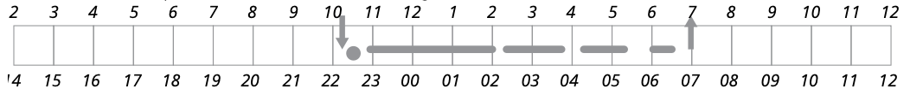
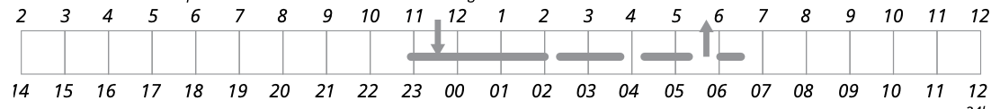
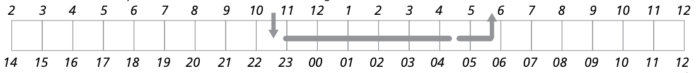

# 「ベストな快眠テクニックって何なの？」を探り出してみようぜ！＃５「就寝時間制限療法」

「**ベストな快眠テクニックって何なの？**」の続きでーす([#1](https://daigovideolab.jp/blog/2183987),[#2](https://daigovideolab.jp/blog/2184243),[#3](https://daigovideolab.jp/blog/2185138),[#4](https://daigovideolab.jp/blog/2185749))。

---

このシリーズでは、「いろんな快眠のテクニックを試したけど、すぐにまた眠れなくなっちゃうなぁ……」とお悩みの方に向けて、

- 自分が眠れない理由をどうやって確かめるか？

- 自分にとってベストな快眠テクニックとはなにか？

ってのを掘り下げる作業を行っていきます。不眠の原因はめっちゃたくさんあるから、自分に適した快眠テクニックを選ぶのが超大事なんですよ。

で、前回から自分に適した快眠改善テクニックに進みまして、それぞれのテクニックの具体的な実践法をチェックしております。前回は超基本的な考え方を見たので、今回から、さらに個別の手法をチェックしていきましょう。

## **睡眠維持系の不眠に効く！：就寝時間制限療法**

夜間にまとまった睡眠を維持するのが苦手な人は、「就寝時間制限療法」をお試しください。睡眠維持の不眠だけでなく、入眠障害や夜間の覚醒が多い場合にも使用できますんで。

夜中に目が覚めている時間が長い人は、より多く睡眠をとったり、失われた睡眠を取り戻そう として、ベッドにいる時間全体が長くすることが多めであります。しかし、ベッドにいる時間を長くしすぎると、睡眠が浅くて断片的になってしまい、「こんなに眠れなくて大丈夫だろうか？」と睡眠の心配をするようになり、不眠症が強くなっちゃうんですな。

その代わりに、ベッドにいる時間を制限することで、睡眠圧を高めるのがこのテクニックの眼目。そうすることで睡眠が定着し、 ベッドで起きている時間が短くなりまして、この効果により、脳が「ベッドの上は覚醒ではなく睡眠の場所なのだ！」と認識し、不眠症反応を抑えるのに役立つわけです。

それでは、具体的な手法を見てみましょうー。

- **ステップ1**：1週間の覚醒日誌を見て、毎晩の総睡眠時間を計算。その合計を7で割って、全体の平均睡眠時間を出しましょう。このステップでは、1週間全体の平均睡眠時間を計算することが重要です。↓の例では、ベッドで過ごした合計時間は8.5時間なんだけど、その夜の総睡眠時間は約6時間になってますね。

- **ステップ2**：ステップ１で計算した平均的な睡眠時間だけ、ベッドにいるように行動を制限しましょう。例えば、上の睡眠パターンでは、平均睡眠時間は約6時間なので、6時間以上をベッドの上で過ごさないようにします。

- **ステップ3**：就寝と起床の時間を決めます。例えば、午後11時45分から午前5時45分の間などです。これは、午後11時半から午前5時半でもいいし、午前12時半から午前6時半でも構いません。
  ここでのポイントは、ベッドにいる時間を合計6時間に制限するために、就寝と起床の時間を厳密に決めねばならないってところです。合計6時間の範囲に収まるのであれば 、実際の就寝時間や外泊時間は、自身の都合の良い時間で選択してもらってOKです。この新しい就寝ルーチンを、1週間毎晩続けてください（もちろん週末も維持する）。
  ちなみに、ステップ１の平均睡眠時間が5時間未満だった場合は、ベッドにいる時間を5時間未満に制限する必要はないので注意してください。この時は、ベッドにいる時間を5時間に設定しましょう。

- **ステップ4**：就寝時間制限療法をやっている間は、1週間、覚醒日誌をつけ続けましょう。最初の数日間は、まだ何度か夜間に目が覚めてしまうはずで、実際の総睡眠時間は、通常よりかなり短くなるでしょう（たとえば、下の例みたいな感じです）。これは就寝時間制限療法では当たり前の現象なので、総睡眠時間の減少は気にせずにいてください。そのうち、就寝時間のすべてを快眠で満たすことができるようになりますんで。

- **ステップ5**：1週間が終わったら、ステップ１と同じように、睡眠の平均時間をもう一度計算してください。その結果、まだ夜間に平均45分以上ほど目が覚めているようであれば、もう1週間、就寝時間制限療法を続けましょう。通常は、1週目か2週目の終わりには 、下の例のように、ベッドにいる時間のほとんどを睡眠が占めているような状態になるはずであります。

- **ステップ6**：上の例のように、ベッドにいる時間と眠っている時間の差が45分未満に収まった場合は、睡眠の質が向上したと判断できます。この状態が達成できたら、次の1週間は、ベッドにいる時間を30分延長してみましょう。上記の例で言えば、総睡眠時間が6時間近くある場合（起きている時間が45分未満）、ベッド にいる時間を30分延ばして、11時30分に寝て6時に起きるか、あるいは朝5時45分に起きるのはそのままにして、午後11時15分に早く寝るようにします。

- **ステップ7**：毎週末に、ベッドの上にいた平均時間と実際に眠った平均時間を計算し続けましょう。その週の睡眠時間が、ベッドで過ごした時間に近ければ（差が45分以内）、次の週も就寝時間を15分から30分延ばすことができます。

- **ステップ8**：あとは、十分な睡眠がとれていると感じるまで、週単位でベッドにいる時間を徐々に長くしていきます。この作業の途中で、もし夜間に目が覚めている時間が45分以上になってしまったら、その数字が45分以下になるまでベッドにいる時間を30分減らしてください。いったんベッドにいる時間を減らしたら、その後1〜2週間は同じ状態を維持しましょう。
  このトレーニングの目標は、ベッドで起きている時間を最短にすることと、日中適度にリフレッシュして眠気が起きないぐらいの十分な総睡眠時間を確保することの2つです。この目標の間で、適切なバランスを見つけるが超大事。
  就寝時間制限療法をスタートさせると、最初の数週間は眠気が増加するはず。これはしょうがないことですが、その後、就寝時間が徐々に長くなるにつれて眠気が減少します。最終的には（3〜6週間後ぐらいが目安）、睡眠の質と長さが改善され、日中はよりエネルギッシュで幸せな気分になります。以下は、この最終段階における覚醒日誌の典型的な例です。

ということで、就寝時間制限療法の実践法は以上です。実際にやってみるとわかりますが、最初はこのテクニックに従うのは簡単ではありません。夜、寝る前にテレビを見たり、映画を見 たり、読書をしたり、趣味に没頭したりと、いつもとは違うことをして時間をつぶす必要が出てくるんで、これがなかなか大変なんですよね。トレーニングをはじめて最初の期間中は、日中や夕方に眠たくなってしまうこともあるでしょう。この睡眠圧の上昇により、夜間に目が覚めても、より早く眠りに戻れるようになりますんで。

もし就寝時間制限療法のあいだに日中の強い眠気を感じた場合は、10〜15分の仮眠で2〜3時間覚醒度が向上し、残りの1日を乗 り切ることができるかもしれません。この時は、15分以上は眠らないようにアラームをセットしておいてください 。また、この短時間の仮眠は、就寝予定時刻の何時間も前に、日中だけに行うようにしてください。

就寝時間制限療法を1〜2週間続けると、ほとんどの場合、決められた就寝時間の1〜2時間前に強い眠気が生じるようになります。これが就寝時間制限療法における最大の敵なので、その時間帯に眠くならないように対策をとる必要があるでしょう。この時間をやり過ごせるように、なにかうまく時間を使えるアクティビティを用意しておいてください。

このタイミングで仮眠を取ってしまうと、せっかくトレーニングで作り上げようとしている睡眠圧が下がっちゃうので注意してください。このタイミングで強い眠気が襲ってきたあとほどすぐに眠りにつけるし、目が覚めても、すぐに眠りにつける可能性が高くなるので、ここが頑張りどころであります。また、1〜2週間もすると少しずつ睡眠圧が強くなり、決めた時間に起きられなくなる可能性もあります。この問題を防ぐためにも、アラームをセットしておきましょう。

最後に、このトレーニングの目的は、「夜間の目覚めをなくす」ことではない点を押さえておきましょう。「夜間の目覚めをなくす」は非現実的だし不必要なものでして、実際のところ、短時間の覚醒は睡眠時間の正常な一部であり、翌日の感情や機能を損なうものではありませんので。事実、どんなに寝つきが良い人でも、夜中に長く目が覚めることはあるんですが、それで日中の眠りが浅くならないのが大きな特徴なんですな。

このトレーニングの目的は、より早く入眠し、夜間の覚醒をより少なく短くすることで、ベッドで眠っている時間を長くし、逆にベッドで起きている時間を短くすることです。これが続くと、夜間に目が覚めた後でも、すぐに眠りに戻るのが通常のパターンであることに脳が慣れ始めるんですよ。また、夜に起きている時間が短くなるため、睡眠について心配する時間が減り、心配事やイライラする時間が減るのも大きなメリットですね。

くり返しになりますが、これは簡単なトレーニングではありません。眠気が強まった状態で数週間を過ごす必要があるので、途中で嫌になっちゃうケースも多いんですよね。

ただし、このトレーニングを実践した人は、「眠気が増すにつれて疲労が軽減した」と報告する場合も多かったりします。眠気があるのに疲れがなくなるは不思議な現象ですけど、眠気のおかげで夜間の睡眠が深まったのが原因なんでしょうな。

いずれにせよ、就寝時間制限療法ってのは、多くの調査研究で効果が示された手法なので、ぜひお試しください。不眠症の経験が長い人ほど改善には数週間がかかるはずですが、それだけの努力を投資する価値がありますんで。
