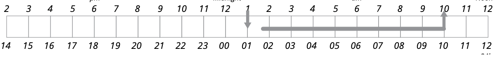
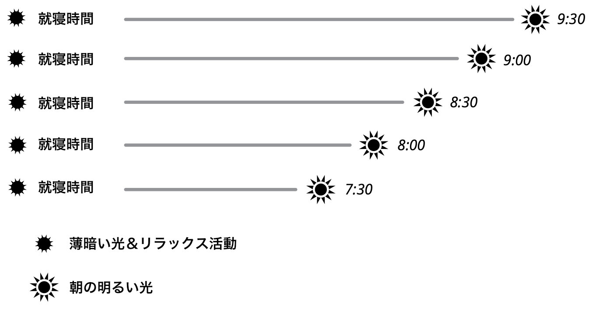
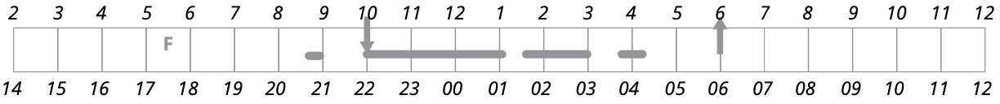

# 「ベストな快眠テクニックって何なの？」を探り出してみようぜ！＃６「ブライトライト・セラピー」

「**ベストな快眠テクニックって何なの？**」の続きでーす（[#1](https://daigovideolab.jp/blog/2183987),[#2](https://daigovideolab.jp/blog/2184243),[#3](https://daigovideolab.jp/blog/2185138),[#4](https://daigovideolab.jp/blog/2185749),[#5](https://daigovideolab.jp/blog/2185933)）。

---

このシリーズでは、「いろんな快眠のテクニックを試したけど、すぐにまた眠れなくなっちゃうなぁ……」とお悩みの方に向けて、

- 自分が眠れない理由をどうやって確かめるか？

- 自分にとってベストな快眠テクニックとはなにか？

ってのを掘り下げる作業を行っていきます。不眠の原因はめっちゃたくさんあるから、自分に適した快眠テクニックを選ぶのが超大事なんですよ。

で、前回から自分に適した快眠改善テクニックに進みまして、それぞれのテクニックの具体的な実践法をチェックしております。今回は、体内時計の遅れに悩む方への対策をチェックしていきましょうー。

## **体内時計が遅れている人用：ブライトライト・セラピー**

体内時計の遅れで不眠が起きている可能性がある場合は、ブライトライト・セラピーが効くでしょう。つまり、夜中には早く眠れないのに、朝起きるのが困難ってケースですな。このケースでは、まずはブライトライト・セラピーを試してみて、それでもまだ睡眠が難しいときは「快眠習慣」と「刺激制御療法」なども追加で取り組んでみてください。

### １．朝のブライトライト・セラピー

まずは、朝に適切なタイミングで明るい光を繰り返し浴びて、体内時計を早めの時間に調整することから始めてください。朝の光を浴びる最も適切なタイミングを見極めるには、以下のステップに従うと良いでしょう。

- **ステップ1**：朝のブライトライト・セラピーを行うには、会社に間に合う時間ではなく、「自分が自然に目を覚ます時間」に起床する必要があります。そのため、まずは週末の休日や長期休暇など、無理に起きなくても良い日を選んでください。

- **ステップ2**：アラームなしで、自然に目覚める時間を確認します。繰り返しになりますが、これは仕事のために起きなければならない時間ではなく、あなたが「自然に」目を覚ます時間です。この時間が**出発点**になるので、覚醒日誌を使って、自分が自然に目を覚ますタイミングを調べておきましょう。たとえば、下の日誌では、この人の自然な起床時間は午前10時です。

- **ステップ3**：週末の2日間、できれば1週間ぐらいの休暇を使い、毎日30分ほど早く起きて明るい場所に行きましょう。上記の例で言えば、この人の自然な起床時間は午前10時なので、1日目の朝は9時半に起き、その次の朝は9時、その次は8時半、その次は8時と、あなたが目標とする起床時間に達するまで同じ作業をくり返します。もし、これが難しいと感じたら、起床を短くするタイミングを2日分おきに変えても構いません。
  ここで大事なのは、初日の朝に、焦って目標の時間に起きようはしないことです。たとえば、上記の例のように、いつもは10時に目が覚める人が、急に7時に起きて太陽の光を浴びても意味がありませんので。
  これをやると、体内時計がさらに遅れてちゃうのでご注意を。起床時間や朝の光を浴びる時間は、30分ごとに徐々に早めていくのが基本です。
  また、光の刺激は強度が高いほど体内時計の改善に効果があるので、サングラスをかけるのは避けましょう。明るい光を浴びる時間は**1回につき少なくとも30分**を費やすのが目安ですが、光を浴びる時間が長くなるほど効果が出やすいため、1時間を使うとさらに体内時計が改善しやすくなります。
  毎朝30〜60分も時間がない、あるいは日光が十分でない場合は、「[BrightlightME+](https://amzn.to/3UCQgPm)」や「[JUXLamp](https://amzn.to/3uiavqQ)」のような携帯用照明器具の購入を検討してみるのもありです。この手のガジェットは価格差が大きいんだけど、まぁ安物でもそんなに変わりません。

- **朝のブライトライト・セラピーの例**

- **ステップ4**：同時に、だんだんと眠気を感じるようになり、毎晩少しずつ早く眠れるようになっていることに気づくだろう。しかし、30分早く起きられるようになったからといって、すぐに30分早く眠れるようになるわけではありません。光療法を始めて1〜2週間もすれば、あなたの睡眠パターンは徐々に早くなっていきます。しかし、ベッドに入っても15分ほどで眠りにつけない場合は、ベッドから出てリラックスできることをしてください。

- **ステップ5**：体内時計を再設定したら、何時に寝ようとも寝坊をしないことが大切になります。寝坊すると朝の光を浴びることができず、体内時計が再び遅れてしまいますんで。なので、前夜にたとえ夜中の1時まで眠れなかったとしても、朝はほぼ同じ時間に起きて、明るい光を浴びるようにしましょう。
  ここで覚えておいてほしいのは、体内時計が早い人は、日が暮れると眠くなり、テレビの前で寝落ちしまうことがあるところです。典型的な覚醒日誌は以下のような感じ。これも体内時計を乱す原因になるので、寝落ちだけはしないようにがんばってください。

### ２．午後のブライトライト・セラピー

早朝覚醒型不眠症の場合は、午後からの明るい光の刺激を受けるのが最も効果的です。これは、上とは異なるもうひとつの体内時計のトラブルのことで、体内時計の時刻が早すぎるせいで、早く目が覚めすぎて眠れなくなるという問題が出ちゃうパターンですね。

このケースでは、体内時計を遅い時間に調整してやる必要があります。たとえば、夏はまだ日差しがあるうちに散歩に出かけたり、庭仕事をしたり、夜になっても、台所や書斎、読書やテレビを見ている間は、できるだけ遅くまで明かりをつけておくわけですな。また、冬場などは夕方の自然光が減るので、光治療器を使ってみるのも効果的です。ネットで「光治療」「ブライトライトセラピー」などの検索ワードで探すと、光治療用のガジェットが見つかるはずであります。

体内時計と睡眠パターンのあいだにどんな関係があるのかと言いますと、

- 光を浴びるたびに、少しずつ体内時計も後ろにずれる（10〜20分）。

- 光を浴びる時間が遅くなるほど体内時計も後ろにずれる（午後10時で暗くするのはなく、午前0時まで照明をつけておいたりとか）

- 光を浴びる時間が長くなるほど、そして光を浴びる時間が強ければ強いほど、体内時計も後ろにずれる（20分より60分、5000ルクスより10000ルクスのほうが体内時計のずれは大きくなる）

って感じになります。要するに、体内時計が早めにずれている人ほど、より遅い時間に強い光を長く浴びたほうが良いわけっすね。

ちなみに、この療法を行う場合は、朝の明るい光を避けることも非常に重要になります。体内時計を後ろにずらしたいときは、朝の通勤、庭仕事、散歩などで可能な限り明るい光を避け、散歩の最初の2、3時間はサングラスをかけたほうがいいでしょう。

ちなみに、体内時計を後ろにずらしたいときは、メラトニンも有効なことがあります。この場合、メラトニンを摂取するタイミングは、早朝に目が覚めた直後になります。これによって概日リズムを遅らせることができ、より遅く、より長い睡眠をとることができる可能性が上がりますんで。早朝覚醒にお悩みの方は、こちらもお試しください。

## **午後の緊張やストレスで眠れない人用：****リラクゼーション・セラピー**

睡眠にお悩みの方の中には、午後に大きな緊張やストレスを感じ、そのせいで眠れなくなってしまうケースがあります。本来、人体は夕方から少しずつ体をリラックスさせ、夜に向けて睡眠圧を高めていくんですけど、午後に「仕事が終わらない……」「明日も大変だ……」みたいなストレスに襲われて、睡眠圧が上がらなくなるんですね。

この場合は、普通にリラクゼーション法を使うのがおすすめです。リラックスできないのが問題なんだから、リラクゼーションを使ったほうがいいのは当然ですからね。そのためのテクニックはたくさんありますし、このブロマガでも[過去に大量に紹介している](https://www.google.com/search?q=%E3%83%AA%E3%83%A9%E3%83%83%E3%82%AF%E3%82%B9+site:https://ch.nicovideo.jp/paleo&sourceid=chrome&ie=UTF-8)ので、[好きなものを使っていただければ](https://www.google.com/search?q=%E3%83%AA%E3%83%A9%E3%83%83%E3%82%AF%E3%82%B9+site:https://ch.nicovideo.jp/paleo&sourceid=chrome&ie=UTF-8)幸いです。

ちなみに、睡眠に効くリラクゼーション法には、大きな共通点がありまして、

- 本当に効果があるリラクゼーション法は、「呼吸を意識する」「心地よいイメージに集中する」など、特定の意味を持たないいプロセスに注意を集中させるものである。

- 特定の意味を持たないプロセスに注意を集中させることで、不安な思考が意識に入るのを防ぐことができ、リラックスして眠るれるようになる。このメカニズムが発生するものであれば、そのなかから自分が心地よいと感じるテクニックを選べばOK。「深呼吸」でも「漸進的筋弛緩法」でも「ビジュアライゼーション」でも「瞑想」でもなんでもいい。

といったあたりを押さえておくと良いでしょう。一部には、「リラクゼーション法を試したけどうまくいかなかった」という人も多いんですが、このようなケースの場合、一度か二度しかリラクゼーション法を試していないケースが多かったりします。

リラクゼーション法ってのは、自転車の乗り方を学ぶのに似ていて、上手になるにはめっちゃ練習が必要なスキルなんですよ。何度か自転車から転げ落ちて止めちゃったら意味がないように、リラックスにも挑戦し続ける必要があるんですよね。

おそらく、リラクゼーション法の訓練をはじめて間もないうちは、リラックスしている間に、ネガティブな思考が何度も頭の中に浮かんでくるはず。この問題はトレーニングを積まないと解決出来ないので、特別な意味を持たないイメージやプロセスに集中し直す作業をくり返すしかないんですよ。

また、入眠のためにリラクゼーション法を使うときも、夜使う前によく練習しておく必要があります。夜、そのテクニックを使って眠ろうとする前に、毎日10分程度、練習時間を確保するようにしましょう。

練習をしておかないと、テクニックがうまく機能せずに落胆したり、「もう私に効くテクニックはない！」とか思ったりしがちなので。練習を重ねることで、集中を維持できる時間は徐々に長くなっていくはずで、そうなれば睡眠に入る閾値を超えるまで、覚醒度がどんどん下がっていきますんで。

ってことで、今回はこのへんで。次回は、さらに睡眠時不眠症に使える対策を見ていきたいと思います。ではまた！
