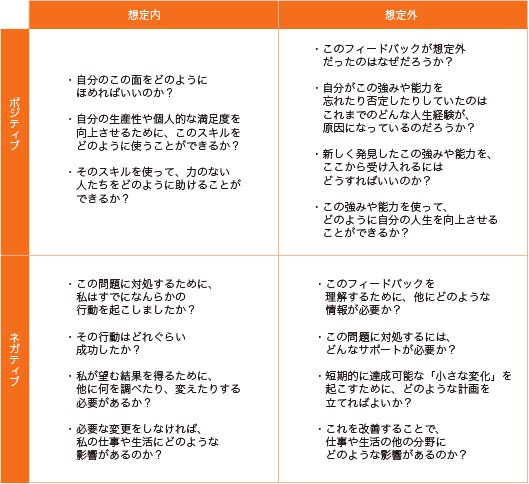

# これからを生き抜くために必要なナンバーワン能力「戦略的思考」を鍛えようぜ！#2「フィードバック・マトリックス」

「**戦略的思考を鍛えようぜ！**」シリーズの続きでーす([#1](https://daigovideolab.jp/blog/2191687),[#2](https://daigovideolab.jp/blog/2192330))。

---

このシリーズでは、VUCA（変化、不確実、複雑、曖昧）が強まる現代において、最も重要なスキルだと言われる「戦略的思考」の伸ばし方をチェックしております。戦略的思考ってのは「未来のピンチとチャンスについて批判的かつ創造的に考えられる能力」みたいな感じで、確かにこれからの時代を生き抜くのに欠かせないでしょう。

そこで本シリーズでは、戦略的思考を鍛えるために、マイケル・D・ワトキンス博士の研究をもとに、

1. パターン認識
2. システム分析
3. 精神的敏捷性
4. 構造化された問題解決
5. ヴィジョニング
6. 組織の仕組みの理解力

という6つの必須能力を鍛えていく方法を見ていこうと思うわけです。でもって、前回からは、戦略的思考の土台となる「パターン認識」を 伸ばす方法について考えてまして、 その第一の方法として、師匠を探すやり方を掘り下げてみました。

パターン認識は、 複雑な世界の中から重要なデータを見極める能力なので、 確実に育てておきたいところです。今回もその続きで、「 正しくフィードバックを受けるにはどうすればいいか？」 を見ていきましょう。

## **パターン認識を身につけるにはどうすればいいのか？#2**

### **２．フィードバック・マトリックス**

パターン認識力を身につけるために、 師匠探しの次に大事なのが「**いかにうまくフィードバックを受けるか？**」という観点です。 それもそのはずで、いかに素晴らしい師匠を見つけようが、相手のフィードバックを受けるのが下手だったら、 せっかくのアドバイスを生かすことができませんからね。

これは、誰かにアドバイスを与えた経験がある人なら、共感していただけるポイントでしょう。マネジャーとしてチームメンバーのパフォーマンスについてフィードバックしたのに、結果的に何も変わらないことは珍しくないですからね。自分の言いたいことを明確かつ率直に伝えたつもりでも、部下には伝わらないケースは いくらでもあります。

逆もまだしかりで、上司からフィードバックを受けたものの、「言ってることはわかるけど、どう行動に移せばいいのかわからない…」みたいに感じたことがある人も多いはず。 このような場面では、もちろんフィードバックを与える側に問題があるケースも多いんですが、受け手の準備が整っていないせいで発生することもよくあります。

フィードバックを受けるのが下手な人によく見られるのは、 以下のような反応です。

1. ネガティブなフィードバックを受け入れた素振りをするが、その理由を説明しようとしたり、正当化しようとしたり、他人の せいにしたりする。 または、 ネガティブなフィードバックの内容は理解するものの、 「それに対処するのは現実的には不可能だ」と言ってみたり、「それは私の責任 はない」 などと言って逃げようとする。
2. フィードバックの中のポジティブな部分だけを取り上げて、「やはり自分は正しかったのだ」と思い込む。変化への抵抗感が強い人や、傾聴スキルが低い人にありがちな反応。
3. ネガティブなフィードバックを 受けたときに、アドバイスを与えた人が間違っていると判断し、そのコメントを完全に否定するパターン。傲慢な人や自信過剰な人にありがち。
4. ポジティブなフィードバックを受けた場合に、 アドバイスをくれた人に対して「私に気を遣っているだけ」「この人は誰でも褒めるんだ」 などと思い込み、その賞賛が本物であることを受け入れることができないパターン。自信がない人や、自己疑念が 大きい人にありがち。

いずれの反応も、 心当たりがある人は多いでしょう。 どの反応をするにせよ、自分の行動やパフォーマンスを変えたり、自分の強みを生かそうとするのではなく、以前と同じことを続けるだけに終わってしまい、 せっかくのフィードバックを生かし切れない点は同じです。 もったいないですねぇ。

というわけで、 パターン認識力を高めるためにも、 うまくフィードバックを受ける能力を養うのは超大事。 その方法はいろいろありますが、 どうも手軽で使いやすいのは「フィードバック・マトリックス」という手法です。 これはアッカーランド大学などの先生方が作ったツールで、 主に教育心理学の世界でよく使われます([R](https://journals.sagepub.com/doi/abs/10.3102/003465430298487))。

もともとはフィードバックを与えるのが 苦手な教師のために作られたもので、 このツールを使った先生は、 何もせずにフィードバックを行った時と比べて、生徒のモチベーションを平均30%高めたと報告されております。

さらに、 ここ数年は、フィードバックを受ける側が使ったこのツールを場合も、 高い効果が得られることがわかってきました。 自分の師匠や上司、 友人などからアドバイスをもらう際は、 その前後に「フィードバック・マトリックス」を 確認しておくと、 相手からもらった助言を使いこなすのが上手くなるはずです。その効果が認められ、最近では企業の研修などにもよく使われているんで、 フィードバックが苦手な人は ぜひ押さえておきましょう。

それでは、「フィードバック・マトリックス」 をご説明します。 このツールは、 以下のような表を使って、フィードバックについて考えていきます。

この表を見ればわかる通り、マトリックスには4つの象限があり、 それぞれがあなたが受け取るフィードバックの種類を表しています。 簡単にまとめると、

1. ポジティブ／ 想定内
2. ネガティブ／想定外
3. ポジティブ／ 想定内
4. ネガティブ／ 想定外

と言う分類になります。ほとんどのフィードバックは、これらのカテゴリのいずれかに分類されるはずで、 この分類を使うことで、フィードバックに対するあなたの感情的な反応を克服しやすくなるんですね。

では、それぞれの象限をくわしく見てみましょう。

**１．****ポジティブ／ 想定内**： 自分が予想した通りの良いフィードバックが返ってきたパターンです。たいていの人は、このフィードバックに対して何もせず、ただ喜ぶだけで終わりがちなんですが、それだけではもったいないはず。 このタイプのフィードバックをもらったら、以下のポイントについて考えてみてください。

- どうすれば自分のこの良い面を、 素直に受け止めることができるだろうか？
- 生産性や仕事の満足度を高めるために、 自分のこの良い面をどのように使えばいいだろうか？
- 自分のこの良い面を使って、この分野があまり得意でない人を助けるにはどうしたらいいか？

**２． ネガティブ／想定内**： 自分自身でもわかっていた欠点を、改めて指摘されるパターンです。自分自身にある程度まで正直な人であれば、自分の改善点に既に気づいている人は多いはずで、 このブロマガをお読みの方は真面目な方が多いので、自分自身に批判的である ケースが多いでしょう。 自分でも欠点に気づいているんだけど、何らかの助けがないと改善できないだけなんですよね。

このような、 想定内のネガティブなフィードバックを前向きに使うには、 以下のポイントについて考えてみてください。

- この問題や欠点に対処するために、私はすでにどのような行動をとっただろうか？
- この問題や欠点に対処するために取った行動は、 どれぐらい成功しただろうか？
- 自分が望む結果を得るためには、他に何を調べたり変えたりする必要があるだろうか？
- 指摘された問題や欠点をこのまま放置していたら、仕事や生活にどのような影響が出るだろうか？

**３．ポジティブ／想定外**： 自分では予想もしていなかったポジティブなフィードバックを受け取ったパターンです。 うれしいサプライズってやつですね。このようなフィードバックもらうと、たいていは相手に感謝して終わるか、「全然そんなことはないですよ」と謙虚に答えて終わるかのどちらかに傾きがちですけど、 それではもったいないので、ちゃんと喜んだ後は、以下のような質問を自分に投げかけてみましょう。

- そのような フィードバックが予想外だったのはなぜか？
- 相手が指摘してきた自分の強みや能力を、 自分では忘れていたり指定していたのには、 どのような原因があったのだろうか？
- 新たに発見したこのスキルを、私はどのように祝おうとしているのか？
- 自分の人生を向上させるために、このスキルをどのように使うことができるか？

**４． ネガティブ／予想外**：自分では予想もしていなかった、嫌なフィードバックをもらってしまうパターンです。 当然ながら、 多くの人にとって聞くのも理解するのも難しいタイプのフィードバックで、「まぁそれはわかるんだけどね」などと言って受け入れたふりをするか、「これは相手が間違っている」として責任を逃れようとするような反応を見せる人がほとんどです。

もちろん、相手が変なこと言ってる場合もあるんだけど、耳に痛いアドバイスをもらった際は、とりあえず自分の中で受け止めてみるのが吉。 ネガティブなアドバイスを受け入れることができれば、多くの自己発見の源となることが 多いですからね。 中でも、 自分では予想もしなかったようなフィードバックってのは、私たちが認めたくなかったり、直面する準備が整っていなかったりする領域からやってくることが多く、 その分だけ自己理解を進めるのに役立つ鍵が眠っていることがあるんですよ。

そんなわけで、 予想外でネガティブなアドバイスをもらった時は、以下の質問を自分に投げかけてみましょう。

- そのネガティブなフィードバックに対処するには、どのようなサポート、トレーニング、コーチングが必要だろうか？

- このフィードバックを使って、自分自身についてもっと知ることができるだろうか？（[ジョハリの窓](https://www.google.com/search?q=%E3%82%B8%E3%83%A7%E3%83%8F%E3%83%AA%E3%81%AE%E7%AA%93)などが参考になる）

- そのネガティブなフィードバックに対処するために、短い機関で達成可能な小さな変化を起こすために、どのような計画を立てればいいだろうか？
- このネガティブなフィードバックを改善することで、仕事や生活の他の分野にどのような影響があるだろか？

「フィードバック・マトリックス」の説明は以上です。 このツールを使う際は、誰かからアドバイスをもらう前に「これから相手はどんなことを言ってくるだろうか？」と予想してみた上で、 ざっとツールの内容を再確認してみてください。 特に私たちは、想定外のことを言われたときに慌てがちなので、「予想にない事を相手が言ってきたら、 どのような質問を使ってみるか？」 を事前に考えておくと良いでしょう。

その上で、実際にアドバイスをもらった後で、再び「フィードバック・マトリックス」にもどり、 該当する項目の質問を自分に投げかけてみてください。 とにかく大事なのは、フィードバックに伴う自分の感情をうまく調整することなので、それさえできればどんなアドバイスでも、うまく自分のものとして生かすことができるようになるはずです。お試しを。
