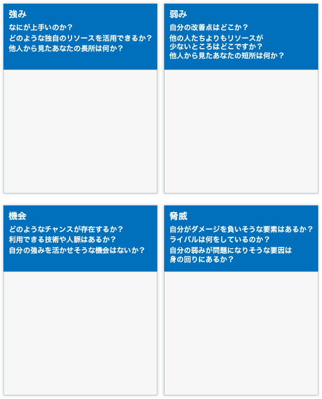
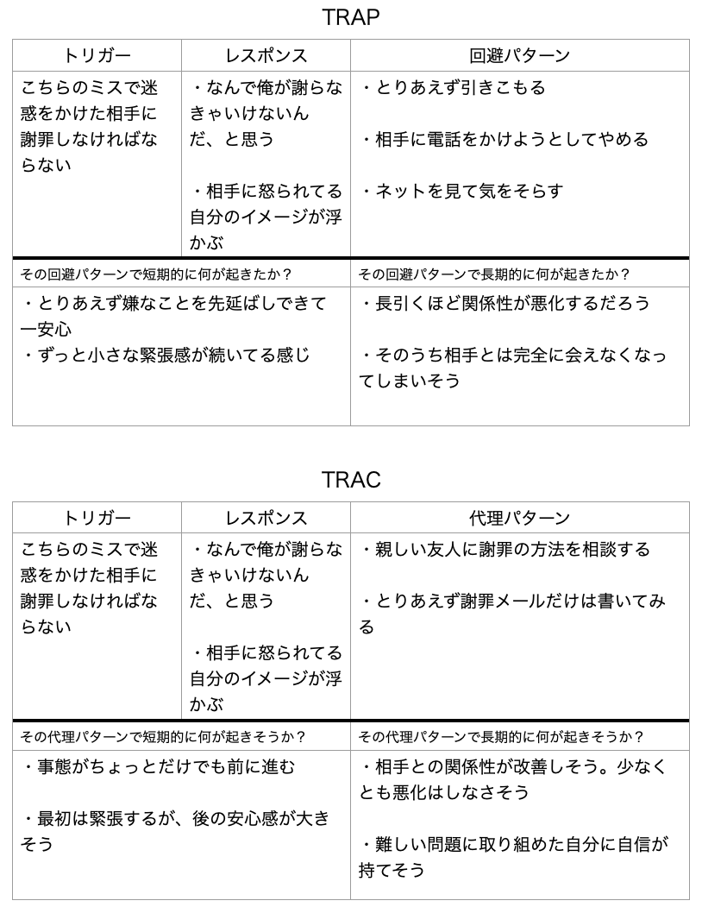

# これからを生き抜くために必要なナンバーワン能力「戦略的思考」を鍛えようぜ！#3「パーソナルSWOT」

「**戦略的思考を鍛えようぜ！**」シリーズの続きでーす([#1](https://daigovideolab.jp/blog/2191687),[#2](https://daigovideolab.jp/blog/2192330),[#3](https://daigovideolab.jp/blog/2192979))。

---

このシリーズでは、VUCA（変化、不確実、複雑、曖昧）が強まる現代において、最も重要なスキルだと言われる「戦略的思考」の伸ばし方をチェックしております。戦略的思考ってのは「未来のピンチとチャンスについて批判的かつ創造的に考えられる能力」みたいな感じで、確かにこれからの時代を生き抜くのに欠かせないでしょう。

そこで本シリーズでは、戦略的思考を鍛えるために、マイケル・D・ワトキンス博士の研究をもとに、

1. パターン認識
2. システム分析
3. 精神的敏捷性
4. 構造化された問題解決
5. ヴィジョニング
6. 組織の仕組みの理解力

という6つの必須能力を鍛えていく方法を見ていこうと思うわけです。でもって、 ここ数回は、「パターン認識」を伸ばす方法について考えてまして、今回は「パーソナルSWOT」という手法を見ていきましょう。

## **パターン認識を身につけるにはどうすればいいのか？#3**

## **3. パーソナルSWOT分析**

SWOT分析は、1970年代に、スタンフォード大学が企業のマーケティング用に開発した、超有名なフレームワークです。Strength（強み）、Weakness（弱み）、Opportunity（機会）、Threat（脅威）の頭文字をつなげたもので、企業が自社サービスの強みを見極め、経営戦略の最適化するために使われてきたんですな。 ビジネス書をよく読む人であれば、 1度は目にしたことがあるでしょう。

ただし、近年では「**SWOTを自己分析に使おうぜ！**」って考え方が普通になりまして、 定期的に自分に対してSWOTを 行うことで、パターン認識力がにつき、 戦略的思考が鍛えられることがわかってきました。SWOT分析は、他の方法では見つけられなかったようなパターンを発見 するために作られた手法なので、 当然ながら、戦略的思考を養うのにも役立つんですな。また、自分の弱点を理解するのにも役立つので、「 なんか最近人生がうまくいかないな……」って方も定期的にお試しください。

わりと即効性があるフレームワークなので、こいつを使って自分自身を見つめ直せば、周囲の人たちからは一線を画し、キャリアアップや個人目標の達成に必要な能力をさらに伸ばすことができるはずであります。

使い方は簡単で、以下のような４つのブロックに、それぞれ答えを書き込んでください。

### **１．「強み」の質問**

- 他の人が持っていない長所（例えば、スキル、資格、学歴、人脈など）は何か？
- 自分が誰よりも優れている点は何か？
- あなたが周囲の人よりもアクセスしやすいリソースは存在するか？
- 他の人（特に上司）はあなたの長所をどう見ているのだろうか？
- 自分が最も誇りに思っている業績は？
- 自分が信じている価値観の中で、あまり他の人が持っていないものはあるか？
- あなたは影響力のある人々とつながりを持っていないか？

これらの質問について、「自分自身の視点」と「周囲の人々の視点」から考えてみてください。謙遜したり恥ずかしがったりせず、できる限り客観的に答えを考えましょう。

それでも自分の強みを特定するのが難しい場合は、自分の個人的な特徴を書き出してみてください。その中には、うまくいけば強みとして考えられるものもあるはずなんで。

### **２．「弱点****」の質問**

- 普段、自信がなくて避けている仕事や作業はどのようなものか？
- 周囲はあなたの弱点をどう見ているだろうか？
- あなたは自分のスキルや能力に自信を持っていますか？ もしそうでなければ、どこが一番弱いですか？
- 仕事について、あなたが抱える問題点は何ですか？（例えば、遅刻が多い、整理整頓ができない、短気、ストレスへの対処が下手など）
- あなたは、自分の暮らしで足かせとなるような性格な特徴を持っているでしょうか？ 例えば、定期的にミーティングを行わなければならない場合、「人前で話すのが怖い」という性格は大きな弱点になるだろう。

これらの質問について、「自分自身の視点」と「周囲の人々の視点」から考えてみてください。「自分には見えない弱点が他の人には見えていないか？」「重要な分野で常にあなたを上回っている同僚はいないか？」などを現実的に考えてください。不愉快な真実にはできるだけ早く向き合うのが一番ですんで。

### **３．「機会」の質問**

- 自分の人生を改善させてくれるような新技術はありますか？
- 自分が力を注いでいる仕事や趣味は成長していますか？ もしそうなら、いまの市場をどのように活用できますか？
- 自分を助けてくれるような人脈や、的確なアドバイスをしてくれるようなコミュニティはありますか？
- 自分の会社には、どのようなトレンドがあり、それをどのように活用できますか？
- ライバルの中に、何か重要なことを怠っている人や企業はいませんか？もしいるなら、彼らの失敗を利用できますか？
- あなたの会社や業界のなかで、あまり満たされていないニーズはありますか？
- あなたの友人や会社の顧客は、何か不満を持っていないだろうか？もしそうなら、彼らに解決策を提供することで、チャンスを作ることはできないでしょうか？
- 以下のような場面で、なにか有益な機会は見つからないだろうか？
  - ネットワーキング・イベント、趣味のコミュニティ、会議。
  - 同僚の仕事を いくつか手伝うことで、より経験を積む ことはできないだろうか？
  - 新しいスキルを学ばなければならない新しい役割やプロジェクトに 参加できないだろうか？

ここで重要なのは、自分の長所や 得意なことを意識しつつ、これによって新たなチャンスが開けないかどうかを自問すること。そして、自分の短所や欠点を見て、その短所をなくすことで新たなチャンスが開けないかどうかを自問することであります。

### **４，「脅威」の質問**

- 現在、人生や仕事でどのような問題や障害に直面していますか？
- 同僚たちの中に、プロジェクトや役割をめぐってあなたと競争している者はいないでしょうか？
- あなたの人生や仕事はどのように変化していますか？（仕事に対する需要やトレンドなど）
- テクノロジーの変化が、あなたの立場を脅かす可能性がありますか？
- 自分の弱点が脅威につながる可能性はありますか？

これらの質問についても、「自分自身の視点」と「周囲の人々の視点」から考えてみてください。たくさんの答えを考えるほど、重要な情報を得られるはずですんで。

### **パーソナルSWOTの例**

以下にパーソナルSWOTの評価を並べておくので、 参考にしてください。

- **「強み」の例**
  - 私はとてもクリエイティブだと言われる。クライアントドに新しい視点を与えて、感動を与えることがよくありる。
  - 私はクライアントやチームとよくコミュニケーションをとる。
  - 私には、 問題を解決するための質問をする能力がある。
  - 私はクライアントの成功に全力を尽くす。

- **「弱み」の例**
  - 私には、「物事は素早くこなすべきだ」「TODOリストは すべてコンプリートすべきだ」という強迫観念があり、その結果、仕事の質が落ちてしまうことがある。
  - クライアントにアイデアをプレゼンするときに緊張しすぎる。
  - 人前で話すことへの恐怖心が強く、プレゼンが堅苦しくなってしまうことも多い。

- **「機会」の例**
  - 自分と同じジャンルでYouTubeをやっている人に、「ファンを粗末に扱う」という評判が出てきた。
  - 来月、大規模なマーケティング会議に出席する。戦略的なネットワーキングができるし、素晴らしいトレーニングセミナーもある。
  - アートディレクターがもうすぐ 長期の休暇を取る。彼がいない間に仕事をカバーすれば、キャリアアップのチャンスになるだろう。

- **「脅威」の例**
  - 同僚のAさんは私よりずっと話が上手で、私とアートディレクターのポジションを争っている。
  - 最近の人手不足のせいでしばしば 残業与儀なくされ、 そのせいで創造性が低下している。
  - 現在の経済情勢により、自分が働く業界は伸び悩んでいる。多くの企業がスタッフを解雇しており、 自分の会社もさらなる人員削減を検討している。

このように分析していき、 同僚の休暇中に他の仕事を手伝ってみたりとか、自分の強みを生かしながら仕事に取り組んでみたりといった対策を考えやすくなるわけですね。 もし何も思いつかなかったとしても、定期的に行うことで、自分の人生に何らかのパターンが浮かび上がってくるのがわかるはず。 それにより、少しずつパターン認識能力が鍛えられているはずです。 これは自分でもたまにやってますが、その時々の自分が持っている「才能」の棚卸しになって、 行動の指針を立てやすくなるのがよろしいですね。

## **４．トラップ・トラック法**

トラップ・トラック法は、 自分が無意識のうちに取っている特定の行動パターンを理解するために使える手法です。 私たちは誰でも、 何らかの問題が起きたときに、無意識のうちに決まったパターンの行動を取ってしまうもの。「勉強をしなければならないときほどスマホを触る」「誰かに謝罪しなければならないときに引きこもる」など、 このようなマイナスの行動パターンには、誰もが身に覚えがあるでしょう。

このようなマイナスの行動パターンは、 何度も繰り返すうちに自分の中で“自動化”されてしまうので、 自分がどのような行動パターンとってるのかを認識するのは意外と難しかったりします。そこで行動活性化療法の世界では、トラップ・トラック法を使って、 自分のマイナスな行動パターンに気づく能力を養っていきます。

トラップ（TRAP）とトラック（TRAP）は複数の単語の頭文字をまとめた略語で、

- TRAP : トリガー（Trigger）→ レスポンス（Response）→ 回避パターン（Avoidance Pattern）

- TRAC : トリガー（Trigger）→ レスポンス（Response）→ 代理コーピング（Alternative Coping）

みたいになります。 具体的には、以下のような記録用を使い、まずは「TRAP」で「自分の マイナスな行動パターン」を分析し、そのあとで「TRAC」を使って問題を解決していきます。それぞれに書き込む内容を見ていきましょう。

### **TRAP**

1. **トリガー**：あなたがストレスを感じているようなタスクを記入します。 本当はやらなきゃいけないんだけれども、どうしても手がつけられなかったり、積極的に避けてしまったりするようなイベントを書き込んでください。
2. **レスポンス**：「ストレスを感じているタスク」について考えたときに、あなたの中にどんな思考や感情がわきあがるのかを記入します。たとえば「企画書を書かなければならない」というトリガーを記入した場合には、「すぐにやらなくてもいい」や「そもそも理由がよくわからない」「とにかくめんどくさい」のように、頭の中に自然と浮かんでくる思考や感情を思いつくだけ 書き込んでください。
3. **回避の行動パターン**：「ストレスを感じているタスク」をやらねばならないときに、あなたがどのようなマイナスの行動パターンを取ってしまうのかを書き込みます。「スマホを見始める」「部屋を掃除する」「寝る」などのように、 あなたがこれまでに取ってきたマイナスの行動パターンをすべて書き込みましょう。
4. **回避パターンの短期的な影響**：ステップ3で考えた「回避の行動パターン」をしたあとに、どのような変化が起きるのかを記録します。「スマホを見て罪悪感を抱いた」「部屋が片付いてスッキリした」「自分のことが嫌いになった」など、「回避の行動パターン」で得られた短期的なメリットとデメリットを考えてみましょう。
5. **回避パターンの長期的な影響**：「回避の行動パターン」をこれからも取り続けたら、数年後にはどのような変化が起きそうかを予想して書き込みます。「仕事をしないせいで昇進ができない」「人生に後悔しながら暮らしている」のように、 長期の結果を書き込んでください。

### **TRAC**

1. **トリガー＆レスポンス**：この２つの項目には、TRAPと同じように「ストレスを感じているタスク」と「頭の中に浮かぶ思考と感情」を記入します。TRAPに記録したものと同じ内容になって構わないので、 面倒がらずに書き込むようにしてください。
2. **代理コーピング**：TRAPに書き込んだ「回避の行動パターン」を止めるために、代わりにできそうな行動をリストアップしてください。「スマホを見てしまう」のが問題なら、その代わりに「3行だけ文章を書く」が代理コーピングになるかもしれませんし、「つい寝てしまう」のが問題なら、「帰宅後すぐに勉強する」のが 代理コーピングになるかもしれません。問題を避けるために使えそうな行動なら何でもいいので、 思いつくだけ考えてみましょう。
   代理の行動を思いつかない場合は、次の質問について考えてみてください。
   ・ 長期的により良い結果を出すためにはどうすればいいだろうか？
   ・ 自分が大事にする「価値観」に沿った行動を取るにはどうすればいいだろうか？
   ・ 今後の幸福度を高めてくれそうな行動はなんだろうか？
3. **代理コーピングの短期的な影響**：ステップ2で考えた代理コーピングを改めて確認し、「この行動を取ったら短期的にどうなるだろうか？」と想像してみましょう。「3行だけでも文章を書ければ安心できるだろう」や「帰宅後に勉強をするとめんどくさそう」など、 短時間の間（長くても1日）で、 どのような変化が起きそうかを考えて書き込んでください。
4. **代理コーピングの長期的な影響**：もし代理コーピングを実践したら、数年後にどのような変化が起きるかを想像します。「自信がつくだろう」や「年収が上がるかもしれない」のように、長期的に起きそうな結果を書き込んでください。

トラップ・トラック法のポイントは、問題の分析を短期と長期に分けているところです。 たいていの人は、 ストレスを感じると考え方が短期的になる傾向があるので、 長期的な視線で物事の発生パターンを見抜くことができなくなっちゃうんですよね。 そのせいで、長期的にはメリットがないような行動を選んでしまうわけですな。

そこでトラップ・トラック法を使えば、自分のだめな行動パターンがよく理解できるため、 より長期的なメリットに目を向けられるようになります。これもまた人生のパターン認識力を鍛える良い方法なので、 ぜひお試しください。
