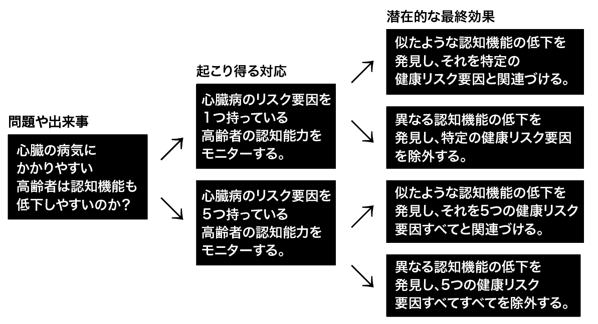
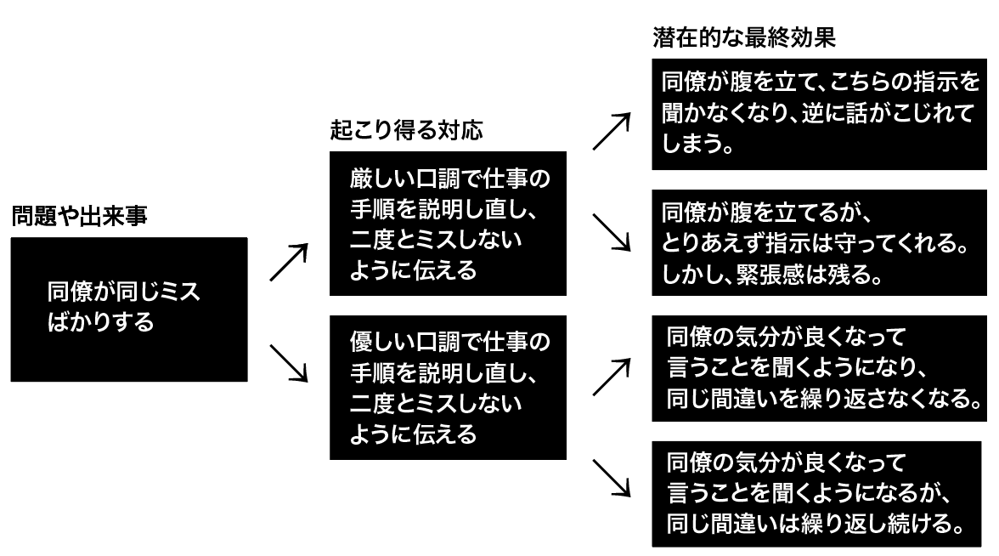

# これからを生き抜くために必要なナンバーワン能力「戦略的思考」を鍛えようぜ！#5「もしも分析」

「**戦略的思考を鍛えようぜ！**」シリーズの続きでーす([#1](https://daigovideolab.jp/blog/2191687),[#2](https://daigovideolab.jp/blog/2192330),[#3](https://daigovideolab.jp/blog/2193827),[#4](https://daigovideolab.jp/blog/2194266))。

---

このシリーズでは、VUCA（変化、不確実、複雑、曖昧）が強まる現代において、最も重要なスキルだと言われる「戦略的思考」の伸ばし方をチェックしております。戦略的思考ってのは「未来のピンチとチャンスについて批判的かつ創造的に考えられる能力」みたいな感じで、確かにこれからの時代を生き抜くのに欠かせないでしょう。

そこで本シリーズでは、戦略的思考を鍛えるために、マイケル・D・ワトキンス博士の研究をもとに、

1. パターン認識
2. システム分析
3. 精神的敏捷性
4. 構造化された問題解決
5. ヴィジョニング
6. 組織の仕組みの理解力

という6つの必須能力を鍛えていく方法を見ていこうと思うわけです。でもって、「パターン認識」を伸ばす方法については前回で終わりまして、今回からは「**システム分析**」の能力を見ていきましょう。

## **そもそもシステム分析とはなんぞや?**

システム分析ってのは、 自分が取った対応がどんな複数の結果をもたらすのかを特定し、 それによって問題を解決していく手法のことです。といっても、いまいちわかりにくいでしょうから、 いくつか例を上げてみましょう。

システム分析が最もよく使われるのは学問の世界で、たとえばマイアミ大学が行った研究([R](https://www.ahajournals.org/doi/10.1161/JAHA.115.002731))では、男女1,033人を対象に「**心臓が健康な人は頭も良いのか？**」を調べたことがありました。具体的には、

1. 喫煙しない
2. 健康的な体重を維持する
3. 身体を動かす
4. 良い食事をする
5. 正常な血圧とコレステロールを維持する

といった、心臓の健康に良い生活をしている人は、 歳をとっても認知能力が衰えづらいかどうかを調べたんですな。 その結果は、予想通り「心臓に良い暮らしをしている人は、６年後に脳の処理能力が高かった」って結果だったんだそうな。

というと、 普通の調査のように思えますが、ここでシステム分析を行わないと、 研究は以下のように進むことがあります。

あんま考えずに手当たり次第にデータを集めており、 割と出たとこ勝負で分析を進めております。これでも論文は書けたりするんですが、時間、リソース、資金を浪費することになりやすく、 評価されるような論文もまず書けないでしょう。

その代わりに、事前にシステム分析を行っておくと、大体こんな感じになります。

こんな感じで、 自分が行った対応の結果をちゃんと図にしておけば、 いたずらに多の原因を 探さなくても良くなり、より正確な結論を 出しやすくなるでしょう。 こんな感じで、潜在的な行動と結果を考え抜ていくのがシステム分析の基本です。

まぁこれでもわかりにくいような気がするので、もうちょい身近な例で考えてみましょう。たとえば、 あなたの同僚が、同じミスを何度も繰り返しており、 これをどうにかしたいとしましょう。 システム分析を行う場合、 以下のようなダイヤグラムが考えられるでしょう。

こんな感じで、自分が取った対応に対する具体的な結果や変化をまとめておくのがシステム分析です。簡単なステップとしては、

1. 自分がどうにかしたい問題や潜在的な変化を特定する。
2. 自分の対応に対して、状況はどのように変化するか、人々はどのような反応を示すかを考える。
3. 最後に、その結果として、問題はどのように解決するか？問題は本当に解決するのか？新たな問題は生まれないのか？などを検討する。

みたいになります。もちろん未来を予測することは不可能ですが、あり得そうな反応をチェックしておけば、より良い選択肢を選びやすくなるのは間違いないでしょう。

まぁ頭が良い人ってのは、この作業をほぼ自動的にやっているケースが多いので、あらためて図にする必要はないでしょう。が、ある試算によると、**世界人口の95%は、一直線の原因と結果の連鎖で問題を解決することに慣れているため、システムという観点から物事を考えることができない**とのこと([R](https://amzn.to/448eymP))。ということは、システムで考えるように心がけるだけでも上位５％に入ることができ、自分の優位性が一気に高められるわけですな。

事実、システム分析とパフォーマンスの向上には明確な相関が見られてまして、このような脳の使い方ができる人は、仕事で高い成果を上げやすいって報告が多いんですよ（相関係数もめっちゃ高い）（[R](https://www.emerald.com/insight/content/doi/10.1108/13683041011093758/full/html)）。それもそのはずで、私たちの日常は、多くの文脈（社会、経済、技術など）の中に存在し、システムの中のシステムが入った「入れ子」状態で機能してますからね。問題の規模が大きくなればなるほど、その相互作用は複雑になるんで、システムの流れを理解したほうが良いのは間違いないですからね。

## **もしも分析を使ってみよう！**

では、システム分析をどう実践するかってことですが、工学や科学を専攻した人であれば、教育課程でその基礎を学んでいるはず。しかし、そのような訓練を受けていなくても、超基本的なやり方であれば誰でも使いこなせますんで、ここではその方法をお伝えしましょう。

ちなみに、ガチのシステム分析はわりと難しいので、ここでは扱いません。 興味がある方は、以下の本を手に取ってみてくださいませ。

- ドネラ・H・メドウズ「[システム思考をはじめてみよう](https://amzn.to/3TTHIBm)」
- ピーターMセンゲ「[学習する組織――システム思考で未来を創造する](https://amzn.to/3Q78JQW)」

ってことで、簡易版のシステム分析では何を行うかと言うと、「**What if（もしも）?**」の質問をくり返すだけです。

たとえば、いま自分がアクセサリーを販売する仕事をしていて、新たに洋服店の開業を考えているとしましょう。当然、事業計画書には、競合の有無、業界の伸び率、売上予測など、最善の見積もりが並ぶはずであります。

しかし、 これだけだと「この計画を実行に移すべきか？」をいまいち決定しづらいのも確かです。さまざまな困難があるなかで、新しい事業が本当に存続可能なのかどうかを確認するには、もうちょい分析が必要でしょう。そのために役立つのが「What If分析」で、新たな事業に関する「もしも？」を、思いつく限り並べていけばOKです。

- 通りの向かいに競合店が開店したら？
- 供給ラインが限られている場合は？
- 為替レートが変わったら？
- 消費税が上がったら？

「もしも？」の数に制限はないんだけど、通常は「**最低でも3つは『もしも』を考える！**」ってのが基本です。まぁ私の経験則で言うと、5つも考えれば結構な範囲の問題はカバーできるので、 頑張って10個も20個も考えなくて良いとは思います（ただし、 考えれば考えるほど、 思わぬリスクが見つかったりするので、 大きな問題の場合は、10個ぐらい目指してみるのもあり）。

でもって、 「もしも」を 考え終わったら、 実際にそれぞれの質問に答えていけばOK。 上の例で言えば、最初の「もしも」である「通りの向かいに競合店が開店したら？」を」について考えてみるだけでも、調査すべき選択肢がいくつもあることが理解できるはず。 例えば、こんな感じです。

- 価格を引き下げる
- ニッチ市場の定義とマーケティングを行う
- 補完的な製品ラインを提供する
- 顧客サービスの向上を考える

こちらも回答の数に制限はありませんが、だいたい3〜5個の答えを思いつければ上等だとされています。 これだけやれば、今の問題に不測の事態が含まれていることを十分に確認できるはずですんで。これができれば、あとはこれらのオプションのそれぞれを調査し、それに応じて計画を調整することができるはずであります。

「What If分析」はめっちゃ簡単な方法なので、 私たちが直面するほとんどすべての問題に使えるのが良いところです。 その割に、何らかの問題を解決したり、 重要な意思決定をするときに、この方法を使う人は意外なほど少なかったりするんですよね（ある意味、当たり前すぎて逆に誰もやらないのかもしれない）。 そう考えると、手軽に使えるうえに、 周囲と差をつけやすくしてくれる良い方法だと言えましょう。

簡単な方法なので、詳しいやり方を説明するまでもないでしょうが、いちおう実践のステップを お伝えしておくと、 以下のようになります。

- **ステップ1 分析する範囲を決める：**まずは自分が分析したい問題を明確にしましょう。 自分の立ち上げたプロジェクトに関する潜在的なリスクの影響に関心があるのか？ どこに投資するべきかを決めたいのか？ 「社員が定着しない」問題を解決したいのか？など、 どんな活動でもいいので、 無籍したい問題をシンプルな文章で定義しましょう。

- **ステップ2 さらに分析すべき重要な問題を特定する：**ステップ1で 決めた問題に対して、 より深く分析したいポイントを決めましょう。販売に関する問題であれば、供給、競争、コスト、需要に関する質問から始めるかもしれないし、投資に関する問題であれば、金利の変化、市場の状況、経済予測に焦点を当てるかもしれません。「社員が定着しない」問題に関する問題では、競争力のある賃金を提供する能力、トレーニングの機会を提供するコスト、組織文化などの質問が浮かぶかも知れません。

- **ステップ3 それぞれの問題に「もしも」の質問を作る：「**売上、投資、維持にどのような影響がありそうか？」「コストが5％、10％......と増えていったら？ 」「金利が1/4％、1/2％、......と上がっていったら？」「トレーニング費用が2％、4％、......と上がっていったら？」のように、ステップ２で特定した問題について「もしも」をガンガン考えて行きましょう。

- **ステップ4「もしも」の質問に答える**：さらに調査し、仮定を検証し、「もしも」の質問の答えを探しましょう。ある領域で影響が大きい場合は、その領域についてさらに詳しく調査してください（この時点で、不安に思っていたことが意外と大したことじゃないと気づくことも多い）。

ってことで今回は、「システム分析」の初歩の初歩をお伝えしました。くり返しになりますが、ガチの「システム分析」「システム思考」ってのは、かなり複雑なツールを使いこなす必要があるので、専業のコンサルでもない限りは「What If分析」を徹底するほうが現実的でしょう。

これだけでも認知の負荷はかなり軽減され、戦略的思考力を高めることができますし、その結果、新たなチャンスをよりスピーディに発見する能力も養われますんで。なにか困ったことがあったら、とりあえず「もしも？で考えたら？」みたいに問いを作ってみると良いのではないでしょうか。ではまた次回！
