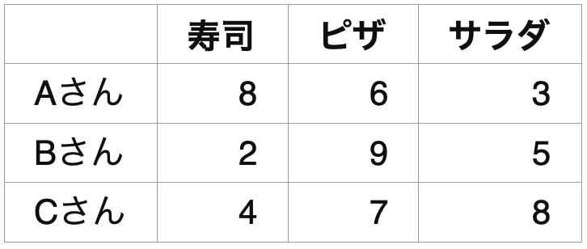
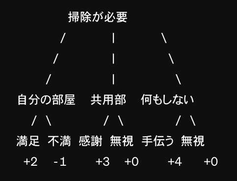
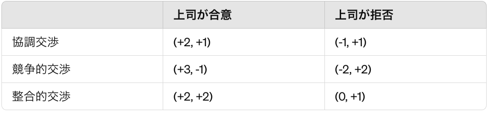
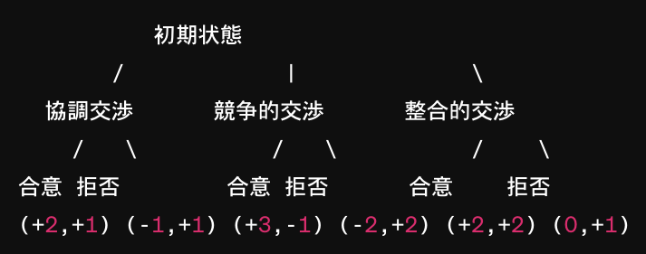

# これからを生き抜くために必要なナンバーワン能力「戦略的思考」を鍛えようぜ！#7「利得行列」

「**戦略的思考を鍛えようぜ！**」シリーズの続きでーす([#1](https://daigovideolab.jp/blog/2191687),[#2](https://daigovideolab.jp/blog/2192330),[#3](https://daigovideolab.jp/blog/2193827),[#4](https://daigovideolab.jp/blog/2194266),[#5](https://daigovideolab.jp/blog/2194838),[#6](https://daigovideolab.jp/blog/2195600))。

---

このシリーズでは、VUCA（変化、不確実、複雑、曖昧）が強まる現代において、最も重要なスキルだと言われる「戦略的思考」の伸ばし方をチェックしております。戦略的思考ってのは「未来のピンチとチャンスについて批判的かつ創造的に考えられる能力」みたいな感じで、確かにこれからの時代を生き抜くのに欠かせないでしょう。

そこで本シリーズでは、戦略的思考を鍛えるために、マイケル・D・ワトキンス博士の研究をもとに、

1. パターン認識
2. システム分析
3. 精神的敏捷性
4. 構造化された問題解決
5. ヴィジョニング
6. 組織の仕組みの理解力

という6つの必須能力を鍛えていく方法を見ていこうと思うわけです。でもって、前回は「**精神的敏捷性**」を伸ばす方法を考えてまして、「レベルシフト」って能力を鍛える方法を見てみました。

そこで今回は、もうひとつ、精神的敏捷性に欠かせない能力である「**ゲーム理論の使用**」について見てみましょう。

## **ゲーム理論を使って決断の制度を上げてみよう！**

「**精神的敏捷性**」の第二の柱は、ゲームプレイです。これは、世の中で起きる問題を「ゲーム」として捉え、他のプレーヤ ー」の行動を予測し、それを戦略に織り込む能力を意味します。

これはゲーム理論をベースにした考え方で、「自分の行動に対して相手はどう行動するか？」「自分の選択に対して周囲の人はどう反応するか？」といった疑問の答えを探っていきます。人間にがどうやって合理的な決定を下すかを理解する手法として使われていて、「ここで自分が新製品を出したら、競合他社はどんな手を打ってくるだろう？」みたいな疑問に、的確な予測を立てるために使うんですな。

当然、これはビジネスに限らずあらゆる問題の解決に重要なポイントで、他人の動きを予測できれば、彼らが取るだろう選択肢のいくつかを取り除くこともできるし、彼らが動き出したときに打ち負かすこともできますからね。実際のところ、人生における問題の多くは、「**多くのチェスゲームを同時にプレイするよ うなもの**」なんで、ゲームの考え方ってのはめっちゃ大事なんですよ。

ということで、ここではゲームプレイの考え方を見ていきますが、**ガチのゲーム理論はめっちゃ複雑**なのでここでは触れません。日常の問題に活用するぐらいなら、そんなに難しい方法論はいらないので、ここではめっちゃ初歩（だけど超大事）なとこだけを押さえておくことにします。

もしこれでゲーム理論による問題解決に興味が出た時は、以下の書籍などを当たってみてくださいませ。

- アビナッシュ・ディキシット 「[戦略的思考とは何か エール大学式「ゲーム理論」の発想法](https://amzn.to/4de6HbF)」

- アビナッシュ・ディキシット「[戦略的思考をどう実践するか エール大学式「ゲーム理論」の活用法](https://amzn.to/3QndeqN)」

- 岡田章「[ゲーム理論ワークブック](https://amzn.to/3UCZOJq)」

で、ゲームプレイの考え方を知るには、ゲーム理論の細かい理屈に深入りするよりは、日常生活に応用している様子を見てみるのが一番。日常のトラブルをゲーム理論で解決した事例として、めっちゃシンプルに、友人との休日の予定を決める際のシナリオを考えてみましょう。

### **事例１．利得行列を使ってみよう！**

まずは、最も簡単にゲーム理論っぽいものを味わえる、「利得行列」を押さえて起きましょう。あくまで「ゲーム理論っぽいもの」ではあるんですが、実際の意思決定にはめちゃくちゃ役立つ考え方だし、あらゆる場面で使える便利なツールなので、ぜひチェックしといてください。

- **状況**：3人で食事に行きたいが、メンバーの好みがバラバラで決まらない。
- **利得行列の適用**：
  - **１．選択肢の洗い出し**：まずは、検討すべき選択肢を選びます。ここでは、Aさんが寿司を、Bさんがビザを、Cさんがサラダを食べたいとします。
  - **２．利得行列の作成**： 各料理について、プレイヤーがその料理を選んだ際に得られる満足度を利得として設定します。その結果、利得表が以下のようになりました。
    この表は、各セルの数値が、そのプレイヤーがその料理を選んだ場合の満足度（利得）を表しています。数値は0から10の範囲で、高いほどそのプレイヤーにとってより望ましい選択だと言えます。

-
  - **３．利得表の解釈**：できあがった利得表を解釈しましょう。これを見ると、以下のことがわかります。
    - Aさんは「寿司」を最も好むようだが、「サラダ」はあまり好まない。
    - Bさんは「ピザ」が最も好きで、「寿司」があまり好きではない。
    - Cさんは「サラダ」を最も高く評価しており、「寿司」は最も低く評価している。
  - **４．最適戦略の探索**：この情報を基に、グループはどの料理を注文するかを決める際に、各自の利得が最大化されるように交渉や妥協を行っていきます。例えば、全員が少なくとも中程度の満足を得られる「ピザ」を選ぶ！という妥協案が成立するかもしれません。

### **事例２****．ゲームの木を使ってみよう！**

続いて、利得行列と同じぐらい使い勝手が良いのは「ゲームの木」です。こちらも厳密にやろうとすると難しいので、日常のトラブルに使うぐらいなら、めっちゃ簡易版を押さえておくほうが吉。

- **状況**：家庭内の掃除スケジュールを決めたい。

- **ゲームの木の適用**
  - **１．プレイヤーの特定**：ここでは「家族の掃除分担」をゲームととらえ、家族の各メンバー（例：父、母、子供1、子供2）がプレイヤーになります。
  - **２．行動の選択**：各家族メンバーが取り得る行動をリストアップします。例えば、各メンバーが「自分の部屋を掃除する」「共用部を掃除する」「掃除をしない」という選択肢があるとします。
  - **３．選択に対する反応の追加**：各行動に対する他のメンバーの可能な反応を考えます。たとえば、あるメンバーが「共用部を掃除する」を選択した場合、他のメンバーは「感謝する」「無視する」「手伝う」と反応するかもしれません。
  - **４．利得の設定**：各結果に対して、その結果から得られる利得（満足度）を割り当てます。利得は、掃除の負担感、時間の節約、家族からの評価など、メンバーが「この要素は満足感を左右する！」と納得できるような要素に基づいて決定されます。
  - **５．ゲームの木を描く**：ここまでの作業をもとに、ゲームの木にまとめます。たとえば、以下のような具合です。

でもって、最後はゲームの木を使って家族で議論し、最適な戦略を導き出します。このゲームの木を見ると、家族メンバーがそれぞれの選択によってどのような利得や損失を受ける可能性があるかが視覚的にわかるんで、各自がどの行動を取れば良いかがわかりやすいんですな。もちろん、これで誰もが納得するような解が出せるとは限らないんだけど、何も考えずに「お前は部屋の掃除だ！」とか決めちゃうよりは有意義な結論が出しやすいでしょう。

### **事例３．利得行列とゲームの木をセットで使おう！**

利得行列とゲームの木はどちらも単独で十分に有効な方法ですが、組みあわせるとさらに便利だったりします。こちらも事例で使い方を見てみましょう。

- **状況**：あなたが上司に給与交渉をしているとします。このケースでは、あなた（従業員）とあなたの上司がプレイヤーです。もちろん、給与の増額があなたの目的になります。

### **ステップ１．利得行列の作成**

まずは、あなたが使う交渉手法をリストアップし、それにもとづいて利得行列を作ります。交渉の方法は自分が試したい方法をすべてリストアップするのが基本ですが、ここでは参考として、以下の3つで考えてみましょう。

1. **協調交渉**：共に利益を求める協力的なアプローチ。信頼関係と相互の理解を重視。自分の昇進が部門にどのようにプラスに働くかを明確にし、上司との信頼関係を土台として提案。部門の目標達成にどう貢献できるか具体的な計画を提示し、上司の支持を得るための相互利益を強調。
2. **競争的交渉**：自己の利益を最大化するために積極的かつ攻撃的なアプローチを取る。他の候補者と比較して自身の優位性を証明。過去の実績、特有のスキル、部門への影響をデータと共に示し、自身の価値を際立たせる。必要であれば、市場価値や他社からの関心を示して、決断を促す。
3. **整合的交渉**：双方のニーズを理解し、バランスの取れた提案をする。昇進によって自身が取り組める新たなプロジェクトや責任領域を提案し、それが如何に部門の課題解決に寄与するかを詳細に説明。また、昇進が遅れた場合の代替案として、短期的なリーダーシッププロジェクトや特定の業務への参加を提案し、段階的に目標に近づくプランを提示。

その上で、利得行列を作ったら、以下のようになりました。

この行列では、数字のペアがそれぞれあなたと上司の利得を示しています。例えば、「高い要求をする + 上司が受け入れる」場合、あなたの利得は+3、上司の利得は-2になります。

### **ステップ２． ゲームの木の作成**

次に、利得行列にもとづいてゲームの木を作成します。この作業をやっておくと、自分の行動とそれに続く反応が視覚的にわかりやすくなるんで、非常に良い感じなんですよね。

### **ステップ３．交渉法の選択と実行**

ここまでで、それぞれの交渉手法の特性が理解できたので、その上で最適な戦略を考えていきます。利得行列とゲームの木を分析し、あなたにとって最も利得が高く、実現可能性のある戦略を選択しましょう。

このケースでは、各戦略の利得とリスクを考慮した結果、「整合的交」渉が最適な方法と判断されるかもしれません。この手法では両者のニーズを考慮したバランスの良い解決策を目指すため、拒否されるリスクが比較的低く、合意に至る可能性が高いと言えるでしょう。

## **まとめ**

ってことで、今回は「利得行列」と「ゲームの木」を使って、意思決定の精度を高める方法を見てみました。くり返しになりますが、今回の手法は、あくまで「ゲーム理論っぽいもの」であり、ガチでやろうと思ったらかなり大変なことになるって事実は覚えておいてください。

また、お気づきの方もいるでしょうが、ここで取り上げた意思決定ツールは「[科学的な適職](https://amzn.to/3QlTrI8)」に近いところがあります。「[科学的な適職](https://amzn.to/3QlTrI8)」で「良い会社を選ぶための方法」として紹介したツールを、さらにシンプルにまとめたのが今回の考え方なんですね。なので、普段のトラブルで「利得行列」と「ゲームの木」をちょこちょこと使ってみて、さらに上を目指したくなったら「[科学的な適職](https://amzn.to/3QlTrI8)」のツールを日常のトラブル解決に使うフェーズに進んでみるのもいいでしょう。
