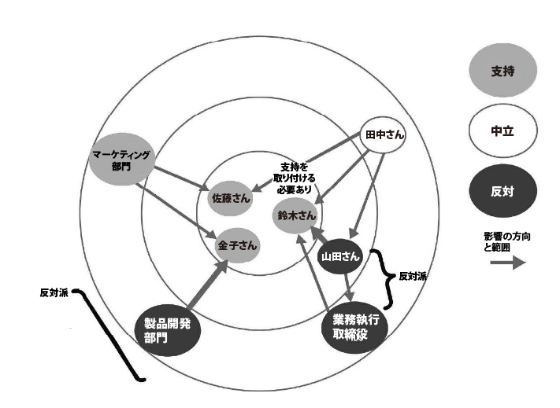
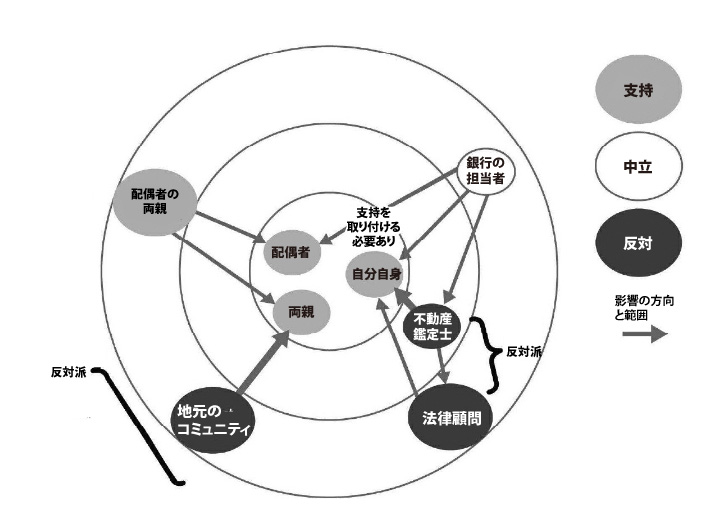

# これからを生き抜くために必要なナンバーワン能力「戦略的思考」を鍛えようぜ！#13「影響力ネットワークのマッピング」

「**戦略的思考を鍛えようぜ！**」シリーズの続きでーす([#1](https://daigovideolab.jp/blog/2191687),[#2](https://daigovideolab.jp/blog/2192330),[#3](https://daigovideolab.jp/blog/2193827),[#4](https://daigovideolab.jp/blog/2194266),[#5](https://daigovideolab.jp/blog/2194838),[#6](https://daigovideolab.jp/blog/2195600),[#7](https://daigovideolab.jp/blog/2195949),[#8](https://daigovideolab.jp/blog/2197003),[#9](https://daigovideolab.jp/blog/2197415),[#10](https://daigovideolab.jp/blog/2198145),[#11](https://daigovideolab.jp/blog/2198694),[#12](https://daigovideolab.jp/blog/2199330))。

---

このシリーズでは、VUCA（変化、不確実、複雑、曖昧）が強まる現代において、最も重要なスキルだと言われる「戦略的思考」の伸ばし方をチェックしております。戦略的思考ってのは「未来のピンチとチャンスについて批判的かつ創造的に考えられる能力」みたいな感じで、確かにこれからの時代を生き抜くのに欠かせないでしょう。

そこで本シリーズでは、戦略的思考を鍛えるために、マイケル・D・ワトキンス博士の研究をもとに、

1. パターン認識
2. システム分析
3. 精神的敏捷性
4. 構造化された問題解決
5. ヴィジョニング
6. 組織の仕組みの理解力

という6つの必須能力を鍛えていく方法を見ていこうと思うわけです。でもって、[前回](https://daigovideolab.jp/blog/2199330)から戦略的思考に必要な能力の最後である「**組織の仕組みの理解力**」の説明に入ってまして、「影響力の目標を定める」ってアプローチをご紹介しました。今回もその続きで、自分に関わる人たちとの関係性を理解するための方法を見ていきましょう。

## **アプローチ２．影響力ネットワークのマッピング**

「影響力ネットワークのマッピング」は、自分と関わる人たちが、どのような影響力の関係性を持っているかを図で示してみる方法です。あなたが直面している問題を思い描きながら、「誰が誰に影響を与えているのか?」を考えて、以下のような図にまとめてください。

この図がどういう意味かと言いますと、中央の「支持派」は、影響力が集中しているグループを示し、矢印は影響の方向と範囲を示しています。色分けは支持、中立、反対の立場を示しており、製品開発と業務執行取締役が潜在的な反対派として示されております。

これは「ブルズアイ・ダイアグラム」と呼ばれるもので、以下のように進めていきます。

1. 重要な意思決定者を特定し、その人物を中央に配置します。
   **例**：企業のCEO
2. 次に、意思決定者に影響を与える他の人々やグループを特定し、その人たちを、さらに外側の円に配置します。中心から離れれば離れるほど、これらの個人やグループの影響力は小さくなります。
   **例**：直接の影響者＝製品開発部長／マーケティング部長／財務部長、間接の影響者＝製品開発チーム／広告代理店／投資家／大手取引先、周辺の影響者＝消費者団体／メディア／一般消費者
3. 矢印を使って影響力の方向と強さを示し、影響力が強いときほど太い矢印にしましょう。
   **例**：製品開発部長からCEOへの矢印（太い）／マーケティング部長からCEOへの矢印（太い）／財務部長からCEOへの矢印（中くらい）／製品開発チームから製品開発部長への矢印（細い）／消費者団体からメディアへの矢印（細い）
4. 最後に、誰を支持、中立、反対と考えるかを評価。潜在的な支持者と反対者のグループを特定して終了です。
   **例**：支持: 製品開発部長、マーケティング部長、広告代理店 中立: 財務部長、投資家、大手取引先 反対: 消費者団体、一部のメディア

こんな感じで、影響力のネットワークを図にしておくと、自分の目的を達成する上で、「誰の支持をより多く取り付けるべきなのか？」「反対派を説得するための経路はないのか？」みたいなポイントがよくわかりますからね。製品のを成功させるためには、「製品開発部長やマーケティング部長の支持を確保し、消費者団体の懸念を解消する戦略を立てないとなぁ……」とか、「メディアの報道による消費者の反応を注視し、必要に応じて対策を講じないとなぁ……」といった判断が立てやすくなるはずであります。

また、ビジネスだけでなく、自分の人生に関する人たちの影響力ネットワークを作ってみても面白いので、こちらもお試しください。たとえば、「家を買いたい！」というときの影響力ネットワークは、以下のようになるかもしれません。

この作業をやっておくと、家を買う際に、誰の意見やサポートが最も重要かを理解し、ローンの取得や適切な物件の選定などのプロセスを円滑に進めやすくなりますんで。なにか利害関係者が多いプロジェクトを行うときは、まずこの作業を試してみるのも吉です。

## **アプローチ３．****組織の仕組み理解力チェックリスト**

組織の仕組みの理解力を高めるための、より簡単な方法として、チェックリストを使うのも有効です。これは、ワトキンス博士が提唱するチェックリストで、「自分が関わる人たちが、いまどんな関係性を築いているのか？」「目標を達成するためには、どの関係者に働きかければいいのか？」ってのを、５つのポイントをチェックするだけで理解できるようになるんですな。

チェックリストは以下の５つのみ。いまの自分が抱える問題を考えつつ、それぞれの答えを考えてください。

1. 自分の目標を前に進めるために必要な人間関係の中で、最も強化すべき重要な協力関係とは何か?
2. 他の影響力のあるプレーヤーは、どのような目標を追求し ているのか? 彼らの目標は、自分の目標とどこが一致し、どこが対立する可能性があるのか?
3. 自分の人間関係のなかで、それぞれの人たちはどのように影響しあっているのか? 重要な問題が起きた時に、誰が誰の指示を受けるのか?
4. 自分の人間関係のなかで、大きな影響力を持つ人のモチベーションはなにか？ その人を駆り立てる状況的な圧力とはどのようなものか？
5. 自分の目標を前に進めるために、最も効果的な戦略とはどのようなものか? 自分の言いたいことを伝えるために、主張をどのように組み立てるべきか? チャルディーニ「[影響力の武器](https://amzn.to/4bzOGmU)」で説明されているツールは役に立たないだろうか?

これだけではわかりづらいので、ビジネスにおいて、このチェックリストで考えてみた事例を紹介します。

**1. 自分の目標を前に進めるために必要な人間関係の中で、最も強化すべき重要な協力関係とは何か?**

私の目標は、組織内で新しいプロジェクトを成功させること。そのためには、プロジェクトマネージャーである田中さんとの協力関係を強化することが最も重要となる。田中さんは、プロジェクトの進行を円滑にするためのリソース配分とスケジュール管理に重要な役割を果たしている。

**2. 他の影響力のあるプレーヤーは、どのような目標を追求しているのか? 彼らの目標は、自分の目標とどこが一致し、どこが対立する可能性があるのか?**

技術部長の佐藤さんは、新技術の導入を推進することを目標としている。私のプロジェクトも最新技術を取り入れる予定であり、佐藤さんの目標と一致しているが、佐藤さんはリスク管理に非常に慎重であるため、新技術導入のスケジュールについて対立する可能性がある。

**3. 自分の人間関係のなかで、それぞれの人たちはどのように影響しあっているのか? 重要な問題が起きた時に、誰が誰の指示を受けるのか?**

プロジェクトは、マネージャーの田中さんを中心に動いている。技術的な問題が発生した場合は、技術部長の佐藤さんの指示を仰ぐ。また、マーケティング部門の木村さんは、プロジェクトの市場導入戦略に関して重要な意見を持っており、田中さんと連携して進めることが多い。

**4. 自分の人間関係のなかで、大きな影響力を持つ人のモチベーションはなにか？ その人を駆り立てる状況的な圧力とはどのようなものか？**

技術部長の佐藤さんは、新技術を導入して会社の競争力を高めることに強いモチベーションを持っている。しかし、彼はプロジェクトが失敗した場合のリスクも非常に意識しており、失敗による評価低下の圧力を感じている。

**5. 自分の目標を前に進めるために、最も効果的な戦略とはどのようなものか? 自分の言いたいことを伝えるために、主張をどのように組み立てるべきか? チャルディーニ「影響力の武器」で説明されているツールは役に立たないだろうか?**

最も効果的な戦略は、プロジェクトの価値を具体的なデータと事例をもとに説明し、関係者の理解と賛同を得ることだ。チャルディーニの「影響力の武器」における、相互性の法則を使い、過去に関わったプロジェクトでの成功事例を共有し、協力を求めることが有効だと思われる。また、社会的証明の原則を使って、他の成功したプロジェクトのデータを示すことで、関係者の信頼を得ることができる。

このように、チェックリストに従って考えるだけで、関係者のネットワークと利害関係、具体的な対策などがわかりやすくなるはず。

もうひとつ、このチェックリストを、日常の問題解決に使ってみた例も考えてみましょう。

**1. 自分の目標を前に進めるために必要な人間関係の中で、最も強化すべき重要な協力関係とは何か?**

私の目標は、家庭内での家事分担をより公平にすることである。そのためには、パートナーとの協力関係を強化することが最も重要となる。妻は家庭内の多くの家事を担っており、家事分担の見直しには彼女の協力が欠かせない。

**2. 他の影響力のあるプレーヤーは、どのような目標を追求しているのか? 彼らの目標は、自分の目標とどこが一致し、どこが対立する可能性があるのか?**

子どもたちにも家事を手伝って欲しい。子どもたちの目標は、私の目標と一致しており、家事の分担をより公平にすることが可能となる。しかし、子どもたちは学校の課題や部活動で忙しくなると、家事の手伝いが難しくなることから、スケジュールの調整で対立する可能性がある。

**3. 自分の人間関係のなかで、それぞれの人たちはどのように影響しあっているのか? 重要な問題が起きた時に、誰が誰の指示を受けるのか?**

家庭内では、基本的に私と妻が中心となって家事を分担している。子どもたちは、私たちの指示に従って家事を手伝っている。重要な問題が起きた場合、例えば家事の分担について不満が出た場合は、私と妻が話し合いの中心となり、解決策を見つけることになる。

**4. 自分の人間関係のなかで、大きな影響力を持つ人のモチベーションはなにか？ その人を駆り立てる状況的な圧力とはどのようなものか？**

妻のモチベーションは、家庭がスムーズに運営されることと、家事の負担が公平に分担されることにある。彼女は、家事負担が過剰になることでストレスを感じており、そのための圧力を感じている。

**5. 自分の目標を前に進めるために、最も効果的な戦略とはどのようなものか? 自分の言いたいことを伝えるために、主張をどのように組み立てるべきか? チャルディーニ「影響力の武器」で説明されているツールは役に立たないだろうか?**

最も効果的な戦略は、家事の現状とその負担を具体的に共有し、妻と一緒に解決策を見つけること。「影響力の武器」では、相互性の法則を利用して、私も積極的に家事を分担し、その上で協力を求めることが有効だろう。また、社会的証明の原則を使って、他の家庭での成功事例を示すことで、家事分担の改善が可能であることを納得してもらうことができる。

## **アプローチ４．ロゴス、エトス、パトス・チェック**

ここまでのアプローチを使うことで、あなたの関係者たちが、どのような影響力のネットワークを持っているかがわかったはず。そこで最後には、アクティブリスニングの回でまとめた「[レトリックの三角形](https://daigovideolab.jp/blog/2158906)」を使ってみましょう。

これは、アリストテレスの修辞学のカテゴリーであるロゴス、エトス、パトスを使ったもので、大事な相手に自分の意見を伝えたい時にめっちゃ役立つはず。詳しいところは「[レトリックの三角形](https://daigovideolab.jp/blog/2158906)」をチェックしていただければ幸いですが、戦略的思考を鍛える際に考えるべきは、以下のポイントだけです。

<table border="1"><tbody><tr><th>ロゴス（Logos） – データと論理的な議論</th><td>
<ul><li>相手にとって、どのデータや分析が説得力があるか？  </li>
<li>相手にとって、どの論理が訴えるか？</li>
</ul></td></tr><tr><th>エトス（Ethos） – 原則、ポリシー、およびその他の「ルール」</th><td>
<ul><li>相手を納得させるのに役立つ原則やポリシーはあるか？  </li>
<li>相手に原則やポリシーに反する行動を求める場合、例外を正当化するためには何が有効か？</li>
</ul></td></tr><tr><th>パトス（Pathos） – 感情と意味</th><td>
<ul><li>感情的な「トリガー」（例えば、忠誠心や公共の利益への貢献）に訴えることはできないか？  </li>
<li>相手の立場を支持、または反対することで、相手に何らかの意味を見出す手助けができるか？  </li>
<li>相手が感情的に反応している場合、一歩引いて視点を得る手助けができるか？</li>
</ul></td></tr></tbody></table>

それでは、このフレームワークをもとに、ビジネスの問題を解決してみた事例を考えてみましょう。

たとえば、あなたが勤める企業の営業チームは、新しい市場に参入するための戦略を立てています。しかし、マーケティング部門との協力がうまくいかないため、営業部長の山田さんはマーケティング部長の佐藤さんを説得し、両部門の協力を強化する必要があるとします。この場合、ロゴス、エトス、パトス・チェックは、以下のように行ってください。

- **ロゴス (論理・データ)**
  - **相手にとって、どのデータや分析が説得力があるか？**
    新しい市場に参入することで得られる具体的な利益予測データと過去の成功事例を提示。また、市場調査データを用いて、新市場での需要の高まりと競合他社の状況を説明するのがよさげ。
  - **相手にとって、どの論理が訴えるか？**マーケティング戦略と営業戦略が一体となることでシナジー効果が生まれ、より高い成果を出せることを論理的に説明。具体的には、マーケティングのリードジェネレーションと営業のクロージングが連携することで、販売サイクルが短縮されることを強調するのがよさげ。

- **エトス (信頼性・権威)**
  - **相手を納得させるのに役立つ原則やポリシーはあるか？**
    企業のミッションステートメントにある「顧客満足度の向上」を引用し、両部門が協力することで顧客への提供価値が高まることを示すのがよさげ。
  - **相手に原則やポリシーに反する行動を求める場合、例外を正当化するためには何が有効か？**迅速な市場参入が競争優位性を確保するために不可欠であり、現行のポリシーを一時的に変更する必要があることを説明。過去に同様の戦略が成功した事例を挙げて、例外を正当化するのがよさげ。

- **パトス (感情)**
  - **感情的な「トリガー」に訴えることはできないか？**
    佐藤さんの忠誠心と企業への貢献意識に訴えかけ、新市場参入が企業全体の成長に大きく寄与することを強調。また、成功した場合の個人的なキャリアアップの可能性についても触れるのがよさげ。
  - **相手の立場を支持、または反対することで、相手に何らかの意味を見出す手助けができるか？**佐藤さんのマーケティング部門が持つ課題や懸念を認識し、それに対するサポートを約束。具体的には、追加のリソースや予算の確保を提案し、佐藤さんの立場を尊重する姿勢を示すのがよさげ。
  - **相手が感情的に反応している場合、一歩引いて視点を得る手助けができるか？**佐藤さんが感情的に反応した場合には、一歩引いて冷静にデータと事実に基づく議論を行うことで、佐藤さんが客観的な視点を持てるようにサポート。また、第三者の専門家の意見を取り入れることで、公平な視点を提供するのがよさげ。

って感じで、なにかに困ったときは、「論理、権威、感情の３つにバランス良く訴えかけられないか？」と考えてみると、事態がめっちゃスムーズに進む可能性があったりします。こちらも手軽なフレームワークなので、お試しいただきたいところです。

ってことで、長らく続いてきた「戦略的思考シリーズ」はこれにて終了。まぁ全てやるのは大変でしょうが、ここまで紹介してきたアプローチをどれかひとつ押さえるだけでも、これからの時代に適応した行動を取りやすくなるはずであります。個人的には、「精神的敏捷性」をもうちょい重点的に鍛えていこうかと。
