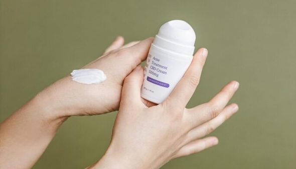

# 【2024年版】嫌な体臭と汗を抑えるのに役立ちまくる「インビジブル系のデオドラント＆制汗剤」のベストはこれだ！

だいぶ汗をかく季節になってきたので、今回は「**インビジブル系のデオドラント＆制汗剤**」の推奨品をピックアップしておきましょう。

インビジブル系のデオドラントってのは、衣服に移ることなく、肌にとどまるように設計された商品のことです。速乾性があり、ダマになりにくく、透明感のあるつけ心地を目指したものが多く、普段づかいするのにめっちゃ良いんですよ。

私は汗っかきなのでいままで数十種類の制汗剤とデオドラントを試してまして、それぞれ臭いと汗をブロックする能力を評価しております。それと同時に、文献と照らし合わせて成分をチェックし、肌荒れやアレルギーの問題が起きにくそうなものを選んでみました。40分間の有酸素運動を行った上で、どれぐらい汗腺をブロックするか、どれぐらい効果が持続するか、塗り直したりシャワーを浴びたりする必要がないをチェックしたんで、いずれも機能は高いのではないかと。

また、その他のポイントとしては、

- アルミニウム、銀、マグネシウムなどのいずれかがふくまれている。

- グリコール酸のような酸を含み、細菌が繁殖しにくい環境を作ってくれている。

- 保湿成分が含まれており、肌を落ち着かせて潤いを与え、炎症のリスクを軽減してくれる。これは、敏感肌の人や脇毛を処理している人、かぶれや脇の不快感がある人には特に重要。

- 特に敏感肌の人は、α-ヒドロキシ酸の ような角質除去成分や、アルコールや重曹のような乾燥剤を含むデオドラントは避けるべき。

- 天然デオドラント剤は、必ずしも非アルミベースのものより優れているとは限らない。天然デオドラントには糖分が多く含まれていることが多く、人によってはイースト菌感染を引き起こす可能性があるので注意。

といったところがあります。多くの製品は制汗剤とデオドラント剤の両方の成分を配合しているので、汗をかきやすい人は、普通のデオドラントではなく、制汗の機能を持った商品の使用も検討してみましょう。

ってことで、以上をふまえたうえで、おすすめできる商品を見てみましょうー。

## **総合ベスト：**[**シークレット クリニカルストレングスデオドラント**](https://jp.iherb.com/pr/secret-clinical-strength-antiperspirant-deodorant-invisible-solid-powder-protection-2-6-oz-73-g/93287?rcode=IRO489)

シークレット社のデオドラントは、個人的にかなり良かった商品のひとつ。アルミニウム系の制汗剤が汗とニオイを効果的に抑えまして、40分間ほど有酸素運動の後でも、効果的に汗の臭いを抑えてくれておりました。さらには、24時間が過ぎた後でも、脇から嫌な臭いがしなかったので、機能性は高いのはないかと。

また、インビジブル系の能力も高く、自分の服にもまったく移らなかったのも良いですね。肌に当たる感覚もめちゃくちゃスムーズで、ウェットな質感でありながら、乾くとダマにならずにクリアになりました。自分のテストでは、一日中運動したり動き回ったりした後でも、まったく服に移らなかった感じです。

保湿の成分としては、プロビタミンB5、乾燥防止アルコールなどを使っているので、おそらく敏感肌の方にも問題が出にくいのではないんじゃないでしょうか。

## **男性向けベスト：**[**ディグリー・メン ウルトラクリア**](https://amzn.to/3z1g7HP)

ディグリーの制汗剤はアルミニウム系の成分を大量に使っており、汗と臭いの両方に効果的で、24時間を過ぎても効果が強力に持続する商品。私が使ってみたところでは、衣服に目立つシミが起きず、体を激しく動かした後でも効果が持続したのが良い感じでした。

テクスチャーもなめらかで、肌の上にスムーズに塗りやすく、衣服に移らずべたつきも残らないのが非常に良いですね。HIITをしまくった後でもフレッシュで快適な感じがしたので、特に汗をかきやすい男性にはオススメです。その他のスキンケア成分として、ステアリルアルコールが保湿をうながしてくれるんで、肌の乾燥が気になる方もぜひどうぞ。

難点としては、ちょっと香りが強めなんで、無香料をお求めの方には辛いかもしれません。

## **スプレー系ベスト：**[**ダヴ インビジブル ソリッド デオドラント**](https://jp.iherb.com/pr/dove-antiperspirant-deodorant-powder-2-pack-2-6-oz-74-g-each/92403?rcode=IRO489)

スプレー系のデオドラントが好きな人は、ダヴを選んでみるのも良いチョイスです。「100色までの色移りに強い！」と宣伝されている商品で、私がテストしてみたところでも事実な感じでした。塗布した瞬間から透明で数分で完全に乾いたし、その後黒のトップスが汚れることもなかったんで、非常によろしいのではないでしょうか。

まぁ、製品表示に「効果が48時間も続くよ！」と書いてあるわりには、実際の効果は24時間ぐらいしか続かない感じでしたが、（それも、街を歩いたり、運動したり、地下鉄に乗ったりするぐらいの運動量で）、それでも優れた制汗剤ではありますんで、スプレー型をお求めの方はご一考ください。

ちなみに、肌に着けたあとの香りは心地よいものの、最終的には汗と混ざってしまうので、人によっては不快に感じるケースもあるかもしれません。ちょっと香りが独特なんで、人によっては強すぎるかもしれないんですよね。

## 無臭系＆敏感肌系ベスト：[**クリニーク ロールオンアンティパースパイラント デオドラント**](https://amzn.to/4cfzdsg)

香料はいらない！何も香りがないデオドラントが欲しい！という方には、クリニークの商品がおすすめです。この制汗剤もアルミニウム系の商品で、非乾燥性アルコールを使っており、肌への当たりが優しいのも非常にナイスなポイント。40分の有酸素運動の後にも汗の臭いがしなかったので、機能性も悪くないんじゃないかと。

もっとも、24時間が過ぎた後には若干の体臭が感じられたので、上で取り上げた他のデオドラントや制汗剤ほど効果は強くはない感じではありますが、乾きは早いし、塗った瞬間から透明になるし、汗が残らないので、テクスチャーは最高レベルっすね。もちろん、私が試した限りでは、どの衣服にも移りませんでした。

また、上記のとおり、肌への刺激も非常に低いので、アレルギー反応を起こしやすい人や敏感肌の人にも、この商品をおすすめしておきます。
