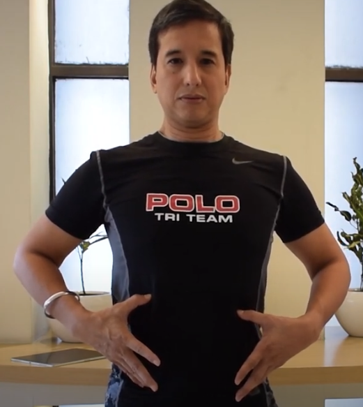

# 脳の働きを最適化しようぜ！#6「減圧呼吸法」

## 

「**脳の最適化**」シリーズの続きです！([#1](https://daigovideolab.jp/blog/20240706post-113),[#2](https://daigovideolab.jp/blog/20240708post-127),[#3](https://daigovideolab.jp/blog/20240710post-132),[#4](https://daigovideolab.jp/blog/20240719post-154),[#5](https://daigovideolab.jp/blog/20240721post-162))

脳の最適化ってのは、文字通り自分の脳が万全に働いている状態のこと。脳の神経系と身体の間のコミュニケーションがスムーズに行われ、「なんか元気！」や「なんか生き生きしてる！」みたいな感覚が強い状態を目指そうって話であります。 このようなテーマは今までもしてきましたが、「**体に良いことをたくさん****やってるのに成果が出ない！**」という方は、「**脳と身体の連携**」がうまく取れていないケースが多いんですよ。そこで、このシリーズでは、あなたの脳のポテンシャルを発揮させるために、いろんなフィックスを取り上げていきます。

でもって、前回からは「**脳と身体の連携を取り戻す呼吸法**」のチェックに入ってまして、今回もその続きを見ていきましょう。

## **最適化03．脳を癒す呼吸法（続き）**

というわけで、「脳と身体の連携を取り戻す呼吸法」の続きです。HPA軸を癒せる呼吸法はまだまだありますんで、ざっと読んで「これならできそうだ！」と思えそうなものから取り入れてみてくださいませ。

### **呼吸法3. 減圧呼吸法**

一日中キーボードに向かって猫背になったり、スマホに向かって首がまっすぐになったり、長時間の通勤で体が固まったり、仕事で疲れたせいでソファでだらだらしたりと、これらの行為はどれも悪い姿勢を助長し、呼吸パターンを悪化させる原因になったりします。

これが続くと、関節に不必要なストレスや負担がかかってしまい、内臓の機能が制限され、脳との連携にも不調が起きてしまうのが大きな問題なんですよね。なので、これらの問題を解決するために、ファンデーション・トレーニングのエリック・グッドマン博士がおすすめするのが、減圧呼吸法であります。

これは、グッドマン博士が、呼吸を使って背骨を除圧し、神経と腰の機能を回復させるために開発した呼吸法のひとつ。吸気によって胸郭を上に広げ、胸の横に広げるという減圧呼吸パターンを取り入れてまして、血行を促進し、呼吸をしやすくし、背筋を伸ばすようにデザインされているんですな。背骨を伸ばすのが一番の目的なので、「なんか体がスッキリしないなー」みたいな方もお試しいただくと良いでしょう。

減圧呼吸法は、以下のように行います。

１．足を少し開いてまっすぐ立つ。軽くアゴを引いて胸を上げ、背骨をまっすぐに保ちます。

２．両手を以下の画像のように腹に当てる。小指は腰骨の上に、親指は肋骨の下に置く。両ひじは外側に大きく開く。

３．上の姿勢のまま呼吸を行う。息を吸うときには、親指を軽く上にあげつつ肋骨を最大限まで上にあげ、それと同時に肋骨が広がる様子をイメージ。親指と小指の距離ができるだけ広がるようにする。

４．息を吐くときには、上のステップで拡げた親指と小指の距離を保つように、できるだけ肋骨を下げないように吐き出していく。

このような呼吸をくり返すのが減圧呼吸法の基本です。吸うときに3〜5カウント、吐くときに同じく3〜5カウントを心がけてください。実践する時間に決まりはありませんが、初心者は3〜5回ほどくり返せばOK。慣れたら1〜3分ぐらいまで伸ばしてください。試してみるとなんかスッキリした気分になるので、私もたまにやっております。

### **呼吸法４．スタティック・アプネア・テーブル**

スタティック・アプネア・テーブルは、極端な酸素不足、または過剰な二酸化炭素へ身体を慣らすためにデザインされた呼吸法です。「長めに息を止める→普通に息をする」って行為をくり返す呼吸法でして、これにより以下のようなメリットを得られると考えられております。

- **肺機能の向上**: 無呼吸トレーニングにより、肺の容量や柔軟性が向上。これにより、酸素の取り込み効率が高まり、全体的な呼吸能力が向上する。

- **二酸化炭素耐性の向上**: 高濃度の二酸化炭素に対する耐性を高めることで、呼吸中枢の感受性が低下し、息を長く止めることができるようになる。これは筋トレをやるときなどに意外と有効。

- **メンタル強化**: 無呼吸状態でのトレーニングは、メンタルの集中力とリラックス技術を向上させる可能性がある。呼吸をコントロールしながら、パニックやストレスを管理する能力も強化されると考えられている。

- **心肺機能の向上**: 無呼吸トレーニングは、心拍数を下げ、心臓と肺の効率的な働きを促進する。これにより、酸素の利用効率が向上し、全体的な心肺機能が強化される。

- **体内の酸素利用効率の向上**: 体内での酸素の利用効率が向上し、少ない酸素でも効率的にエネルギーを生産できるようになる。そのため、長時間の活動でもスタミナが切れにくくなる。

ってことで、いろんなメリットがある手法なので、気になる方はお試しください（体調に問題がある方は、必ず医師に相談する必要がありますが）。

スタティック・アプネア・テーブルは、以下のように行います。

table {  width: 100%;  border-collapse: collapse;  }  th, td {  border: 1px solid black;  padding: 8px;  text-align: center;  }  th {  background-color: #f2f2f2;  } 

<table border="1"><thead><tr><th colspan="2">CO2</th><th colspan="2">O2</th></tr></thead><tbody><tr><td>呼吸</td><td>2:30</td><td>呼吸</td><td>2:00</td></tr><tr><td>保持</td><td>1:30</td><td>保持</td><td>1:00</td></tr><tr><td>呼吸</td><td>2:15</td><td>呼吸</td><td>2:00</td></tr><tr><td>保持</td><td>1:30</td><td>保持</td><td>1:15</td></tr><tr><td>呼吸</td><td>2:00</td><td>呼吸</td><td>2:00</td></tr><tr><td>保持</td><td>1:30</td><td>保持</td><td>1:30</td></tr><tr><td>呼吸</td><td>1:45</td><td>呼吸</td><td>2:00</td></tr><tr><td>保持</td><td>1:30</td><td>保持</td><td>1:45</td></tr><tr><td>呼吸</td><td>1:30</td><td>呼吸</td><td>2:00</td></tr><tr><td>保持</td><td>1:30</td><td>保持</td><td>2:00</td></tr><tr><td>呼吸</td><td>1:30</td><td>呼吸</td><td>2:15</td></tr><tr><td>保持</td><td>1:30</td><td>保持</td><td>2:15</td></tr><tr><td>呼吸</td><td>1:15</td><td>呼吸</td><td>2:30</td></tr><tr><td>保持</td><td>1:30</td><td>保持</td><td>2:30</td></tr><tr><td>呼吸</td><td>1:00</td><td>呼吸</td><td>2:00</td></tr><tr><td>保持</td><td>1:30</td><td>保持</td><td>2:30</td></tr><tr><td colspan="2">合計: 25:15</td><td colspan="2">合計: 30:45</td></tr></tbody></table>

どちらの表も、「呼吸」は普通に息を吸ったり吐いたりする分数で、「保持」は呼吸を止める分数を表しています。また、左側の「CO2」は、普通に呼吸をする時間を短くすることで、高濃度の二酸化炭素に体を慣らすように設計されたもの。右側の「O2」は、息を止める時間を長くすることで、極端に低いレベルの酸素に身体を慣らすように設計されております。

まぁ実際のところ、どちらの方法が良いって話ではないので、自分がやりやすいほうを選んでいただければ幸いです。

### **呼吸法5. ブレスホールド・ウォーク**

ブレスホールド・ウォークは、フィットネスコーチとして有名なベン・グリーンフィールド先生が提唱する呼吸トレーニングです。そのやり方は簡単で、だいたい以下のようになります。

1. **ルートを選ぶ**：だいたい1.6〜3.2キロの散歩ルートを選ぶ。トレッドミルを使っても可。
2. **息止め散歩**：決めたルートを歩きながら、腹式呼吸で深く息を吸い込む。それが終わったら、歩きながら可能な限り息を止め続け、もう息を止められなくなったら、鼻から静かに息を吸う。
3. **くり返す**：上記の手順をくり返しつつ、約20〜30分間のウォーキングを続ける。

って感じで、「深く息を吸う→できるだけ息を止めて歩く」をくり返すのがブレスホールド・ウォークです。

グリーンフィールド先生のオリジナルなアイデアなので、この手法に関する明確なエビデンスはないんですけども、呼吸コントロールに関する過去のデータ([R](https://www.sciencedirect.com/topics/medicine-and-dentistry/ventilatory-response-to-exercise))に照らせば、呼吸の制御と酸素効率の向上により、長時間の運動や高強度の運動に対する耐性が強化される可能性はあるでしょう。

低酸素に強くなることで、全体的な持久力と運動パフォーマンスを向上させる効果は得られるんじゃないかなーって感じですね。ウォーキングをよくする人は、散歩がてらに取り入れてみてもいいんじゃないかと。

### **呼吸法6.****ヴィム・ホフの基本呼吸法**

ヴィム・ホフは、「[体を冷やして健康になりまくる『ヴィム・ホフ・メソッド』は本当に体に良いのか？](https://yuchrszk.blogspot.com/2024/04/blog-post_04.html)」で取り上げた、「冷水浸漬療法」の推奨者です。「アイスマン」との異名を持つ人物で、氷点下の中をパンツいっちょで走りまくることで知られる元気なオジサンです。

そんなホフさんが開発した呼吸法は、**息を止める能力を少しずつ育てるトレーニング**になります。

この呼吸法は高地でのハードなトレーニングを模倣したもので、低酸素な状態に体をならしていくのが大きな目的のひとつ。低酸素に慣れることで、サウナや寒冷温熱療法をやったときと同じように体が反応し、体内の「サバイバルモード」がオンになり、ポジティブなストレス反応が引き起こされるんですよ。

ってことで、 ヴィム・ホフの基本呼吸法は以下のようになります。

1. **呼吸サイクルを行う**: まずは連続して30回の呼吸を行います。その際は、吸うときは深く吸い、吐くときは完全に吐ききらず、少し空気を肺に残しましょう。これにより、吸う酸素の量が、吐く酸素の量より多くなります。
2. **息を止める**： 30回の呼吸が終わったら、思い切り息を吐き出し、肺の中から空気がなくなった状態で息を止めます。そのまま、限界まで息を止めてください。
3. **回復呼吸**：息を吸い込んでから、今度は15〜30秒間息を止めます。これで脳への血流を増やすことができます。
4. **サイクルを繰り返す**: 以上のプロセスを2〜3セット繰り返します。
5. **回復呼吸を行う**: 最後に深く息を吸い、体内の酸素量を通常のレベルまで回復させましょう。

このような作業を行うことで一時的に体内の酸素量を減らし、低酸素な状態に体を適応させていくわけですね。ちなみに、ヴィム・ホフさんは、肺から空気がなくなるまで息を吐きながら、スクワットや腕立て伏せなどの自重運動をすることも勧めてまして、これは私も試してみようと思った次第です。

まぁご多分に漏れず、この呼吸法にも明確なエビデンスはないんですが、上述のとおり、低酸素に身をさらすトレーニングは試す価値がありますんで、ヴィム・ホフ呼吸法にも意味があるんじゃないかと（血圧などに問題がある方は注意していただきたいですが）。いちおう現時点での可能性を列挙しておくと、こんな感じになります。

1. **有酸素能力の向上**：断続的な低酸素トレーニング（IHT）は、有酸素能力とVO₂ max（最大酸素摂取量）を向上させる可能性が示されている。この適応により、全体的な心肺機能が向上し、アスリートや持久力が必要な人々にはメリットが大。呼吸筋を刺激し、肺機能を改善し、酸素を体に送る効率を高める……かもしれない​([R](https://bmcsportsscimedrehabil.biomedcentral.com/articles/10.1186/s13102-023-00784-3))。
2. **神経可塑性と運動機能の改善**：断続的に低酸素の状態に身をさらすと、脳の神経が刺激を受け、運動ニューロン機能と呼吸筋力を向上させる…………かもしれない​([R](https://karger.com/cmr/article/30/4/362/838715/Would-Intermittent-Hypoxia-Add-Significant))。
3. **心血管および代謝の利点**：断続的な低酸素トレーニングは、赤血球の数を増加させ、新しい血管が生まれる量が上がり、心血管の健康を改善するっぽい([R](https://www.mdpi.com/2218-1989/13/2/181))。
4. **認知および心理的効果**：短時間だけ低酸素の状態に身をさらすと、脳に新しい神経が生まれやすくなり、抗うつ効果を持つ物質（BDNF）のレベルが増える……かもしれない([R](https://karger.com/cmr/article/30/4/362/838715/Would-Intermittent-Hypoxia-Add-Significant))。

残念ながら、いずれもエビデンスとしては超弱いものの、個人的に「断続的な低酸素」のメリットにはそこそこ期待しております。ではまたー。
