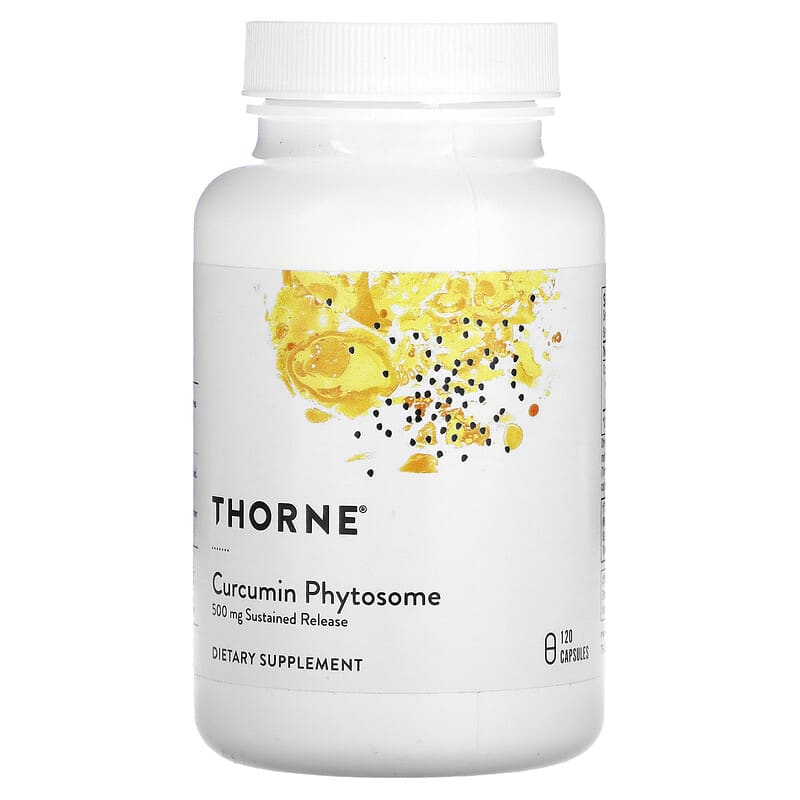
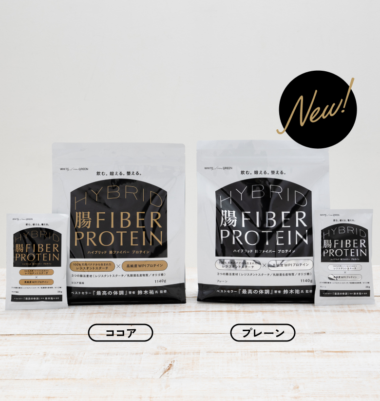
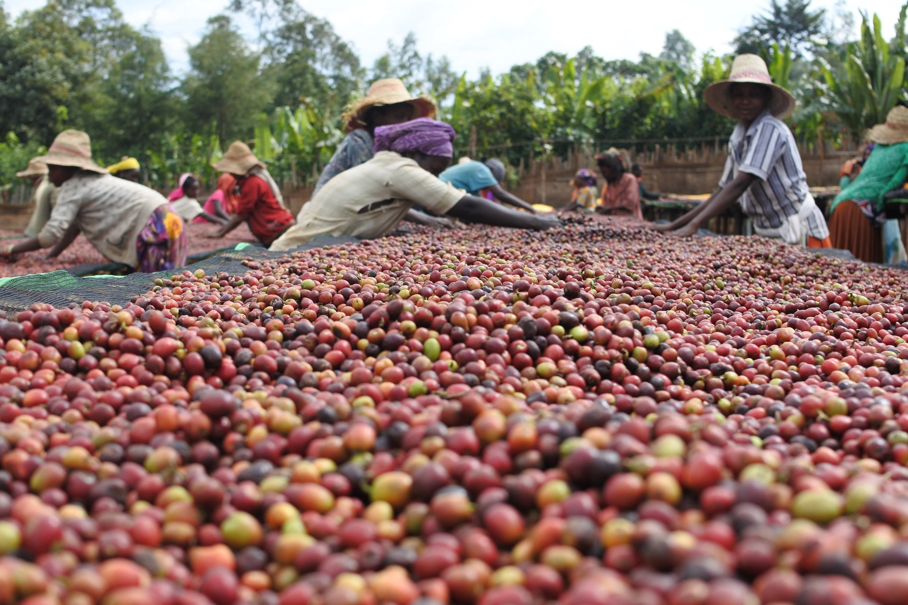
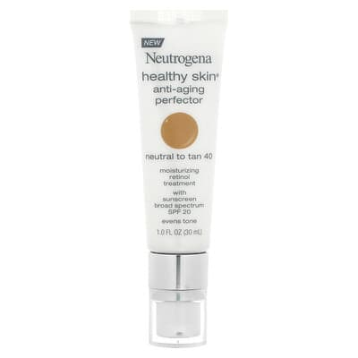
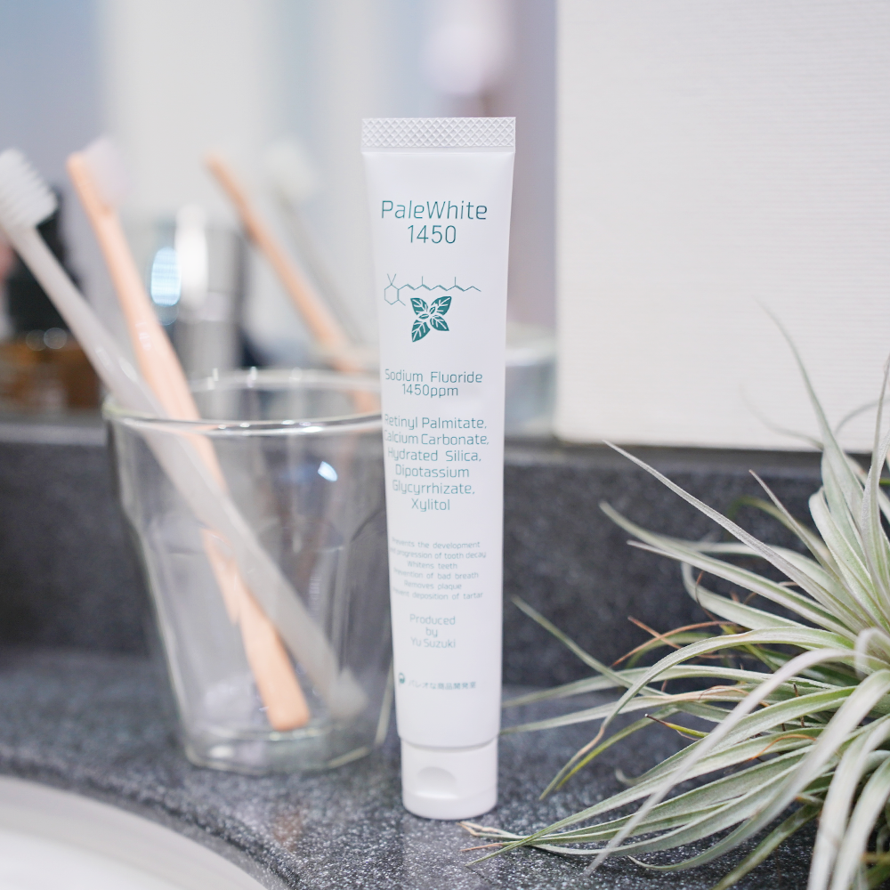
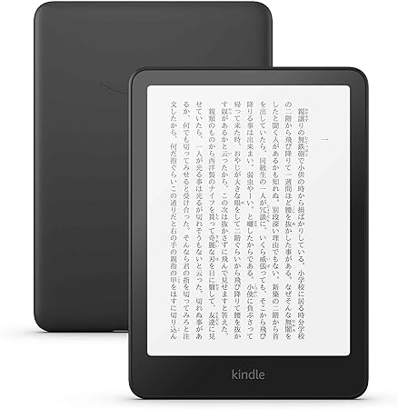
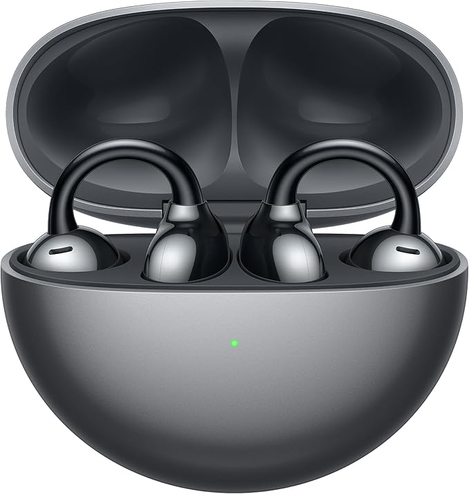
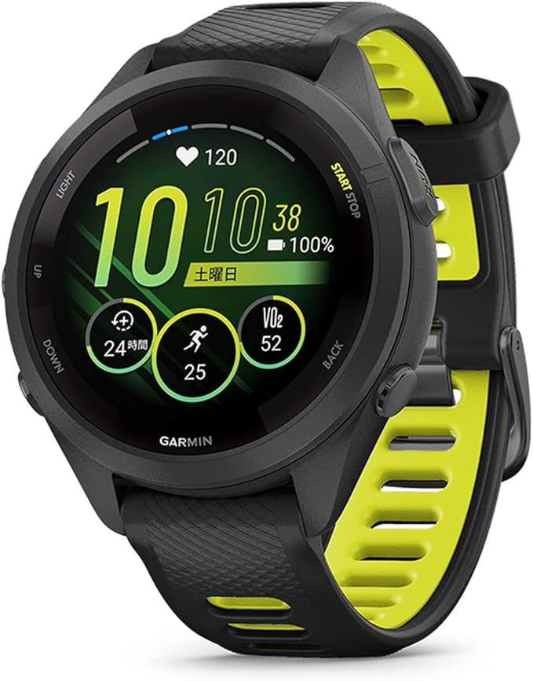

# 2024年版 いまスタメンで使っているサプリ＆食品＆ガジェット

ってことで今年も終わりでして、みなさまには今年もお世話になりました。

というわけで2024年最後のエントリは、毎度おなじみ「スタメンサプリ」や「美容アイテム」をまとめていこうと思います。

といっても、愛用のアイテムにそうそう変化があるわけでもないんで、例年のデータをベースに、今年から新たに定番になったガジェットを付け加えていきましょう。では、皆さまよいお年をー。

---

## **サプリ／食品編**

## **新たに取り入れたもの**

### **▼ソーンのクルクミン**

#### Thorne, Curcumin Phytosome, Sustained Release, 500 mg, 120 Capsules

高品質なクルクミンを含むサプリメントで、持続型リリース設計。関節の健康をサポート。

[商品を見る](https://jp.iherb.com/pr/thorne-curcumin-phytosome-sustained-release-500-mg-120-capsules/68449?rcode=IRO489)

私のようなアレルギー持ちには、やっぱりクルクミンみたいな抗酸化サプリは必要だよなーってことで、近ごろは再びサプリを利用し始めております。クルクミンは吸収率が低いから商品選びが難しいんですけど、迷ったあげく信頼のブランドであるソーン社をチョイス。フィトソーム化もしているので、おそらく吸収率はめっちゃ高いはず。

ちなみに、抗酸化サプリとしては「[NOW Foods, サフラン](https://jp.iherb.com/pr/now-foods-saffron-50-mg-60-veg-capsules/106635?rcode=IRO489)」も強力だと思われるので、導入してみるべきか迷ってたりします。

### **▼ハイブリッド腸ファイバープロテイン プレーン味**

#### バナナプロテイン – 美味しく手軽に健康をサポート

バナナの香りが楽しめるプロテインで、栄養補給をもっと楽しく。忙しい日々でも健康を簡単にサポート。

[商品を見る](https://frombanana.com/lp?u=lp_protein)

毎度おなじみ私が監修しているプロテインです。今年から「プレーン味」を発売してまして、個人的にはこちらをメインで使うようになりました。限りなくクセがない味わいに仕上げたので、「プレーンのプロテインは生臭くて……」みたいな方にもお使いいただけるはずであります。私の場合は、単体で飲むだけではなく、卵焼きやカレーに混ぜてみたりして、日々のタンパク質摂取量を底上げするために使ってますね。

### **▼mamechamameのコーヒー豆**

#### 森と猫 ハウスブレンド – 香り高い150gのブレンドコーヒー

自然と調和したコーヒーの味わいを楽しめるハウスブレンド。毎日のリラックスタイムに最適な一杯をどうぞ。

[商品を見る](https://www.mamechamame.com/product/mori-to-neko-house-blend-blend-150g-1-/31?cp=true&sa=true&sbp=false&q=false)

毎朝コーヒーを飲むのが習慣になってまして、良い豆はいつも探しております。まぁ私はそんなに味の違いがわかるような人間でもないんですけど、mamechamameさんの豆は明らかに美味しいので定期購入しております。在庫が安定しないのが困っちゃうところですが……。

## **いままでと変わらないもの**

**▼[オプティマム ニュートリション クレアチン カプセル](https://jp.iherb.com/pr/optimum-nutrition-micronized-creatine-capsules-3-g-200-capsules-1-25-g-per-capsule/68618?rcode=IRO489)**：第三者機関のチェックを受けた安全性が高いクレアチンです。他にも良いクレアチンは多いんだけど、在庫が安定しているのでこれを選んでおります。

▼[ナイトレスト](https://jp.iherb.com/pr/source-naturals-sleep-science-nightrest-with-melatonin-100-tablets/1358?rcode=IRO489)：毎度おなじみのメラトニンサプリ。メラトニンの他にも、気持ちを落ち着けるためのハーブがいろいろ入っていて、私の中ではこれが一番効いてる気がします（プラセボかもですが）。

▼[キョーリック 熟成ニンニクエキス](https://jp.iherb.com/pr/kyolic-aged-garlic-extract-cardiovascular-health-original-formula-100-300-capsules/3943?rcode=IRO489)：ガーリックの優秀さは疑いようがないもんで、日常の摂取量を増やすために使ってます。キョーリックは定番のニンニクブランドなんで、困ったらこれを買っておけば間違いないでしょう。

**▼[Paleo Laven-D(パレオ ラベンディ)](https://bit.ly/48uQDPz)**：必須栄養素であるビタミンDについては、相変わらずラベンディを使ってます。ビタミンDの吸収率をラベンダーオイルでアップさせた商品で、個人的にはリラクゼーションにも良いのではないかなーと。もっと安いものがお好みなら「[NOW Foods, 強力ビタミンD-3](https://jp.iherb.com/pr/now-foods-vitamin-d-3-high-potency-5-000-iu-120-softgels/10421?rcode=IRO489)」をどうぞ。

**▼**[ポリフェル](https://bit.ly/41FcuS3)：こちらも自分の商品で恐縮ですが、手軽にアントシアニンを摂取するために使ってます。

**▼[PALEO FOUS（パレオ フォウス）](https://cores-ec.site/paleo/products/detail/36?inflow=12)**：カフェインにテアニンとロディオラを組み合わせたアイテム。疲労感が強い時に使ってます。

**▼[葉桐 茶問屋の深むし緑茶](https://amzn.to/3H1WRIN)**：コーヒーと同時に緑茶も毎日飲んでますんで、相変わらず茶葉のまとめ買いをしております。

## **停止しているもの**

**▼[マグネシウム：Now Foods, クエン酸マグネシウム](https://jp.iherb.com/pr/now-foods-magnesium-citrate-120-veg-capsules/698?rcode=IRO489)**：マグネシウムについては、よく計算してみたら「普段の野菜で十分足りてるよな」って気になったのと、そもそもナイトレストにもマグネシウムが入っているので、まぁ追加のサプリは別に良いかって感じになりました。

▼**[なめる亜鉛](https://bit.ly/3GSfmBH)**：風邪用に備えている自家製サプリ。停止しているというか、今年は全く体調を崩さなかったので使うチャンスはありませんでした。50代になったら風邪を引く頻度も上がりそうなんで、またお世話になる回数も増えるんでしょうけど。

## **美容部門**

## **新たに取り入れたもの**

### **▼Neutrogena, Healthy Skin, Anti-Aging Perfector,**

#### Neutrogena Healthy Skin Anti-Aging Perfector SPF 20, Neutral to Tan 40

肌を滑らかに整えながら、SPF20で日焼けを防ぐアンチエイジング効果のあるスキンパーフェクター。自然な色合いで健康的な肌を演出します。

[商品を見る](https://jp.iherb.com/pr/neutrogena-healthy-skin-anti-aging-perfector-spf-20-neutral-to-tan-40-1-fl-oz-30-ml/127189?rcode=IRO489)

#### Neutrogena Healthy Skin Anti-Aging Perfector SPF 20, Ivory to Fair 10

SPF20の保護機能を備えたアンチエイジングパーフェクター。アイボリーからフェアな肌色の方に最適な自然な仕上がりを提供します。

[商品を見る](https://jp.iherb.com/pr/neutrogena-healthy-skin-anti-aging-perfector-spf-20-ivory-to-fair-10-1-fl-oz-30-ml/127186?rcode=IRO489)

レチノールと日焼け止めと保湿をまとめて行える便利アイテム。ちょっと前までは「[Olay, Regenerist（リジェネリスト）](https://jp.iherb.com/pr/olay-regenerist-retinol-24-peptide-hydrating-moisturizer-with-sunscreen-spf-30-1-7-fl-oz-50-ml-discontinued-item/112494)」を使ってたんだけど、販売終了になったので、いろいろ探した結果ニュートロジーナに落ち着きました。実際に使ってみたところ、私のような敏感肌の人間にも、良い感じに使うことができました。

ちなみに、こいつはコンシーラーみたいな機能もついてるので、購入の際は自分の肌色と相談して決めてください。おそらく多くの人は「[アイボリー トゥ フェア](https://jp.iherb.com/pr/neutrogena-healthy-skin-anti-aging-perfector-spf-20-ivory-to-fair-10-1-fl-oz-30-ml/127186?rcode=IRO489)」が適応だと思いますが。

### **▼PaleWhite1450**

#### PaleWhite Paleo – 健康志向のための高品質サプリメント

自然由来の成分を使用したPaleWhite Paleoで、健康的なライフスタイルをサポート。毎日の栄養補給に最適です。

[商品を見る](https://nufu.online/products/palewhite_paleo?srsltid=AfmBOopI_YBj1zqLCZqpIkpzwWJnu_sQo1jUK3xy7J_3EffamNTDO4_H)

今年は歯磨き粉も監修しまして、今まで使い慣れた商品からこちらに切り替えました。余分なものはできるだけ排除してフッ素量を限界まで増やしたのと、口内細菌に優しい成分を入れてみました。

## **いままでと変わらないもの**

▼[ニュートロジーナ ノルウェーフォーミュラ インテンスリペア](https://amzn.to/4fxmiCX) ：グリセリンベースの保湿剤。海外旅行の時だけはワセリンを使ってますが、普段はグリセリンを使うほうが私の肌には合ってるみたいなんでこちらを使ってます。

**▼[Sierra Bees, オーガニックリップバーム](https://jp.iherb.com/pr/sierra-bees-organic-lip-balms-combo-pack-8-pack-0-15-oz-4-25-g-each/63674?rcode=IRO489)**：リップクリームは別に何でも良いっちゃ良いのですが、シエラビーに慣れたのでこちらを使ってます。

**▼[パレウォッシュ](https://bit.ly/3RESD0T)**[https://bit.ly/3RESD0T](https://bit.ly/3RESD0T)：自家製の全身シャンプーです。敏感肌で頭皮が乾燥しやすい人には、割としっとりしながら使えるんじゃないかと。

## **停止しているもの**

▼[ロック マルチ ・コレクシオン](https://jp.iherb.com/pr/roc-multi-correxion-even-tone-lift-chest-neck-face-cream-spf-30-1-7-oz-48-g/109092?rcode=IRO489)：レチノールと日焼け止めと保湿をまとめて行える便利アイテム。商品としては定評があって、成分も素晴らしいと思うのですが、なんせ香りがあまり好きではないのであんま使わなくなりました。香りが気にならない人なら、こちらをファーストチョイスにしても良いと思う。

**▼[NONIO(ノニオ) プラス ホワイトニング](https://amzn.to/3soyalM)**：自分で歯磨き粉を作ってしまったので、ノニオさんの購入は停止になりました。

## **ガジェット部門**

## **新たに取り入れたもの**

### **▼Kindle Paperwhite 12世代**

#### Kindle Paperwhite 12世代

7インチディスプレイ、色調調節ライト、12週間持続バッテリー、広告なし

[商品を見る](https://amzn.to/4gOhzhn)

11世代の無印Kindleからの乗り換え。前バージョンに比べて明らかにページめくりのスピードが上がってまして、今までの中では最も買い換えのメリットを感じられました。11世代を持っている方が乗り換えるべきかと言われると困っちゃうけど、それより前のKindleを持っているなら、買い換えを考えても良いかもしれないっすね。

### **▼ファーウェイのイヤホン**

#### HUAWEI FreeClip

耳を塞がないイヤホン 軽量約5.6g(本体) 音漏れ防止 マイク付き 通話ノイズリダクション

[商品を見る](https://amzn.to/4fzyWBF)

イヤーカフ型のイヤホンです。わたくし、脳の処理機能を使わない単純作業をやる時は、いつも音楽を聞いてモチベーションを上げているんですが、耳を完全に覆ってしまうタイプだと宅急便のインターホンが聞こえなくなっちゃうのが難点。ということで、ファーウェイのフリークリップを買ってみたら、これが装着感は最高だし、音質もとても良いし、リモート会議でも使えるレベルのマイク性能も備えているしで、とても満足感が高い商品になってました。

### **▼ガーミンForerunner 265S**

#### Forerunner 265S Music

ロングバッテリー/超軽量/高精度GPS/色鮮やかなAMOLEDタッチディスプレイ/アプリと連携してデータ管理/睡眠スコア・Body Battery計測

[商品を見る](https://amzn.to/3ZXIzEu)

Apple Watchから乗り換えた、ランニング用のスマートウォッチです。私は別に長距離ランニングはしてないんですけど、ガーミンはApple Watchよりもバイタルの測定に優れているのと、バッテリーの持続時間がめっちゃ長い（約2週間）のが好きで、買い換えて良かった！と思った次第です。まぁスマートウォッチを仕事に活用したい！みたいな方にはApple Watch一択なんでしょうが、私みたいにバイタル測定だけが目的ならこっちを買うほうが幸せになれるでしょうね。

## **いままでと変わらないもの**

**▼[NEKONOBIX（ネコノビックス）](https://cores-ec.site/paleo/products/detail/50?inflow=12)**：猫背改善Tシャツ。

▼[ポラールH10](https://amzn.to/3ZTL7mG)：心拍変動トレーニング用。

▼[スピーク](https://www.speak.com/jp)：英会話のトレーニング用。昨年から続いて今も地道に続けてますが、なんとなく物足りなくなってきたので、どこかのタイミングでちゃんと対人の英会話をはじめたいかな……とか思ったり。

**▼[core（コア）](https://yuchrszk.blogspot.com/2021/04/core.html)**：瞑想トレーニングガジェット。これもずっと使ってるんだけど、ストレス値が一定してきたので、もはやこういった瞑想の補助輪ガジェットは不要なのかなーとも思っております。

**▼[トラベラーズノート](https://amzn.to/32q8j1Y)**：細かいタスク管理用に使っている手書きノート。思いついたことをぱっとメモするには、やはりいまだに紙の方が優位性がありますねぇ……。
