# 脳の働きを最適化しようぜ！#52「疲れゼロのワークスペースを目指す」

「**脳の最適化**」シリーズの続きです！([#1](https://daigovideolab.jp/blog/20240706post-113),[#2](https://daigovideolab.jp/blog/20240708post-127),[#3](https://daigovideolab.jp/blog/20240710post-132),[#4](https://daigovideolab.jp/blog/20240719post-154),[#5](https://daigovideolab.jp/blog/20240721post-162),[#6](https://daigovideolab.jp/blog/20240725post-168),[#7](https://daigovideolab.jp/blog/20240804post-193),[#8](https://daigovideolab.jp/blog/20240806post-196),[#9](https://daigovideolab.jp/blog/20240810post-202),[#10](https://daigovideolab.jp/blog/20240814post-211),[#11](https://daigovideolab.jp/blog/20240816post-214),[#12](https://daigovideolab.jp/blog/20240818post-218),[#13](https://daigovideolab.jp/blog/20240820post-225),[#14](https://daigovideolab.jp/blog/20240822post-228),[#15](https://daigovideolab.jp/blog/20240824post-231),[#16](https://daigovideolab.jp/blog/20240828post-248),[#17](https://daigovideolab.jp/blog/20240901post-258),[#18](https://daigovideolab.jp/blog/20240905post-266),[#19](https://daigovideolab.jp/blog/20240907post-268),[#20](https://daigovideolab.jp/blog/20240911post-278),[#21](https://daigovideolab.jp/blog/2203435),[#22](https://daigovideolab.jp/blog/2203473),[#23](https://daigovideolab.jp/blog/2203493),[#24](https://daigovideolab.jp/blog/2203529),[#25](https://daigovideolab.jp/blog/2204247),[#26](https://daigovideolab.jp/blog/2204568),[#27](https://daigovideolab.jp/blog/2204729),[#28](https://daigovideolab.jp/blog/2204935),[#29](https://daigovideolab.jp/blog/2205202),[#30](https://daigovideolab.jp/blog/2205243),[#31](https://daigovideolab.jp/blog/2205269),[#32](https://daigovideolab.jp/blog/2205804),[#33](https://daigovideolab.jp/blog/2205996),[#34](https://daigovideolab.jp/blog/2206353),[#35](https://daigovideolab.jp/blog/2206353),[#36](https://daigovideolab.jp/blog/2206418),[#37](https://daigovideolab.jp/blog/2206976),[#38](https://daigovideolab.jp/blog/2207615),[#39](https://daigovideolab.jp/blog/2207783),[#40](https://daigovideolab.jp/blog/2208364),[#41](https://daigovideolab.jp/blog/2208449),[#42](https://daigovideolab.jp/blog/2209189),[#43](https://daigovideolab.jp/blog/2209309),[#44](https://daigovideolab.jp/blog/2209385),[#45](https://daigovideolab.jp/blog/2210197),[#46](https://daigovideolab.jp/blog/2210338),[#47](https://daigovideolab.jp/blog/2210454),[#48](https://daigovideolab.jp/blog/2210740),[#49](https://daigovideolab.jp/blog/2211520),[#50](https://daigovideolab.jp/blog/2211770),[#51](https://daigovideolab.jp/blog/2211847))

---

脳の最適化ってのは、文字通り、自分の脳が万全に働いている状態のこと。脳の神経系と身体の間のコミュニケーションがスムーズに行われ、「なんか元気！」や「なんか生き生きしてる！」みたいな感覚が強い状態を目指そうって話であります。

このようなテーマは今までも取り上げてきましたが、「**体に良いことをたくさん****やってるのに成果が出ない！**」という方は、「**脳と身体の連携**」がうまく取れていないケースが多いんですよ。

そこで、このシリーズでは、あなたの脳のポテンシャルを発揮させるために、いろんなフィックスを取り上げていきます。前々回からは「**見た目が良い人は脳の機能も高いよねー**」って話をしてまして、身体を対称にするための簡単なエクササイズを見てみました。

今回もその続きで、見た目のよい肉体を作るために欠かせない「ワークスペースの過ごし方」の話をします。これまた「見た目の良さ」って観点からはあまり注目されない観点ですけど、「デスクワークでいかに体へダメージを与えずに過ごすか？」ってのも、健康や運動パフォーマンスにおいてめちゃくちゃ重要なのはもちろん、均整の取れた肉体を作るために欠かせないポイントなんですよ。

「仕事が終わると体がバキバキだ！」

「長時間のPC作業で目がシパシパする！」

「肩こり・腰痛が慢性化している！」

デスクワークのしすぎで、こんな悩みを抱えるようになった人は多いはず。かくいう私も、今のようなパレオ生活に入る前は、1日の執筆を終えるたびに、肩はガチガチ、腰はバキバキ、目はショボショボという状態だったりしたもんです。

が、ワークスペースを徹底的に最適化した結果、今では1日中作業してもほぼノーダメージだったりします（頭は疲労で死んでますが）。では、一体どんな環境を作れば肉体へのダメージを抑え、仕事の効率を上げられるのか？ 具体的に「**最強のワークスペースを構築するポイント**」を見ていきましょう。

## **1. スタンディングデスクは「動く」前提で使う**

スタンディングデスクについては、過去にブログで何度も取り上げたので、すでに使用中の方も多いでしょう。「座りっぱなしは体に悪い」ってのは今や常識で、これをスタンディングデスクで防ごうって発想ですな。

ただし、ここには大事なポイントもありまして、実際には座りっぱなしと同じくらい**立ちっぱなしも肉体へのダメージが大きい**ってところです。長時間立っていると、

- 血流が遅くなって脚がむくむ
- 腰に負担がかかり、逆に腰痛が悪化する
- 静脈瘤（いわゆる「こぶ静脈」）のリスクが上がっちゃう

みたいな問題が起きることがわかってるんですよ。嫌になっちゃいますねぇ。

では、どうすればいいのか？ってことですが、その答えは簡単で「**動く前提のデスク環境****を作ろう！**」って感じになります。

### **方法１．15～30分ごとに姿勢を変える**

その方法はいくつかあるものの、最もやりやすいのは、スタンディングデスクを使用しつつ「**15～30分ごとに姿勢を変える**」ってルールを守ることです。あらかじめタイマーをセットしておいて、

- 立つ
- 片足を台に乗せる
- 膝をつく（ハイニーリング）
- 片膝を曲げる（ランジ）
- 床に座る

こんな感じで姿勢のバリエーションを増やすことで、血流を促進し、体の負担を分散できるはずであります。ちなみに、私は30分ごとにストレッチをやってます。

ちなみに、スタンディングデスクを使えず、地面に座りながら作業を行わねばならないような人も、「いろんな座り方をしてみる」ってやり方で対応が可能です。↓のイラストのように、

- ウンコ座りで仕事する
- 正座で座ってみる
- 正座の状態でかかとを上げる
- あぐらをかく
- 足を伸ばす
- 片膝だけ曲げる

といったように複数の座り方を試すことで、同じ姿勢を保ち続けるよりも血糖値をコントロールしやすくなり、筋骨格のトラブルが減ることがわかってますんで([R](https://pubmed.ncbi.nlm.nih.gov/22374636/))。

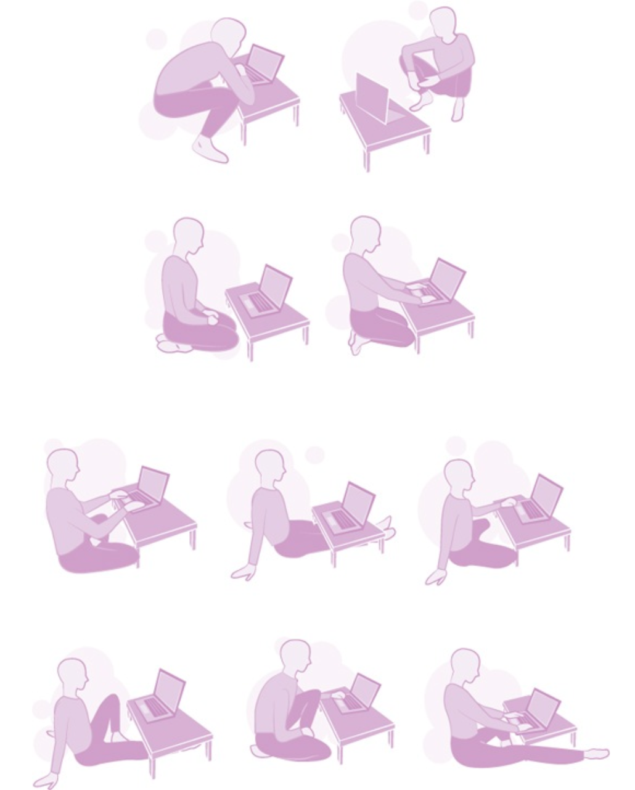

### **方法２. 足元に「バランスボード」や「スイングボード」を置く**

足元に「[バランスボード](https://amzn.to/4kmJS91)」や「[スイングボード](https://amzn.to/3Xn2kER)」を置いてみるのも、足に刺激を与える良い方法です。ただ立っているのではなく、微妙にバランスを取りながら立つことになるんで、足首やふくらはぎの筋肉が刺激され、血流が促進されるんですな。

ざっくり説明すると、

- **バランスボード**：不安定なボードの上で立つことで、微細な筋肉の動きを継続的に生み出せる

- **スイングボード**：常に揺れながら立てるので、筋肉を固めずに済む

みたいになります。どちらも「ずっと静止している」ことを避けられるナイスな介入で、脚のむくみや腰への負担を大幅に軽減できるんですな。

### **方法３. 「壁スクワット」で座らない時間を増やす**

「立っているのがしんどい！でも座るのもイヤだ！」ってときは、「壁スクワット（壁に背中をつけてスクワットの姿勢でキープする）もオススメです。20～30秒キープするだけで下半身の血流が改善するし、筋肉を適度に刺激しながら疲労を軽減できるし、ついでに腰を支える筋力も鍛えられるナイスな手法じゃないでしょうか。完全に座らずに休憩できるので、「動く前提のデスク環境」としては、かなり良い介入だと思うわけです。

## **2. 「馬の鞍」タイプの****椅子を使ってみる**

普通のオフィスチェアは、長時間座ると腰が丸まり、骨盤が後傾しがちなのが難点。この姿勢の崩れが腰痛や肩こりの原因になっちゃうんですな。

そこで私がかつて愛用していたのが、フィンランドの発明家ヴェリ＝ユッシ・ヤルカネンが開発した「[Salliサドルチェア](https://item.rakuten.co.jp/d-fit/27417/)」ってやつです。

[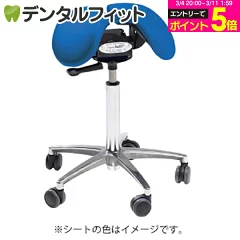](https://item.rakuten.co.jp/d-fit/27417/)

ご覧のとおり、いかにも人間工学をベースにした感じがムンムンの椅子でして、

- 骨盤が自然に立つので、猫背にならない
- 前後に分割された座面で、股間が圧迫されない
- 背もたれなしでも背筋が自然に伸びる

ってあたりを目的に創られております。人間ってのは、馬にまたがるような姿勢を取った時に、最も身体に負担がって考え方で作られてまして、ざっくり言えば「座るだけで姿勢が良くなる」椅子ってイメージですな。

この手の商品って、かつてはあんまり実証データが無かったんですけど、近年は割と良い感じに検証が進んでまして、たとえば2018年のメタ分析([R](https://pubmed.ncbi.nlm.nih.gov/30557311/))では、このようなイスを使うことで、腰痛や首・肩の痛み、腱鞘炎などが改善されるかもしれないと言うんですな。

まぁ2件しかデータを分析していないので、メタ分析としての精度はそんな高くもないんだけど、長時間座ると腰が痛くなる人は試してみる価値があるでしょう。私の場合は、スタンディングの仕事が普通になったので、今は使ってないですが。

ただし、サドルチェアは高価なので、バランスボールを使って「受動的に体を動かす」方法を取るのもありです。バランスボールなら体幹を使って自然と動き続けられるんで、「座る時間が長くなりそうなとき」に取り入れると、腰痛の予防につながって良いのではないかと。

## **3. デスクワーク中も「歩く」**

「仕事しながら歩く」のは、私もいまだに使っているソリューションのひとつ。「集中できなさそう…」 と思うかもしれませんが、これが意外といけるんですな。

私の場合はステッパーをデスクの下に設置して、最低でも1日1万歩は歩くのが日課になっております。昔は1日3万歩を目指してたこともありましたけど、さすがにやりすぎかと思い始めて止めました。

この方法を使うメリットってのは、

- 歩きながら会話するとアイデアが出やすい（ウォーキングミーティング効果）
- 脚力が衰えないので、運動不足の解消にも良いし、「筋骨格系障害」のリスクも下がる

みたいな感じです。歩きながらキーボードを打つのは慣れるまでは大変かもですが、「考える系の仕事」には最高じゃないでしょうか。

また、スタンディングデスクを使えない環境にいる場合は、↓のような「ペダル式エクササイズマシン」を机の下に置くのも良いでしょう。これなら、座りながらも足を軽く動かし続けることができ、ふくらはぎの筋肉が動いて血流もアップしますんで。

## **４. 「ながらストレッチ」で筋肉をほぐす**

長時間のデスクワークで体がガチガチになるのを防ぐために、私は仕事中に何度もストレッチをしております。リモート会議や執筆の合間など、1日のルーティンに以下の「13のストレッチ」を取り入れるだけで、肩こり・腰痛の軽減、姿勢の改善、エネルギーレベルの向上などが見込めますんで、これもぜひお試しください。では、早速チェックしてみましょう。

### **1. スタンディング・オーバーヘッドリーチ（肩＆背中のストレッチ）**

肩こり＆猫背の改善が目的。

1. 足を腰幅に開き、指を組んで手のひらを上に向ける
2. 手を頭上に伸ばし、肩甲骨を引き寄せながら上にグーッと押し上げる
3. 5回深呼吸しながらキープ（3セット）

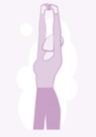

### **2. バタフライ・エルボー（肩甲骨＆胸のストレッチ）**

巻き肩の改善＆胸の開きを良くするために行う。

1. 椅子に座ったまま、指先を耳の後ろに添える（手を組まない）
2. 胸を張り、肘を後ろに引いて胸を開く
3. 息を吐きながら背中を丸め、肘を前で閉じる
4. 4回繰り返す

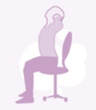

### **3. チェア・チェストオープナー（猫背＆肩こり改善）**

デスクワークで縮こまった胸を開くためのストレッチ。

1. 椅子の端に座り、背もたれの後ろをつかむ
2. 肩を引き下げながら胸を前に押し出す
3. 5回深呼吸（2セット）

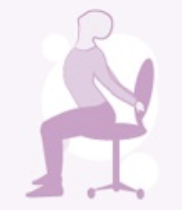

### **4. スタンディング・チェア・ラットストレッチ（背中のストレッチ）**

肩甲骨周りをほぐし、姿勢をリセットする。

1. 椅子の背もたれをつかみ、3歩後ろに下がる
2. 腰を落とし、腕を前に伸ばして背中をストレッチ
3. 5回深呼吸（2セット）

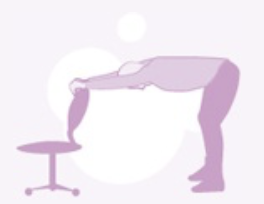

### **5. スタンディング・チェア・ラットツイスト（背中＆腰のストレッチ）**

肩甲骨＆腰の柔軟性UPのために行う。

1. チェア・ラットストレッチの体勢から、右手で左足をタッチ
2. 2回呼吸して戻る
3. 反対側も同様に行い、左右3回ずつ

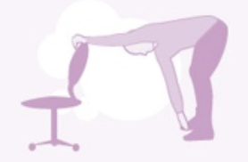

### **6. ミラー・チェアポーズ（全身の活性化）**

太もも＆体幹を鍛え、眠気を吹き飛ばすためのストレッチ。

1. 椅子に向かって立ち、足を揃える
2. 椅子の高さに合わせてスクワットし、手を頭上に伸ばす
3. 5回深呼吸（2セット）

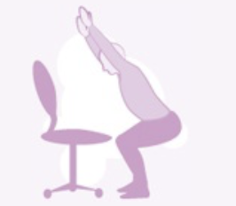

### **7. シーテッド・フィギュア4ヒップストレッチ（股関節の柔軟性UP）**

腰痛＆座りっぱなしによる股関節の硬さを解消する。

1. 右足首を左膝の上に乗せ、背筋を伸ばす
2. 手で右膝を軽く押しながら前屈し、股関節を伸ばす
3. 3回深呼吸してキープ（左右2回ずつ）

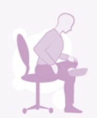

### **8. シーテッド・スパイナルツイスト（背骨＆腰のリセット）**

背骨の柔軟性UP＆デスクワークの疲労回復に効く。

1. 右手を椅子の背もたれ、左手を右膝に置く
2. 背筋を伸ばしながら右にねじる
3. 2回深呼吸して戻る（左右3回ずつ）

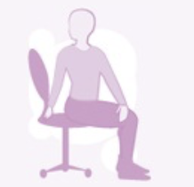

### **9. バウンド・ネックストレッチ（首こり解消）**

スマホ＆PCの使いすぎによる首のコリをほぐすためのストレッチ。

1. 右手で椅子の座面を持ち、左手で右手首を掴む
2. 首を左に倒してストレッチ
3. 2回深呼吸して戻る（左右3回ずつ）

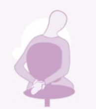

### **10. オルタネイティング・フィンガーズ・リストストレッチ（手首の疲れ解消）**

キーボード作業による手首の負担を軽減するために行う。

1. 右手を前に伸ばし、左手で指を引っ張る（手の甲＆手のひら側）
2. 2回深呼吸（左右3回ずつ）

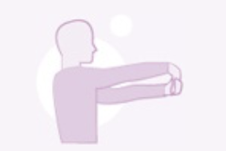

### **11. ハムストリング・ストレッチ（脚のむくみ解消）**

長時間座りっぱなしのむくみ対策として行う。

1. 椅子に右足のかかとを乗せ、つま先を上に向ける
2. 背筋を伸ばして前屈
3. 3回深呼吸（左右2回ずつ）

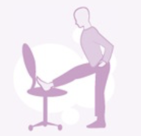

### **12. チェア・ピジョンポーズ（股関節＆腰のストレッチ）**

長時間のデスクワークによる腰痛を防ぐためのストレッチ。

1. 椅子に片足をのせ、もう一方の足を後ろへ伸ばす
2. 両手で椅子を掴みながら前屈
3. 3回深呼吸（左右2回ずつ）

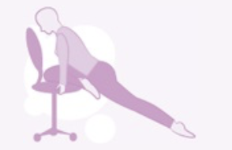

### **13. シングルレッグ・トゥプル（ふくらはぎ＆ハムストリングのストレッチ）**

デスクワークで硬くなった足の裏＆ふくらはぎをほぐすためのストレッチ。

1. 椅子に向かって立ち、片足をつま先でつかむ
2. 軽く引っ張りながらストレッチ
3. 2回深呼吸（左右2回ずつ）

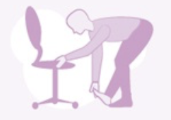

ってことで、これらのストレッチを仕事の合間にぜひお試しください。自分の筋肉のなかで特に固まりやすいところを重点的にやっとくのがオススメです。私は気を抜くと腰痛になりやすいので、チェアピジョンとかよくやってますね。ではまた！
