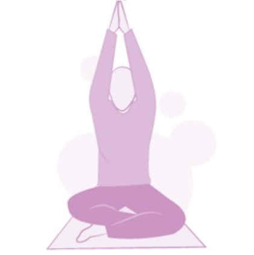
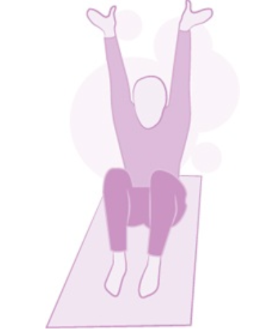
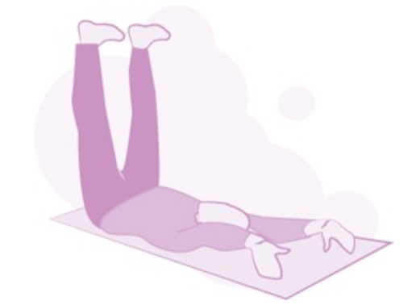

# 脳の働きを最適化しようぜ！#53「1日15分で姿勢とパフォーマンスを変える3つの習慣」

「**脳の最適化**」シリーズの続きです！([#1](https://daigovideolab.jp/blog/20240706post-113),[#2](https://daigovideolab.jp/blog/20240708post-127),[#3](https://daigovideolab.jp/blog/20240710post-132),[#4](https://daigovideolab.jp/blog/20240719post-154),[#5](https://daigovideolab.jp/blog/20240721post-162),[#6](https://daigovideolab.jp/blog/20240725post-168),[#7](https://daigovideolab.jp/blog/20240804post-193),[#8](https://daigovideolab.jp/blog/20240806post-196),[#9](https://daigovideolab.jp/blog/20240810post-202),[#10](https://daigovideolab.jp/blog/20240814post-211),[#11](https://daigovideolab.jp/blog/20240816post-214),[#12](https://daigovideolab.jp/blog/20240818post-218),[#13](https://daigovideolab.jp/blog/20240820post-225),[#14](https://daigovideolab.jp/blog/20240822post-228),[#15](https://daigovideolab.jp/blog/20240824post-231),[#16](https://daigovideolab.jp/blog/20240828post-248),[#17](https://daigovideolab.jp/blog/20240901post-258),[#18](https://daigovideolab.jp/blog/20240905post-266),[#19](https://daigovideolab.jp/blog/20240907post-268),[#20](https://daigovideolab.jp/blog/20240911post-278),[#21](https://daigovideolab.jp/blog/2203435),[#22](https://daigovideolab.jp/blog/2203473),[#23](https://daigovideolab.jp/blog/2203493),[#24](https://daigovideolab.jp/blog/2203529),[#25](https://daigovideolab.jp/blog/2204247),[#26](https://daigovideolab.jp/blog/2204568),[#27](https://daigovideolab.jp/blog/2204729),[#28](https://daigovideolab.jp/blog/2204935),[#29](https://daigovideolab.jp/blog/2205202),[#30](https://daigovideolab.jp/blog/2205243),[#31](https://daigovideolab.jp/blog/2205269),[#32](https://daigovideolab.jp/blog/2205804),[#33](https://daigovideolab.jp/blog/2205996),[#34](https://daigovideolab.jp/blog/2206353),[#35](https://daigovideolab.jp/blog/2206353),[#36](https://daigovideolab.jp/blog/2206418),[#37](https://daigovideolab.jp/blog/2206976),[#38](https://daigovideolab.jp/blog/2207615),[#39](https://daigovideolab.jp/blog/2207783),[#40](https://daigovideolab.jp/blog/2208364),[#41](https://daigovideolab.jp/blog/2208449),[#42](https://daigovideolab.jp/blog/2209189),[#43](https://daigovideolab.jp/blog/2209309),[#44](https://daigovideolab.jp/blog/2209385),[#45](https://daigovideolab.jp/blog/2210197),[#46](https://daigovideolab.jp/blog/2210338),[#47](https://daigovideolab.jp/blog/2210454),[#48](https://daigovideolab.jp/blog/2210740),[#49](https://daigovideolab.jp/blog/2211520),[#50](https://daigovideolab.jp/blog/2211770),[#51](https://daigovideolab.jp/blog/2211847),[#52](https://daigovideolab.jp/blog/2211940))

---

脳の最適化ってのは、文字通り、自分の脳が万全に働いている状態のこと。脳の神経系と身体の間のコミュニケーションがスムーズに行われ、「なんか元気！」や「なんか生き生きしてる！」みたいな感覚が強い状態を目指そうって話であります。

このようなテーマは今までも取り上げてきましたが、「**体に良いことをたくさん****やってるのに成果が出ない！**」という方は、「**脳と身体の連携**」がうまく取れていないケースが多いんですよ。

そこで、このシリーズでは、あなたの脳のポテンシャルを発揮させるために、いろんなフィックスを取り上げていきます。ここ数回は「**見た目が良い人は脳の機能も高いよねー**」って話をしてまして、身体を対称にするための簡単なエクササイズを見ております。

今回もその続きで、見た目のよい肉体を作るために「体の歪みを取る」「体の軸を作る」エクササイズを紹介します。日々のデスクワークやスマホの操作で、肩や腰がバキバキになっている人は多いはず。長時間座りっぱなしだったり、猫背のまま過ごしたりしていると、気づけば背中が丸まり、呼吸が浅くなり、さらには消化まで悪くなる……みたいな悪循環に陥っちゃうわけです。

この問題を放置すると、どんどん体が歪みはじめ、見た目の問題がいよいよ悪化していくんですよね。これはぜひどうにかしておきたいところです。

そこで今回は、「1日15分」で体の歪みを整え、姿勢とパフォーマンスを向上させるための「3つの習慣」を見ていきましょう。それがどのようなものかと言いますと、

1. モビリティ・スナック
2. ファンデーション・トレーニング
3. ELDOAエクササイズ

の３つであります。どれも簡単に実践できるものばかりなので、「体の歪みが気になる……」って方は、ぜひこちらを試してみてください。では、具体的に見てみましょうー。

## **対策1. モビリティ・スナック：朝の10分でカラダをリセット**

まず最初に紹介するのが、「**モビリティ・スナック**」って習慣です。ちょっとしたスキマ時間を使って体のコリや張りをほぐし、関節の可動域を広げようぜ！ってアプローチでして、私の場合は朝起きた後10〜15分を活用して、以下のようなモビリティワークを行ったりしてます。

### **上半身のこわばりをほぐす（3分）**

- **首・肩・背中のストレッチ＆リリース**
  - 首のストレッチ（各方向10秒ずつ）：頭を右に倒し、左の首筋を伸ばす → 逆も行う、顎を軽く引き、首の後ろを伸ばす
  - 肩の回旋（30秒）：両肩をぐるぐる回す（前後各15秒ずつ）
  - 背中の伸び（30秒）：両手を組んで前に押し出し、肩甲骨を広げる

- **フォームローラー or ラクロスボールで筋膜リリース（2分）**
  - 肩甲骨周りをフォームローラーでゴロゴロ（30秒）
  - ラクロスボールで首の付け根を圧迫＆ほぐす（30秒）
  - 胸の前をストレッチ（腕を壁に当て、体をひねる）

以上の動作をしておくと「首・肩・背中の可動域が広がり、呼吸も深くなる」のを感じるはずであります。

### **下半身の固まりをほどく（3分）**

- **股関節と腰回りをリセット**
  - お尻ストレッチ（片足ずつ20秒）：仰向けで片足をもう片方の膝の上に置き、膝を抱えてストレッチ
  - 腰ひねりストレッチ（左右20秒ずつ）：仰向けで膝を立て、両膝を横に倒す

- **ラクロスボールで足裏＆ハムストリングほぐし（2分）**
  - 足裏でボールをコロコロ（30秒ずつ）：足裏の筋膜をほぐして、全身のバランスを整える
  - ハムストリングの付け根（膝裏のポップリテウス）をほぐす（片足30秒ずつ）：座って膝裏にボールを挟み、グッと押し込む

この動作は、 「足腰がスムーズに動く感覚」を実感するために行ってくださいませ。

### **体幹を目覚めさせる（4分）**

- **呼吸を整えて、体の軸を安定させる**
  - 「ディコンプレッション・ブレス」（1分）：背筋を伸ばし、鼻から深く息を吸う。吐くときにお腹をグッと引き締める（腹圧を意識）。

- **簡単なファンデーション・トレーニング（3分）**
  - 「ザ・ハング」ポーズ（30秒 × 2セット）：膝を軽く曲げ、お尻を後ろに引く（ハムストリングと背中を刺激）。
  - 「ペルビック・ブレース」（30秒 × 2セット）：立ったまま、お腹とお尻を軽く締め、体幹を意識する。

ここまでやると、「体幹が安定して、スッと立ちやすくなる」 のが分かるはず。このように、毎朝10〜15分の「自己メンテナンス」を行うことで、体のバランスを整え、1週間で合計70〜105分のリカバリー時間を確保できるわけです。時間がなくてマッサージに行けない人でも、これなら続けられんじゃないでしょうか。

## **対策2. ファウンデーション・トレーニング：姿勢とパフォーマンスの土台を作る**

次に紹介するのは、このブロマガでも紹介した「[ファウンデーション・トレーニング](https://daigovideolab.jp/blog/2210599)」です。このメソッドは、背面の筋肉群（いわゆる"ポステリア・チェーン"）を強化し、体の軸を整えるのが特徴なので、見た目の良い肉体を作るのにも役立つんですよ。

なぜファンデーション・トレーニングが重要なのかと言いますと、長時間のデスクワークやスマホの使用で、私たちの体は重力によって圧迫され続けており、放置しておくと次のような問題が起こるからです。

- 呼吸が浅くなる（肋骨が圧迫されて肺が十分に膨らまない）
- 消化が悪くなる（内臓が圧迫され、栄養吸収が低下）
- 血流が滞る（血管が圧迫され、酸素や栄養が十分に届かない）
- 神経伝達が悪化（脊髄が圧迫され、脳と体の信号伝達が遅くなる）

こうした問題を防ぐために、ファウンデーション・トレーニングでは 「前面の過緊張を解放し、背面の筋肉を活性化する」 ことを目指すんですな。

そのために、ファウンデーション・トレーニングは、特に以下の筋肉をターゲットにします。

- 大臀筋（お尻） → 姿勢の安定性を向上
- 内転筋（内もも） → 骨盤を支える
- 深層の背筋群 → 脊柱の安定化
- 腹部・腸腰筋 → 体幹のコントロール

実際のトレーニングについては[以前のエントリ](https://daigovideolab.jp/blog/2210599)を参考にしていただければ幸いですが、以下のようなスケジューリングで各エクササイズをやってみるのがおすすめです。

### **月曜日・水曜日・金曜日**

各エクササイズを3回ずつ

- 立ったままでデコンプレッション
- ランジ・デコンプレッション
- ウッドペッカー
- ショルダートレーシング
- アンカード・ブリッジ
- アンカード・バックエクステンション
- ニーリング・デコンプレッション

### **火曜日・木曜日・土曜日**

各エクササイズを3回ずつ

- 仰向けデコンプレッション
- うつ伏せデコンプレッション
- ファウンダー
- ウッドペッカー
- ウッドペッカー・ローテーション
- インテグレーテッド・ヒンジ

このトレーニングを習慣にすると、「体が軽くなる」「背筋が伸びる」「呼吸が深くなる」といった変化が実感できますんで、こちらもお試しください。

## **対策3. ELDOAエクササイズ**

最後に紹介するのが、「ELDOA（エルドア）」エクササイズです。これは、脊柱の各椎間にスペースを作り、関節の圧迫を解放するために開発されたメソッドで、だいたい以下のようなメリットをえることができると考えられるんですな([R](https://ichgcp.net/clinical-trials-registry/NCT06049251))。

- **ELDOAがもたらすメリット**
  - 背骨の可動域が広がる
  - 神経伝達がスムーズになる
  - 腰痛や首の痛みが軽減する
  - 姿勢が改善される

特にデスクワークで「首・肩・腰が詰まった感じがする……」という人は、こちらのエクササイズをやってみるのも良いでしょう。

### **1. ELDOAの基本原則**

ELDOAは「筋膜の張力」と「正しい姿勢保持」を利用するエクササイズ で、以下の原則に基づいて行います。

- 各エクササイズは60秒キープ（最初は30秒からでもOK）
- 正しいポジションを維持することが重要（フォームを崩さない）
- 深い呼吸を意識しながら行う（呼吸が浅くならないように）
- 週に3〜5回、継続することで効果が出やすい

### **2. ELDOAの基本エクササイズ**

**① L5-S1（腰椎5番 - 仙骨1番）のELDOA**

腰痛の軽減、坐骨神経痛の改善、骨盤の安定のために行うエクササイズ。この動作を行うことで、腰椎の圧迫が軽減され、腰の可動性が向上する。

1. 床に座り、足を前に伸ばす（骨盤を立てる）
2. 背筋をまっすぐに伸ばし、腕を前に伸ばす（肩はリラックス）
3. つま先を外側に向け、かかとを前に押し出す
4. 両腕を上に伸ばし、できるだけ高く引っ張る
5. 60秒キープしながら深呼吸を繰り返す

**② T6-T7（胸椎6番 - 7番）のELDOA**

猫背の改善、呼吸の質向上、肩こり軽減させるために行うエクササイズ。この動作を行うことで、胸椎の可動域を広げ、呼吸のしやすさが改善される。デスクワークの多い人には特にオススメ。

1. あぐら or 膝立ちの姿勢で座る
2. 背筋を伸ばし、両手を前に伸ばす
3. 両手を天井に向かって引き上げ、指先を広げる
4. 腰を丸めず、胸を開きながらキープ
5. 60秒間、深い呼吸を意識する

**③ C4-C5（頸椎4番 - 5番）のELDOA**

首の可動域改善、肩こり・頭痛予防のために行うエクササイズ。 首の緊張をほぐし、姿勢をリセットできるため、スマホやPC作業が多い人に良い。

1. 壁に背をつけて座る or 立つ
2. あごを軽く引き、首をまっすぐに伸ばす
3. 手を下方向に伸ばしながら、頭頂を天井へ引っ張る
4. 肩をすくめず、首だけを伸ばす意識でキープ
5. 60秒間、ゆっくり深呼吸を繰り返す

ってことで、今回は身体機能をガッツリ高めるためのエクササイズを紹介しました。これら3つを組み合わせることで、全身のバランスが整い、「立ち姿が美しくなる」「呼吸が深くなる」「体の動きがスムーズになる」といった恩恵が得られるはずであります。1日たった15分の習慣で体が変わるはずなんで、ぜひお試しをー。
