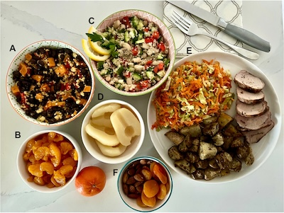

# 腸活の最前線！ロイテリ菌を復活させる「非工業化ダイエット」の全貌と科学的効果

最近あんま書いてないですが、私はそもそもパレオダイエット村の住人なわけです。なるたけ「原始的な食生活」をモデルにした食事をすれば、糖尿や痛風みたいな現代病にはかからないはずだし、見た目も若返るはずだってコンセプトでやってるわけですな。

---

まあパレオダイエットについてはほぼ書き尽くしたし、もうあんまり書くこともないよなーって感じだったんですけど、近ごろアルバータ大学が行った研究([R](https://pubmed.ncbi.nlm.nih.gov/39855197/))は「**腸内環境のフィックスに特化したパレオダイエット**」を調べてくれていて、視点がちょっとおもしろいし、私たちにもすぐに使える内容になってたので、ぜひ内容をおさえておきましょう。

## **腸内細菌こそが文明病の最大原因だ！**

まずは、研究チームの問題意識を確認しておきましょう。ここでチームが調べたのは、「**都市化が進むほど腸内細菌の多様性が失われる！**」って問題であります。近年の研究では、都市化や工業化が進むほど、人間の腸内細菌の多様性が失われるって傾向が明らかになってまして、たとえば未開の地域で生活する人々の腸内には、発酵や免疫調整に関わる菌が豊富で多様性も高いのに、一方で都会で暮らす現代人は、抗生物質の多用、清潔すぎる生活、食物繊維の少ない食生活によって、その菌たちを失ってしまっているって報告がめっちゃ多いんですよ。

さらに、マウスを使った実験でも、西洋型の食事を長期間与えた結果、**腸内細菌が「絶滅」**する現象も確認されていたりします。そして一度失われた菌は、たとえ高食物繊維食に切り替えても、戻ってこなかったというから恐ろしいもんです。これがヒトにも当てはまるかは謎なんだけど（個人的には人間は腸内を修復可能だと思ってますが）、なんとも怖いもんですな。

ということで、研究チームは30人の健康な現代人を集め、その人たちに**パプアニューギニアの「原始的な食生活」をモデルにした“リストア食（Restore Diet）”**を3週間ほど続けさせたらどうなるかをチェックし、それによって体重、血糖、コレステロール、炎症マーカーなどどう変わるのかを調べたんですよ。要するに、研究チームは「**人間の腸内細菌が文明病の最大原因だ！**」みたいに考えたわけっすね。

## **「リストア食」ってどんな食事？**

では、この実験で、研究チームがどんな食事をデザインしたのかって話をしましょう。「リストア食」のキーワードは、**「非工業化」「高食物繊維」「低加工」「低エネルギー密度」**の4つでして、腸内細菌を「元の自然な状態」に戻すことを目的にしております。ここで目指すものは、

1. 食物繊維が発酵しやすい腸内環境をつくる
2. 現代人に不足している菌やエサを補う
3. 加工食品・乳製品・小麦による“菌の偏り”をリセットする
4. 短期間で腸と代謝を再プログラムする

ってのがポイントでして、具体的な内容は以下のような感じです。

### **リストア食とはどのような食事法か？**

- **① 炭水化物源（全体の約60％エネルギー）**
  - 炭水化物は、低GIかつ高食物繊維の糖質源が使われております。メインは以下のとおり。
    - さつまいも＝抗炎症性・難消化性デンプンを含む
    - 豆類（インゲン豆、レンズ豆など）＝オリゴ糖が豊富（ラフィノース、スタキオース）でプレバイオティクス効果あり
    - 玄米または白米＝グルテンフリーのエネルギー源。精製度に応じて調整可能
    - エルサレムアーティチョーク（キクイモ）＝イヌリン含有で、ビフィズス菌を増やしてくれる代表的な食材
    - えんどう豆、ヒヨコ豆＝食物繊維と植物性タンパクが豊富

- **② 野菜・果菜類**
  - 野菜や果物は、「水溶性食物繊維」＋「菌のエサ」＋「発酵基質」として優秀なものだけが選ばれております。メインは以下のとおり。
    - キャベツ＝繊維豊富、ビタミンUも含む（胃腸に優しい）
    - キュウリ＝水分が多く、低エネルギーで腸の通過を助ける
    - タマネギ＝プレバイオティクス（フルクタン類）
    - ネギ、ニンニク＝上と同様にフルクタンが豊富で発酵性高

- **③ たんぱく質（全体の約15％エネルギー）**
  - たんぱく源は植物性が中心で、消化に時間がかかる動物性のたんぱく源は最小限にとどめておくのが基本。メインは以下のとおり。
    - 豆類＝ レジスタントプロテイン＋発酵して腸内細菌のエサになる
    - 魚介＝DHAやEPAを最低限確保

- **④ 脂質（全体の約25％エネルギー）**
  - 飽和脂肪は低めに、新鮮な植物油や未精製脂肪を使うのが基本。メインは以下のとおり。
    - ナッツ類＝良質脂肪酸、食物繊維、ビタミンEが豊富
    - 植物油（超新鮮なキャノーラかオリーブ）＝ 飽和脂肪酸比率が低い。明記はされていないが、アボカドオイルなども使われていると思われる。

- **⑤ 除外された食品**
  - 明確に排除されたのは、以下のような「工業化食」であります。
    - 乳製品（ミルク、ヨーグルト、チーズ）＝カゼインや乳糖が悪玉菌の餌になる場合があるので
    - 小麦製品（パン、パスタ）＝グルテンの影響＋高GI食品なので
    - 加工食品（精製油、お菓子、ソーセージ）＝高脂質・高糖質・低繊維の代表例なので

- **⑥ プレバイオティクス強化食材**
  - 今回の実験の肝は、「ロイテリ菌の活性をサポートするエサ」を意図的に食事に組み込んだ点。主に以下のような食物繊維が重視されており、いずれもロイテリ菌（L. reuteri PB-W1）の生存・定着を助けるために選ばれている。
    - ラフィノース、スタキオース＝豆類・アーティチョーク・玉ねぎなどに豊富
    - イヌリン＝腸内で短鎖脂肪酸（SCFA）を増加させる

- **⑦ マルチビタミンで栄養補完**
  - 研究では、ビタミンやミネラル不足を補うために総合マルチビタミンを毎日摂取。「[Jamieson Vitamins, プリネイタ](https://jp.iherb.com/pr/jamieson-vitamins-prenatal-100-complete-multivitamin-100-caplets/143089?rcode=IRO489)」を使用。

- **リストア食の栄養バランス**
  - この食事では、理論的に理想だと考えられる三大マクロが採用されております。基本的には、厚労省が推奨する「PFCバランス」に近いですが、違うのは「糖質の質」と「脂質の質」の２つ。つまり、単にカロリーをそろえるのではなく、あくまで「菌に優しい構成」になっているのが特徴です。
    - 糖質：60%
    - 脂質：25%
    - タンパク質：15%
    - 食物繊維：**1,000 kcalの食事をするごとに、22gの食物繊維を摂る**（ここがめっちゃ大事。これを目指せば、一般的な成人男性の基準の1.5倍の食物繊維を摂取することになる）

ということで、全体としてはパレオダイエットにかなり近い内容になってますが、とくに重要なのが「Limosilactobacillus reuteri（ロイテリ菌）」って菌を腸内に定着させるための“エサ”を重視しているところでしょう。リストア食でロイテリ菌を重視する理由は、大きく分けて4つありまして、

1. **工業化社会では“絶滅危惧種”だから**：ロイテリ菌は、パプアニューギニアのような非工業化地域では優勢な常在菌ですが、カナダやアメリカ、日本などの工業化社会で検出されるケースは少なめ。ある研究では、非工業化地域の人々の約20％が保有していたのに対し、**工業化された社会では1〜3％未満**しか検出されなかったなどと報告されてたりします。これは、抗生物質の乱用、加工食品中心の食生活、食物繊維の欠如が原因で、つまり、ロイテリ菌の減少＝腸内環境の劣化の象徴と考えられるわけっすね。
2. **ロイテリ菌は「免疫・炎症調整」能力が高い**：ロイテリ菌は、ただの善玉菌ではなく、医療レベルの働きがある菌として知られております。具体的には、抗炎症作用（サイトカインのバランス調整）があるし、 粘膜バリアを強化（腸の“壁”を守る）するし、病原菌の排除（細菌やウイルスの増殖抑制）に役立つし、オキシトシンの分泌を促進する（ストレス緩和や絆の形成にも影響）なんて機能もよく言われてたりするので、腸内だけでなく“心と身体全体”に作用する特殊な菌である可能性がある。
3. **リストア食は、ロイテリ菌の“エサ”を豊富に含む**：今回の研究では、ロイテリ菌のうちでもパプアニューギニア由来のPB-W1株に注目しております。これは、非工業化環境に適応した“原始株”であり、加工食品ではなく天然の植物性オリゴ糖（ラフィノースやスタキオース）を好んで食べ、伝統的な食事をしておけばちゃんと生存してくれることがわかってるんですよ。研究では、PB-W1株はドイツ株（DSM 20016T）よりも10倍以上も腸内で生存できたんだそうな。
4. **ロイテリ菌は“リストア食の指標菌”になり得る**：ロイテリ菌が定着するかどうかは、「この食事が工業化の影響をどれだけ元に戻したか？」を示す“バロメーター（指標）”にもなってくれちゃう。つまり、「ロイテリ菌がちゃんと生き残れる食事＝腸が自然な状態に近づいている証拠」と解釈できるわけです。

みたいになってます。とにかく、近年のパレオダイエット界で重視されてるのが、ロイテリ菌なわけです。

そこでリストア食では、ロイテリ菌が好む食材が多く取り上げられていて、豆類、玉ねぎ、エルサレムアーティチョークなどを増やすことで、ラフィノース、スタキオースなどの難消化性オリゴ糖を積極的に摂取してるわけです。また、この食事はただ「野菜が多い」だけでなく、動物性食品が極端に少ないため、炎症性菌（ビロフィラなど）の量が減り、これもロイテリ菌を増やすのに役立ったと考えられております。

結果、実験で使われた食事の内容は、こんな感じになってます。何を食べるかで悩んだら、とりあえずこいつを参考にメニューを組み立ててみるのも良さそうっすね。

## **「リストア食」で何が起きた？**

それでは、完全にこの食事だけを摂取したグループにどんな変化が起きたのか？ 実験の結果を見てみましょうー。

- **生理的な変化**
  - 体重が平均で1.4%減少。BMIも減少（つまり、カロリー量は維持しているのに、体重は減った）
  - 血糖（空腹時）−6.3%
  - LDLコレステロール −16.8%
  - 炎症マーカー（CRP） −14.0%

ということで、食事量を減らしたわけでも、運動量を増やしたわけでもないのに、ただ「何を食べるか」を変えただけでこれぐらいの変化が出たのはすごいですねぇ。

- **腸内での変化**
  - 善玉菌（ビフィズス菌、ファーカリバクテリウムなど）が増加
  - 炎症性菌（ビロフィラ、アリスティペスなど）が減少
  - 短鎖脂肪酸（SCFA）が増加し、分岐脂肪酸（BCFA）は減少した
  - 腸内pHが低下し、発酵環境が整った
  - 腸内細菌の「多様性（Shannon指数など）」はむしろ下がったという結果が出ました。

こちらも非常に良いですね。とくに注目すべきは「SCFAの増加」でして、これは腸内細菌が繊維を分解して作り出す物質で、腸のバリア機能を高めたり、脳の炎症を抑えたり、糖代謝を改善したりと、万能すぎるほどの効果があると言われてるんですな。

ちなみに、腸内細菌の「多様性」が下がったって結果にビビった人もいるかもですが、これは「悪玉菌が減ったことによる純粋な淘汰」だとお考えください。いわば、役立たずが去って、頼れるメンバーだけでチームが強くなった状態でして、むしろ腸内の機能的な一貫性と安定性が増したと思われるんですよ。

## **リストア食をどうやって日常に取り入れる？**

「リストア食がいいのはわかったけど、どうやって実践すればいいの？」って疑問が出てきたでしょうから、最後に実践のポイントをまとめときましょう。実験の食事を完璧に再現するのは難しいですが、以下のポイントを取り入れるだけでもかなり腸に優しい食生活になるはずであります。

### **今日からできる「ミニ・リストア食」5つのポイント**

1. 毎日豆を1食分入れる（納豆、豆スープ、豆カレーなど）
2. 主食にさつまいもや雑穀米を混ぜる
3. **タマネギ・キャベツ・ごぼう・大根を常備野菜に**
4. 加工食品と小麦製品は2日に1回までに制限する
5. 発酵しやすい腸に整えるため、水を多めに飲む（1.5〜2L）

これだけでも、数週間後には「なんかお腹軽いな」「肌の調子がいいな」「朝スッキリ起きられる」などの変化が現れるはずであります。さらに上を目指したい方は、上で見たリストア食の食材リストだけに絞って日々の食事を組み立ててみると良いでしょう。

もちろん、プロバイオティクス、サプリ、ヨーグルトなども良いんだけど、とにかく「**ロイテリ菌が喜びそうな食事とは？**」って視点から食事を組み立ててみるのもアリな気がしてきました。ロイテリ菌のサプリも使ってみるかなぁ……。
