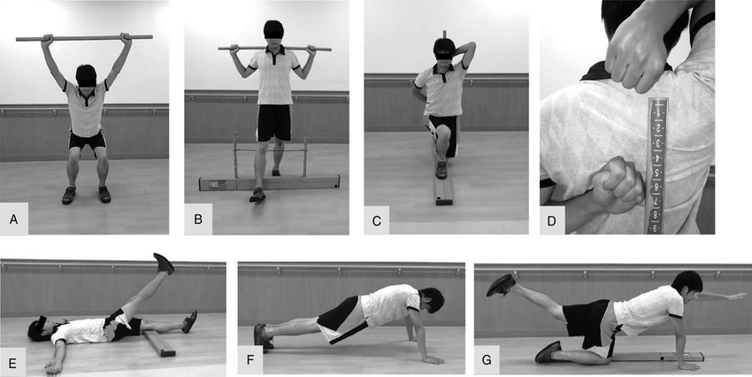
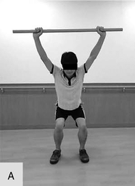
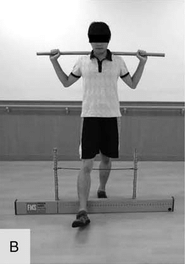
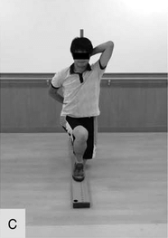
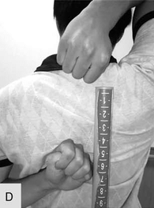
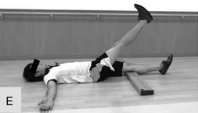
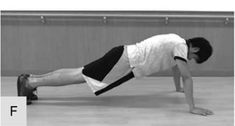
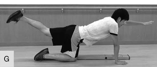

# 100歳まで元気でいるためには“原則”から考えよ！#7「FMS（ファンクショナル・ムーブメント・スクリーン）」

「**100歳まで元気でいるためには“原則”から考えよ**」の続きです！([#1](https://daigovideolab.jp/blog/2215819),[#2](https://daigovideolab.jp/blog/2215909),[#3](https://daigovideolab.jp/blog/2216203),[#4](https://daigovideolab.jp/blog/2216430),[#5](https://daigovideolab.jp/blog/2216654),[#6](https://daigovideolab.jp/blog/2216726))

このシリーズでは、アンチエイジング研究の第一人者であるピーター・アティア博士の研究をもとに、健康寿命を最大まで高める方法を「原則」から考えていっております。

---

前回は「安定性トレーニング」を見てみたんで、今回は「**その安定性を判断するにはどうすればいいの？**」ってのを見てみましょう。

安定性の大事さについては前回さんざんお伝えしたわけですが、そこで皆さん気になるのが「今の自分はどれぐらい安定性が良いのだろう？」ってところでしょう。これを調べる方法はいくつかあるんですが、現時点で最も検証が進んでいるのは「**FMS（ファンクショナル・ムーブメント・スクリーン）**」ってやつです。

これは「自分の体がマトモに動けてる？」を、7つの動作パターンでテストするようにデザインされた身体チェック法です。筋トレもランニングもヨガも、どんな運動でも「土台となる動作パターン」が崩れていたらパフォーマンスは伸びませんし、何よりケガのリスクが跳ね上がっちゃうので、自分の体が正しく動けているかどうかを確かめる作業は必須であります。特に現代人は、座りっぱなしの仕事とスマホ姿勢で、知らないうちに「おかしな動き」を当たり前のようにやってしまっているケースが多いので、その「おかしさ」を暴き出すためにFMSを使うんですな。

FMSは、もともとアスリートのために開発されたテストです。アスリートはケガの多い職業で、その発生率は人口1000人あたり15.4～25.9件ぐらい([R](https://pubmed.ncbi.nlm.nih.gov/12201606/))。このうち50～80％は「使いすぎ（オーバーユース）」が原因だとされてまして、参加前スクリーニングの活用によって予防できる可能性が高いんですよ([R](https://pubmed.ncbi.nlm.nih.gov/10449021/))。

ここらへんのテストの有効性はいくつも確認されてまして、

- FMSスコアが14点未満（21点満点中）だったプロフットボール選手ほど、重度のケガをしやすい傾向があった([R](https://pmc.ncbi.nlm.nih.gov/articles/PMC2953296/))。スコアが低かった選手は、スコアが高い選手に比べて約12倍（オッズ比11.67）も重度のケガを負うリスクが高かったということで、これはどえらい違いだと言えましょう。

- 女子のディビジョンIIアスリートを対象にした研究でも、FMSスコアが14点未満の選手は、そうでない選手よりも4倍も下半身をケガするリスクが高かった([R](https://pubmed.ncbi.nlm.nih.gov/21589661/))。

- ある研究では、7週間（週4～6回）のオフシーズン・コンディショニングプログラムを通じて、FMSスコアが低かったプロフットボール選手のパフォーマンスが向上した。中でも「ディープスクワット」のスコアが低い選手は、プログラムによる改善効果が最も乏しかったと報告されている([R](https://pubmed.ncbi.nlm.nih.gov/20030782/))。

- 433人の消防士を対象にした8週間の介入プログラムにより、FMSスコアの改善によって労働できない期間が60％以上も短縮された([R](https://occup-med.biomedcentral.com/articles/10.1186/1745-6673-2-3))。

- ハーフマラソンに取り組む一般ランナーを対象にした調査では、FMSスコアによる感度は低（0.08）であったものの、特異度は高く（0.95）、「スコアが14未満の被験者数が少なかったこと」が一因と考えられている([R](https://www.researchgate.net/publication/232216111_Predictive_Validity_of_the_Functional_Movement_ScreenTM_in_a_Population_of_Recreational_Runners_Training_for_a_Half_Marathon))。

- ある研究では、レクリエーション活動をする大学生を調べたところ、FMSスコアが17未満の者は、ケガのリスクが約5倍もあることが示された([R](https://pubmed.ncbi.nlm.nih.gov/24567852/))。

ということで、FMSのスコアが低い人ほどスポーツでも日常でも怪我をしやすく、ちゃんと体を動かすことができているかの指標として使えることがお分かりいただけるかと思います。このテストで良い点を取ることができれば、アンチエイジングできる可能性も高まると言うわけですね。

## **FMSでわかる7つの動きのクセ**

では、FMSがどのようなものなのかを見てみましょう。FMSでは、以下の7項目をそれぞれ3点満点で評価します。

<table border="1" style="color: rgb(0, 0, 0);"><tbody><tr><th>種目</th><th>テスト内容</th><th>鍛えられる系統</th></tr><tr><td>A ディープスクワット</td><td>しゃがみ込み動作の可動性と安定性</td><td>股関節・足関節・脊柱の連動</td></tr><tr><td>B ハードルステップ</td><td>片脚でまたぎ、戻る</td><td>片脚立位での安定性</td></tr><tr><td>C インラインランジ</td><td>ランジ姿勢でバーを保持</td><td>股関節と足部の同時安定性</td></tr><tr><td>D 肩モビリティ</td><td>拳を上下から背中で近づける</td><td>肩関節と胸椎の柔軟性</td></tr><tr><td>E アクティブSLR</td><td>片脚を持ち上げる</td><td>股関節分離と骨盤安定性</td></tr><tr><td>F トランクプッシュアップ</td><td>上半身をまっすぐ上げる</td><td>体幹の矢状面安定性</td></tr><tr><td>G ロータリースタビリティ</td><td>同側の手足を連動させる</td><td>コアの多平面安定性</td></tr></tbody></table>

評価のしかたは、こんな感じです。

- 正しくできる → 3点
- 代償動作（ズレ）あり → 2点
- まともに動けない → 1点
- 痛みあり → 0点

※左右どちらも実施して、悪い方のスコアを採用します。

合計21点満点で、この点数が低いほど、「身体の動きに何か問題がある」って証拠になるんですな。これだけシンプルなのに、テストとしての精度が高いってのがいいですね。

このテストの面白いところは、「筋力」や「柔軟性」じゃなく、「正しく動けるか」を重視する点にあります。「体幹トレーニングしてるのに腰が痛い」とか、「筋トレしても一部の関節だけやたら硬い」とか、そういう場合ってのは、ほとんどが「動き方そのものが歪んでる」からなんですよ。FMSを通じてそれをあぶり出せれば、「無駄に鍛えてる部位」や「知らずに酷使してる関節」に気づけるわけです。言ってみれば、これは動作の健康診断なわけですな。

繰り返しになりますが、筋トレをガンガンやるのもいいけど、それ以前に「体の動き」がまともじゃないと台なしになっちゃいますからね。その点で、FMSはあなたの動きの土台を点検し、「動ける体」から「壊れない体」へのシフトを後押ししてくれるナイスのツールになり得るわけです。運動習慣のある人ほど自分のフォームを過信しがちなので、だからこそ、「動けてるつもり」を脱するチェックツールとして、FMSを使い倒してみてはいかがでしょう。

が、ここで難しいのが、FMSは本来、トレーナーや専門家が評価者となって行うものなんですよ。1人で行うためにデザインされたものではないので、ちゃんと行うためには、専門の理学療法士さんかトレーナーを探すしかないんですな。

とは言え、それもなかなか面倒でしょうから、ここでは一人でも実施可能な“セルフFMS”のカスタマイズ法を見てみましょう。あくまでも代理の指標にしか過ぎませんが、それなりに自分の動作をチェックするための参考にはなりますんで。

## **セルフFMSをやってみよう！**

ということで、セルフFMSをやってみましょう。まずは、以下の3点をご用意ください。

1. **スマホ or タブレット（録画用）**：フォームチェック用のカメラ。三脚や、安定した位置に立てかけて「正面・横・斜め後ろ」など多角的に撮影できるとよし。
2. **鏡 or 大きめの姿見**：リアルタイムにフォームを修正するために便利。
3. **評価表（チェックリスト）**： あらかじめ7種目それぞれの「チェックポイント一覧」を紙にまとめておいたもの。以下を参照。

### **FMS スコア式チェックリスト（簡易版）**

<table border="1" style="color: rgb(0, 0, 0);"><tbody><tr><th>種目</th><th>評価ポイント（簡略版）</th><th>スコア（0〜3）</th><th>備考・コメント</th></tr><tr><td>① ディープスクワット</td><td>・両足フラットで深くしゃがめる ・上体が前傾しすぎない ・棒が前に倒れない</td><td>□ 0 □ 1 □ 2 □ 3</td><td> </td></tr><tr><td>② ハードルステップ</td><td>・バランスを崩さずに足を上げて戻せる ・骨盤が水平を保つ</td><td>□ 0 □ 1 □ 2 □ 3</td><td> </td></tr><tr><td>③ インラインランジ</td><td>・姿勢が崩れず上下動作ができる ・3点（頭・背・仙骨）接触維持</td><td>□ 0 □ 1 □ 2 □ 3</td><td> </td></tr><tr><td>④ 肩モビリティ</td><td>・左右の拳の距離がこぶし1個分以内 （左右差ありもOK）</td><td>□ 0 □ 1 □ 2 □ 3</td><td> </td></tr><tr><td>⑤ アクティブSLR</td><td>・膝を伸ばしたまま片脚を上げ、下肢は動かない ・骨盤がズレない</td><td>□ 0 □ 1 □ 2 □ 3</td><td> </td></tr><tr><td>⑥ トランクプッシュアップ</td><td>・身体全体が一枚岩のように持ち上がる ・腰が落ちない</td><td>□ 0 □ 1 □ 2 □ 3</td><td> </td></tr><tr><td>⑦ ロータリースタビリティ</td><td>・四つん這いで同側の手足をスムーズに動かせる ・骨盤が左右にズレない</td><td>□ 0 □ 1 □ 2 □ 3</td><td> </td></tr><tr><td colspan="2"><strong>合計スコア（最大21点）</strong></td><td colspan="2">＿＿＿＿ 点</td></tr></tbody></table>

- **スコアの意味**：
  - 3点：正確なフォームで動作を完了。代償動作なし。
  - 2点：代償動作ありながら動作を完了。
  - 1点：動作を完了できない。
  - 0点：動作中に痛みを感じた。

### **スコアの解釈の目安**

<table border="1" style="color: rgb(0, 0, 0);"><tbody><tr><th>スコア範囲</th><th>解釈例</th></tr><tr><td>17〜21点</td><td>基本的な動作能力に問題なし（定期的な見直しでOK）</td></tr><tr><td>14〜16点</td><td>一部に代償動作あり。ケガ予防のために改善推奨。</td></tr><tr><td>13点以下</td><td>ケガのリスクが高い。動作パターンの再学習推奨。</td></tr><tr><td>0点がある場合</td><td>痛みあり → 医師または専門家の診察を推奨</td></tr></tbody></table>

## **セルフFMSの7種目カスタマイズ法**

では、実際にセルフFMSをやってみましょうー。

### **① ディープスクワット**

- カメラを真横に置き、しゃがんだ時に「踵が浮いていないか」「膝とつま先の向きが一致しているか」を確認。
- 壁の前に立ち、「腕を上に伸ばしたまま壁に当たらないようにスクワット」をやると代償動作の有無がわかりやすい。

### **② ハードルステップ**

- イスと棒（傘やモップ）を使って、前脚を浮かせてまたぐ。
- カメラを正面に置き、骨盤のズレ・体の左右ブレを観察。

### **③ インラインランジ**

- 床にテープやタオルで“狭い直線”を作り、そこに足を前後に置いてランジ。
- 上半身が横に倒れたり、後脚の膝がブレるかどうかを録画で確認。

### **④ 肩モビリティ**

- 手の拳で「背中の上から・下から」回して、どこまで近づくかを測る。
- 拳の距離をメジャーで測っておくと経過比較も可能。

### **⑤ アクティブ・ストレートレッグレイズ（SLR）**

- 仰向けで寝て片脚を上げ、もう片方は地面にキープ。
- 腰が浮かないか・骨盤がズレないかをスマホでチェック。

### **⑥ トランク・スタビリティ・プッシュアップ**

- 手の位置は男性：肩の横、女性：顎の横（原本ルール）
- 胴体が一枚岩のように持ち上がるか？を真横から撮影で確認。

### **⑦ ロータリースタビリティ**

- 四つん這い姿勢から“同じ側の手足”を伸ばし、戻す。
- 骨盤や体幹がグラついていないかを横か斜め後ろから録画。

ってことで、こんな感じで自分の動きを動画でスロー再生しながらチェックしつつ、「膝が内に入っていないか？」「背中が丸まっていないか？」などのポイントに点数をつけてくださいませ。また、セルフFMSを実践する際は、

- 「いまどこに力が入ってる？」
- 「この動き、10年後にもできるだろうか？」
- 「ぐらついてる？何で支えようとしてる？」
- 「今月のスコア、先月より悪くなってない？」

みたいに自分に質問を投げかけながら行うとうまくいきやすいんで、ぜひお試しください。こんな感じで自分の身体へのセルフモニタリング能力を養うのも、このトレーニングの重要なポイントですんで。

これは毎週のようにやる必要はないので、3ヶ月か半年おきぐらいにチェックして、フォームとスコアの変化を記録していくと良いでしょう。でもって、問題のある種目があれば、前回にお伝えした該当部位のエクササイズへ中心的に取り組んでみてください。ではまた！
