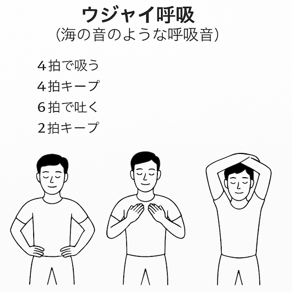
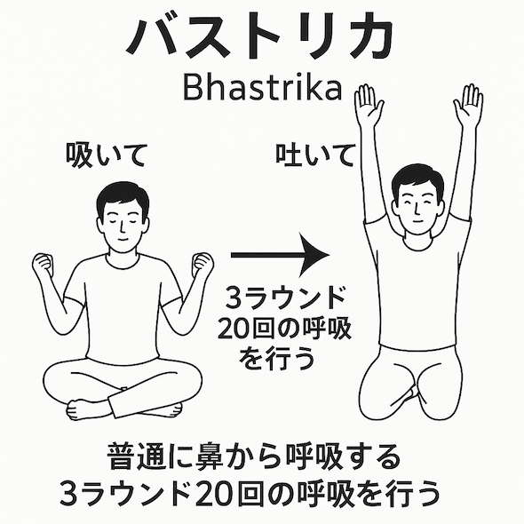
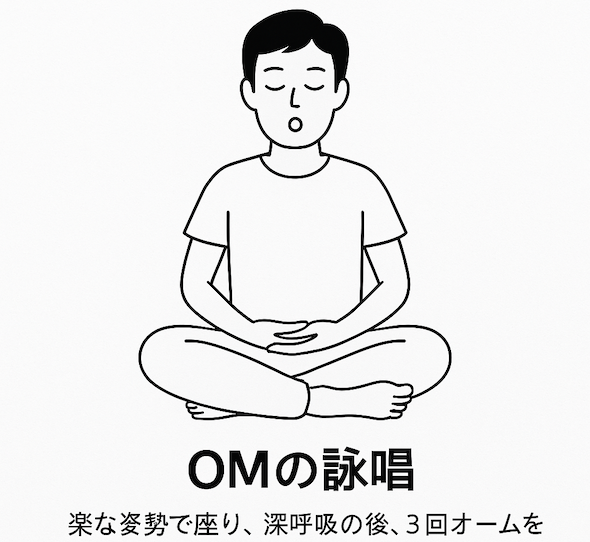
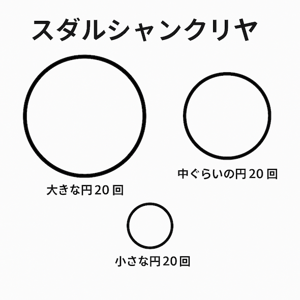

# 科学が認めた呼吸法「SKY」で睡眠が変わる！実践ステップと最新研究まとめ

眠れない夜ってのは、ほんとにつらいもんです。布団に入っても目が冴える！ 夜中に何度も起きる！ 朝になってもぜんぜんスッキリしない！ みたいな状況は、できれば避けたいところです。私の場合も、アレルギーがひどい時には眠れなくなっちゃうことがありまして、あれは焦りますなぁ。

で、どうすれば良質な眠りが手に入るのか？って問題については、これまでにもブロマガでいろんな研究を紹介してきたわけですが、近ごろ「**スダルシャンクリヤ呼吸法**」の睡眠改善効果について、わりと良い研究([R](https://journals.lww.com/joacs/fulltext/2024/12010/sudarshan_kriya_yoga_and_its_effects_on_sleep__a.8.aspx))が出てましたんで、今回はこいつを深掘りしてみましょう。

スダルシャンクリヤ（SKY）ってのは、ヨガで使われる呼吸法のことで、「4つのステージで構成されたリズミカルな呼吸トレーニング」が中心になります。1セッションだいたい30分ぐらいで毎日続けるのが基本でして、気分の鎮静に大きな効果があるとされてるんですな。

事実、これまでも「不安の軽減」「ストレス緩和」「ウェルビーイング向上」などの効果が[報告されてまして](https://yuchrszk.blogspot.com/2016/12/blog-post_9.html)、数ある呼吸法のなかでも研究が進んでいるもののひとつだと言えるでしょう。でもって、当然ながら、不安とストレスが減れば睡眠の質も上がるだろうってことで、最近では「睡眠の改善効果」も注目されてるんですよ。

そこで今回のレビューでは、スダルシャンクリヤと睡眠について調べた研究を9件ほどピックアップ。その内訳をまとめておくと、

- ランダム化比較試験（RCT）：2件
- 前向きコホート研究：3件
- 介入前後比較研究：2件
- 横断研究：2件

みたいになってまして、エビデンスのレベルとしては「**中の上**」ぐらい。レビュー自体は質の高い手法で行われていますが、含まれた研究は規模もバラバラ、測定法もまちまちなので、そこまで強い結論は出せない感じではありますが、十分に参考になるレベルの結論は出してくれてるんじゃないかと。

---

## **SKYで「睡眠が良くなった」研究の傾向**

では、すべてのデータをひっくるめて、SKYにどんな効果が見られたのか？ 分析の結果をざっくりまとめると、こんな感じになります。

- **SKYで寝つきが早くなった（REM潜時の短縮）**：ポリソムノグラフィー（脳波などで睡眠を測定する装置）を使った研究では、SKYをやった人はレム睡眠に入るまでの時間が早まり、深い眠り（徐波睡眠）の時間が長くなる傾向が見られた。
  この効果は、特に**30代〜50代に顕著**で、若年層（20代）ではあまり変化がなかったとのこと。ここらへんは、加齢とともに深い眠りが減っていく傾向を、SKYが補ってくれるかもって感じなんでしょうな。

- **SKYで自覚的な睡眠の質が上がった**：PSQIのような定番の睡眠評価テストでは、SKYを毎日実践した人たちほど、「よく眠れた」と答える傾向が多く見られたとのこと。
  ただし、2件のRCTでは「SKYで眠れるようになった」という傾向は見られたものの、ボンフェローニ補正（多重検定による厳密化）をかけると有意差が消えてしまったというオチもあり、統計的なインパクトとしてはちょっと弱め。

- **SKYは頻度がカギ**：横断研究2本を調べたところ、「週1〜2回」ぐらいのSKYでは睡眠への効果は確認されず。その一方では、「毎日実践する人は、睡眠の質が有意に高かった」という結果になっている。つまり、SKYの効果は「継続が前提」ということがわかる。

ということで、これらの分析をふまえて「SKYで睡眠は改善するの？」ってあたりを考えてみると、

- 今のところ、効果はありそう（特に中年層）
- ただし、毎日やらないと意味がない
- 統計的にガチなRCTはまだ少ない
- トレーニングをやめたら戻るケースもありそう

ぐらいの感じになりそうであります。現段階では「**睡眠に困ってる人なら十分に試す価値はあり**」ぐらいの立ち位置じゃないでしょうか。特に以下のような状況の人には、SKYのトレーニングをおすすめできそうな気がしております。

- 夜の緊張が取れず、なかなか寝つけない人
- サプリや薬には頼りたくない人
- マインドフルネスは苦手だけど、何か瞑想がわりに実践したい人
- 呼吸を意識する習慣を身につけたい人

いずれにせよ、呼吸法が神経を鎮めてくれるのは間違いないですし、瞑想トレーニングの代用にもなりますんで、ちょっと試してみちゃいかがでしょうか。私もアレルギーで困ってる時はやってみようかと。

## **スダルシャンクリヤの実践ガイド（自宅用）**

では、「呼吸法で睡眠を改善したい！」という方のために、スダルシャンクリヤを実践する方法を見てみましょう。本来は講習やワークショップ形式で学ぶものでして、3日〜4日間のトレーニングを受けるのが一般的なんですが、基本的なやり方はセルフでも実践できますんで、気になる方はぜひお試しあれ。

スダルシャンクリヤは4つのステップで構成されてまして、それぞれの段階での呼吸のリズムや動作が明確に決められております。1回あたり20〜30分ぐらいで、呼吸を通じて心身のバランスを整えるのが目標になります。

実践の際は、以下のステップのとおりにこなしてみてください。

## **ステップ1. プラーナヤマ**

最初のステップでは、「ウジャイ呼吸」（海の音のような呼吸音）と呼ばれる手法を使った、リズミカルな呼吸法を行います。

- **ウジャイ呼吸のリズム**：
  - 4拍で吸う
  - 4拍キープ（息を止める）
  - 6拍で吐く
  - 2拍キープ（吐き切った状態で止める）

上記の呼吸のリズムを、以下のイラストのように3つのポジションで、それぞれ10回ずつ繰り返します。

- **プラーナヤマのポジション**：
  - 手を腰に当てる（10回）
  - 両手を肩に当てる（10回）
  - 両手を頭上で交差させる（10回）

各ポジションのあいだには、手を膝の上に置いて休憩を挟みます。

## **ステップ2. バストリカ**

ステップ２では、鼻呼吸を使って、勢いよく息を吸って吐く「送風機のような呼吸法」を行います。詳しくは、以下の要領で、身体の動きと連動させてくださいませ。

- **吸うとき**：腕を上げて、手を開く
- **吐くとき**：腕を下ろして、手を握る

上記の呼吸を、1セット20回、3セット繰り返します。各セットの合間には、手を膝に置いてリラックスしてください。

## **ステップ3. OMの詠唱**

このステップでは、深呼吸をしながら、ゆっくり「OM（オーム）」って言葉を3回唱えます。なんだか謎のステップですが、特定の言葉をゆっくりと口に出すことで、

- 心の安定
- 神経系の落ち着き
- 瞑想状態への導入

といった効果を得られますんで、だまされたと思ってお試しください。ちなみに、唱える言葉はなんでもＯKで、「オーム」が嫌なら「リラックス」でもいいし、「スローダウン」とかでも構いません。自分の気持ちが落ち着くような言葉を好きにお選びください。

## **ステップ4. スダルシャンクリヤ本体**

このステップが、スダルシャンクリヤのメインパートになります。以下のような手順で、円を描くような呼吸リズムで行うのがポイントです。

1. 鼻呼吸をキープしながら、以下の呼吸シークエンスを3回繰り返す
2. 20回の大きな円呼吸
3. 40回の中くらいの円呼吸
4. 40回の小さな円呼吸
5. 最後に大きな円呼吸を5回行って、呼吸を整える

ここで言う呼吸の「円」ってのは、呼吸のスピードと深さを変えて、リズムに変化をつけることを意味しております。大きな円はゆっくり深い呼吸のことで、小さな円ほど速く浅い呼吸を意味しているとお考えください。

## **ステップ5. クールダウン（休息）**

スダルシャンクリヤをやった後は、5〜10分ほど静かに座るか横になる時間を取って、心身をリセットしましょう。

ってことで、スダルシャンクリヤの実践法は以上です。スダルシャンクリヤってのは、段階的な呼吸、身体の動き、音声、リズム変化を組み合わせて行う、全身の“再起動スイッチ”のような呼吸法としてデザインされているのが、おわかりいただけたんじゃないでしょうか。このような実践を毎日30分ほど続けることで、睡眠、メンタル、ストレス反応にポジティブな変化が現れますんで、まずは1週間くらいからトライしてみると良いかもしれません。

ちなみに、スダルシャンクリヤを行う時のポイントは、以下のようになります。これらの注意点を守りながらやってみてくださいませ。

- 呼吸はすべて鼻から行うこと（口呼吸はNG）

- 無理をせず、自分のペースを大事にすること

- 最初は短時間から始めてもOKなので、徐々に慣れていくこと

- 睡眠の質の向上を狙うなら、就寝前に行うのがベター

## スダルシャンクリヤの代替プランは？

スダルシャンクリヤはナイスな呼吸法ですが、1回あたり20〜30分ぐらいのセッションを毎日行う必要があるのが難点。これだけの時間を毎日こなすのは大変だという人もおりましょう。

そういう方には、SKYっぽい効果が得られそうな、もうちょいライトな呼吸法をトレーニングしてみるのもアリです。いくつか例を挙げておくと、こんな感じになります。

### **▶ ボックスブリージング**

自律神経を整える呼吸法として、米軍の特殊部隊やアスリート、医療現場などでも広く使われているテクニックです。やり方はシンプルながら、集中力の向上・ストレス軽減・睡眠の質向上などに幅広い効果があるとされてますんで、「メンタルのリセットボタン」として個人的にも愛用してますね。

名前のとおり、「吸う → 止める → 吐く → 止める」の4つのステップを、すべて同じ時間で行う呼吸法でして、1周を「四角形＝ボックス」としてイメージしながら呼吸を行うことでリズム感が生まれ、心拍や神経系を安定させやすくなるんですね。

- **基本のやり方（4秒ずつの場合）**
  - 鼻から吸う（4秒） お腹を膨らませるように、ゆっくりと深く吸う。
  - 息を止める（4秒） 肺に空気を満たしたまま、リラックスして止める。
  - 口または鼻から吐く（4秒） お腹をへこませるように、ゆっくりと吐き出す。
  - 吐いた状態で止める（4秒） 肺が空になった状態で、無理せず静止する。

以上を「1ボックス」として、 4～6回（3～5分）ほど繰り返すのが基本です。プレゼン・試験・大事な会議の前や、イライラ・不安を感じたときなどに行うのがお勧めですね。

また、慣れてきたら、「秒数」を変えたり、「視覚イメージ」を使ったりして応用することも可能であります。私の場合、4秒だと物足りないので、6秒ぐらいで行うことが多いっすね。

### **▶ ナディショーダナ（交互鼻呼吸）**

片方の鼻を押さえて交互に吸って吐くタイプの呼吸法です。交感神経と副交感神経のバランスを整える効果が高いとされてまして、心を落ち着けたり、集中力を高めたり、睡眠の質を高めたりする目的で広く使われております。

- 基本のやり方
  - 背筋を伸ばして楽な姿勢になり、目を閉じる。
  - 利き手の親指で右の鼻を押さえ、薬指と小指で左の鼻を押さえる。この状態で片方ずつ鼻を開閉していく。
  - 右の鼻を閉じて、左から吸う（4秒）
  - 両鼻を閉じてキープ（4秒）
  - 右の鼻から吐く（6秒）
  - 右の鼻から吸う（4秒）
  - 両鼻を閉じてキープ（4秒）
  - 左の鼻から吐く（6秒）

上記を1サイクルとして、以下のガイドラインを目安に実践してくださいませ。無理せず、自分のペースでOKですんで。

<table border="1" style="color: rgb(0, 0, 0);"><tbody><tr><th>レベル</th><th>回数</th><th>時間の目安</th></tr><tr><td>初級</td><td>3〜5回（サイクル）</td><td>約2〜5分</td></tr><tr><td>中級</td><td>10回</td><td>約7〜10分</td></tr><tr><td>上級</td><td>15回〜20回以上</td><td>約15分以上</td></tr></tbody></table>

ちなみに、この呼吸法で片鼻で呼吸しづらいときは、無理せず軽く鼻を押さえてみてください。どうしても通りが悪いときは、その日は片鼻呼吸をやめて、ゆったりした鼻呼吸（深呼吸）だけに切り替えてもOKです。

## **結論：呼吸は“眠りの入り口”をコントロールできる**

ということで、今回のポイントをざっくりまとめると、以下のようになります。

- SKYは30分ほどの呼吸法で、睡眠改善に効果があるっぽい
- 特に30代〜50代の「眠りが浅くなってきた層」におすすめ
- 効果を得るには「毎日続ける」ことが前提
- とりあえずナディショーダナやボックス呼吸から始めてもOK

睡眠の改善にはいろんな要素が関わりますが、その中でも「呼吸」ってのは自分でコントロールできる有効な要素なんで、「最近、眠りが浅いなぁ…」という方は、まずは呼吸を変えてみるのが手軽で確実な選択肢のひとつだろうと思うわけです。どうぞお試しを。
