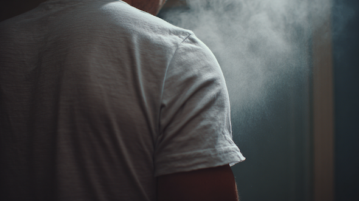

# あなたの「におい」は何タイプ？──最新科学で見る9つの体臭とその攻略法 #1「現代人を悩ませる9つの体臭」

今年の夏も暑いですが、となると気になるのが“体臭”の問題であります｡たとえば、汗だくで満員電車に揺られているときなど、隣の人から鼻をつくような刺激が漂ってきて、「自分は大丈夫だろうか…？」などと心の中がザワつく瞬間は、誰にでもあるんじゃないかと｡

となると、いよいよ体臭対策が気になってくるわけですけども、この問題について近ごろ東海大の先生方が日本人を対象に良い研究([R](https://researchmap.jp/read0068383/published_papers/50720866),[R](https://jglobal.jst.go.jp/detail?JGLOBAL_ID=202402237745411773))をいろいろしてくれてて大変参考になります｡体臭の研究ってのは世界的に行われているんですが、「何を臭いと判断するか？」ってのは各国の文化も強く関係しているので、欧米のデータだけを見てもわからないところが多いんですよね｡

ってことで今回は、日本における体臭の問題を解きほぐしていきましょう｡東海大の指摘によると、まず「現代社会は特に“臭いに敏感”になっている！」ってあたりが強調されております。近年の日本は、かつてよりも他人の体臭に敏感になっているってデータがいくつかあるんだそうな([R](https://www.mandom.co.jp/sweat-smell/))｡

その背景はいくつかありまして、だいたい以下のようになります｡

1. **空気がキレイになった → 匂いの“コントラスト効果”**：高度成長期の日本は大気汚染がバリバリだったのが、その後の建材の規制、換気設備の改善（コロナで一気に加速）により、空気が一気にキレイに変化。その結果、人の体臭が前より目立つようになった。
2. **マスク時代の反動と、嗅覚の再校正**：新型コロナの期間は長期間のマスクが普通だったため、匂いを嗅ぐチャンスがあまりなかった｡嗅覚は慣れやすい感覚なので、入力が少ない期間があると、閾値（臭気を感じ始める強さ）の設定が変わり、再び匂いが入ってきたときに敏感に反応しやすくなる。そのため、マスクを外した瞬間に相対的な刺激が強く感じられてしまう。
3. **気候変動＆都市の高温多湿**：高温・高湿は常在菌の繁殖と揮発性物質（臭いの正体）の放散を促進しやすい。その点で、最近の日本はヒートアイランド＋満員電車＋空調待ちの行列などの要因が重なって、「ぬるい密室」のようになっており、体臭が立ち上がりやすくなった。
4. **日本の生活様式（近距離・再密集）**：日本はもともと小さな空間を共有する文化がある（電車、エレベーター、会議室）。一般に、距離が50cm縮むだけで体臭の知覚確率は体感で一段上がるとされており、これもまた臭いへの反応を敏感にしている。
5. **日本の「迷惑をかけない」規範と“評価懸念”**：日本は同調圧力＋配慮規範が強い社会だと言われている。その点で、「におい」は他者の快不快に直結するので、「自分が迷惑になってるかも……」という評価懸念（人にどう見られるかの不安）をブーストさせやすい｡
6. **ストレス社会は“内側から出る匂い”が増えやすい**：睡眠不足・心理的負担・暑熱などのストレスが増えると、アンモニア（疲労臭）が上がりやすくなる。そのため、外から拭いても取りきれないタイプの匂いが目立ちやすくなり、「ケアしてるのに消えない…」という問題が起きやすくなる。
7. **素材と衣類の問題（見落としがち）**：化繊（ポリエステル等）は皮脂・ニオイ成分が付きやすく残りやすい。そのため、速乾Tシャツを何度も着回す→洗っても臭いが微妙に残る→時間差で再び香り立つ、のループに陥りがち。一方でウール（特にメリノ）は比較的においを溜めにくい傾向がある。
8. **情報環境が“気づき”を増幅**：近年は、SNSやメディアで「体臭」「スメハラ」「デオドラント新製品」などの情報が常に目に入るようになっている｡人間は見聞きしたテーマに注意が向く傾向があり（利用可能性ヒューリスティック）、結果として、同じ匂いでも前より気づきやすくなるという心理効果が働く。

ってことで、こういった現代に特有の要因がいくつも重なり合って、現代の日本に特有の「体臭が気になる！」って問題を強調してるんですな｡おそらく、この傾向は今後も続くので、どんどん「体臭が気になる時代」になっていくんでしょうなーって感じです｡

---

## **現代人を悩ませる「9つの体臭」**

では、現代人を悩ませる体臭問題をどうすればいいのか？ この問題を考えるためには、まず「**そもそも体臭にはどのような種類があるのか？**」ってのを考えるのが基本となります｡ひとくちに体臭といってもいろんな種類がありますんで、そこらへんを把握しておかないと、どんな対策を取ればよいのかがわからないですからねぇ｡

いまの研究では、体臭の種類を９つのパターンにわけることが多め｡まずはここをチェックしときましょう｡

### **体臭1. 汗臭（ワキ・全身）**

これは最もよく聞くやつですね｡汗の主役はエクリン汗腺の分泌で、成分はほぼ水＋電解質だったりします。なので出たては無臭なんだけど、皮膚表面の常在菌（とくにコリネ菌や表皮ブドウ球菌）が、汗に含まれる微量のアミノ酸や乳酸を分解して、こいつを短鎖脂肪酸（酢酸、プロピオン酸、イソ吉草酸など）に変換｡これが酸っぱい系の匂いを発するわけです。特に通気性が悪い化繊や密着ウェアを着て、長い時間放置していると匂いの“熟成”が促進されちゃうので注意したいところです。

- **特徴**
  - スポーツ後の「酸っぱい」ような匂い。運動直後〜数時間で発生しやすい｡
  - 温度・湿度の高い環境で悪化しやすい。
  - 衣類に染み込みやすく、時間が経つと洗濯でも落ちにくくなる。衣類を洗っても残るときは“汗＋皮脂”が混ざっているサインと言える。
  - 長時間のデスクワーク後に外出したときや、満員電車などの高湿度環境で起きやすい｡

### **体臭2. ミドル脂臭（頭頂部・後頭部）**

「汗に含まれる乳酸が菌に代謝されてできるジアセチル」が原因で起きる臭いです。これは日本独自の概念なので、西洋だと“そんな臭いかなぁ”みたいな扱いですが、バターや生乾きに似た酸化臭がありまして、特にオッサンがこの臭いをさせてると嫌われてしまいがちっすね｡

これは30〜50代男性に多いとされていて、この年代は発汗量と頭皮の皮脂・乳酸のバランスが変わるからだと言われております。なかでも後頭〜うなじに滞留しやすく、洗い残しやドライ不足、帽子・ヘルメットの蒸れでブーストされたりします。嫌ですなぁ｡

- 特徴
  - 「生乾きのタオル」「酸化した油」に似た匂い。
  - 特に後頭部〜うなじ周辺に集中。
  - 洗い残しやドライ不足で悪化。
  - 長時間の会議や会食後、ヘルメットや帽子を長時間着用時に発生しやすい｡
  - 「洗っても夕方に臭いが戻る」なら、髪の乾かし不足や枕カバーの再汚染を疑うべし。

### **体臭3. 加齢臭（胸・背中）**

年齢とともに皮脂の不飽和脂肪酸やスクワレンが酸化しやすくなり、（E）-2-ノネナールの比率が乱れることで起きる体臭。これも日本独自の概念なので、本来はそこまでの刺激臭でもないんですけど、いったん「臭い」ってレッテルを貼られちゃったら、覆すのは難しいですからねぇ｡我々としては、粛々と対策していくしかないわけです｡

で、こいつの香りの印象は“枯草・古本・ろうそく”って感じで、汗というよりは皮脂の酸化が本体なので、汗をかかない日でも発生するが厄介なところ。布地に吸着しやすいので、「洗濯してもTシャツに戻る」ってのもよく聞くお悩みっすね。

- **特徴**
  - 「古本」「枯れ草」「ろうそくのような油臭」
  - 胸・背中から多く発生。
  - 衣類に残りやすく、洗濯だけでは落ちにくい。
  - 暑い日に長袖で過ごした後や、夕方〜夜にかけて発生しやすい

### **体臭4. 疲労臭（全身）**

ストレス・睡眠不足・高温曝露で代謝が乱れ、血中アンモニアが相対的に上がり、これによって皮膚や汗から“ツン”とした刺激臭が発生する問題。原因は大きく２つで、

1. 筋代謝・肝（尿素回路）の処理キャパが超えちゃう
2. 腸内でのアンモニアが産生される（悪玉優位）

ってのがあります。このタイプは、日中の暑さによる体力消耗でも発散量が増えるという実験的データもありまして、夏ほど注意したい問題であります｡

- **特徴**
  - ツンとくるアンモニア臭｡
  - 足や背中からも発生しやすい。
  - 外的ケア（拭き取り）だけでは効果が薄い。
  - 長時間の立ち仕事や会議後、猛暑の外回り営業後などに発生しやすい｡

### **体臭5. 脇臭（ワキガ）**

こちらも定番の体臭で、スパイシー寄りの甘辛いトーンが特徴であります｡アポクリン汗腺の汗はタンパク質・脂質・糖が豊富なので、菌分解のせいで強い匂いが発生しやすいんですよ。

発汗だけでなく“緊張汗”でも増幅する傾向がありまして、これはアポクリンが情動刺激に反応しやすいからだと言われております。遺伝の寄与が比較的大きく、個体差がはっきり出やすいのも特徴ですね。

- **特徴**
  - ワキ限定で強い、甘く強い匂い、スパイシーな刺激臭｡
  - 発汗時や緊張時に強まる｡
  - プレゼンや試合など緊張状態、夏場の外出で発生しやすい｡
  - 思春期以降に発現しやすく、家族に同様の傾向があることも。
  - 耳垢が湿っている人は発症しやすい傾向がある。

### **体臭6. ダイエット臭（口・皮膚）**

糖質を極端に減らしたり、長期の断食などで体がケトーシスに入ると、アセトン（ケトン体の一種）が呼気・汗に変わり、りんごが発酵したような甘酸っぱい臭いが出るんですな。

これはダイエットを始めたばかりの時に発生しやすく、摂取エネルギーや水分摂取、活動量で変動。極端なロー・カーボや朝食抜き長時間活動でさらに濃度が上がったりします。

- **特徴**
  - りんごが発酵したような甘酸っぱさ｡
  - 口臭として先に気付きやすい｡
  - 食事パターン変更とタイミングが一致しやすい｡
  - 呼吸と皮膚から両方出る｡
  - 極端な糖質制限ダイエット中や、朝食抜きで長時間活動したときに発生しやすい｡

### **体臭7. モモ臭（皮膚）**

若年女性の皮膚から自然に放たれるラクトン類（γ-・δ-デカラクトンなど）が主役。桃・ココナッツに似た柔らかい香りで、皮膚温が上がる入浴後や軽く汗ばむシーンでふわっと立ちやすい特徴を持っております。これはホルモンや皮脂分泌の状態に影響され、年齢とともに穏やかになりがち。

- **特徴**
  - 桃やココナッツミルクのような甘い香り｡
  - 年齢とともに減少｡
  - 季節と体温で強弱が出やすい。
  - 若い女性の皮膚から自然放出されるラクトン類（甘い香気成分）で、ホルモンや皮脂成分の影響が大きい｡

### **体臭8. ニンニク臭／酒臭／たばこ臭（呼気・汗）**

食品などのせいで起きる、いわゆる“持ち込み臭”です。どんな原因が多いかと言いますと、

- **ニンニク**＝アリルメチルスルフィドなど硫黄系が血中→呼気・汗に長時間残留。
- **酒**＝アセトアルデヒドやエタノール残留が主で、肝代謝と体水分で持続が変わる。
- **たばこ**＝ニコチン・タール由来の“焦げた樹脂”が髪・衣類・皮膚に吸着し、いわゆるサードハンドスモーク臭として残留する。

こいつは原因が明確なだけに対策も簡単ですけど、衣類・髪からの再放散がしつこいって問題がありますね｡

- **特徴**
  - ニンニク：刺激的・硫黄系
  - 酒：アルコール発酵臭
  - たばこ：焦げた樹脂のような匂い
  - 飲み会翌日や、ラーメン＋餃子セットの後に発生しやすい｡

### **体臭9. 皮脂臭（全身・頭皮）**

皮脂の不飽和脂肪酸やスクワレンが酸化し“油っぽい”臭いが出るパターン（過酸化脂質やアルデヒド類が原因）。さらに、これが頭皮に発生すると、表皮ブドウ球菌がアミノ酸（ロイシンなど）を分解してイソ吉草酸を作り、チーズみたいな臭いが混ざることもあったりします。紫外線、脂性肌、通気の悪さ（帽子・合成繊維）などの要因が重なると、さらに臭いがブーストしがちっすね。

- **特徴**
  - 油が古くなった匂い｡
  - 頭皮・Tゾーン・背中で強く発生する｡
  - 帽子やヘルメット着用後、夏の午後などに発生しやすい｡
  - 日中〜夕方の頭皮・Tゾーン・背中で顕著／汗が少なくても出る。
  - 皮脂中の脂肪酸が酸化して生じる過酸化脂質。
  - 思春期や脂性肌で分泌量が増える。
  - 紫外線や加齢で酸化が加速。

## **体臭セルフ判定プロトコル**

ってことで、「自分はどの体臭に当てはまるんだろう？」ってのが気になったかと思いますんで、ここでは家でできる“科学寄りだけど現実的”な体臭セルフ判定プロトコルをまとめてみましょう。難しい道具は不要。2〜3日やれば、主犯タイプの当たりがつきます。

体臭セルフ判定プロトコル（2〜3日で完了）

- **ステップ0.準備（前日〜当日朝）**：まずは準備です｡香水・整髪料・香りつき柔軟剤・ボディソープは極力避けて（判定が濁るため）、無香料モードに切り替えましょう。洗濯は中性・無香料洗剤を使ってください。また、チェック日には強いニオイ食（ニンニク等）は避けましょう。

- **ステップ1.3つの時間帯でチェック**：ニオイは時間帯で質が変わるので（夕方は酸化系が出やすい）、朝起床直後／昼（活動中）／夕〜夜の3回でチェックを行いましょう。具体的な方法は以下のようになります｡
  - **チェック法1. 部位別“ジップロック”濃縮法**：清潔なコットンorティッシュで各部位を軽く拭き取り、小ジップ袋に入れて10分密閉→開封して嗅ぐ。チェックする部位は、①ワキ ②頭頂〜後頭部 ③胸・背中 ④足（甲〜指間）の4つ｡空気中に拡散する前に一時的に閉じ込めて濃縮すると、匂いの“キャラ”がつかみやすくなります。
  - **チェック法2. 24時間Tシャツテスト**：綿Tシャツを1日着て、寝る前にジップ袋で密閉保管。これを翌朝に嗅いでみましょう。「汗臭系」は酸っぱさ、「皮脂/酸化系」は油っぽさ、「加齢臭」は枯草/古本系の臭いがするはずであります。
  - **チェック法3. 発汗チャレンジ（汗臭・ミドル脂臭の切り分け）**：軽い有酸素10〜15分 or 階段上りをして発汗後1時間は汗を拭かずに放置｡その後で、ワキとTシャツをチェックして、酸っぱい臭いがすれば汗臭の疑いがあるし、後頭〜うなじに古いバターや生乾きの臭いがあればミドル脂臭の疑いがあると申せましょう｡
  - **チェック法4.暑熱・睡眠不足デーのチェック（疲労臭）**：寝不足・猛暑日に足・背中からツンとする刺激臭（アンモニア様）が出ないかもチェックしましょう｡もしこれで臭いがするなら疲労臭タイプなので、外側からの対策より体調・腸内改善が効くかもしれません。
  - **チェック法5.食・嗜好品テスト（外因性）**：別日にニンニク／飲酒／喫煙のいずれかを通常量で摂取しましょう。その翌朝〜昼に呼気→汗→衣類の順で残臭をチェックしてください。

- **ステップ2.記録法（シンプルでOK）**：チェックを行ったら、それぞれの臭気の強さを0〜4ポイントで記録しましょう。「0 無臭／1 近接で微臭／2 30cmで分かる臭い／3 会話距離で分かる臭い／4 入室で分かる臭い」ぐらいのイメージです｡2以上の匂いが週に2回あるなら、そのタイプが“主犯”候補だと言えます。

なかなかめんどうではありますが、こんな感じで調べないと「自分がどれだけ臭っているのか？」は意外とわからないものなので、お試しあれ｡いまいち臭いの判断がつきづらい人は、ざっくりした判断基準を載せておくので、こちらを参考にしてください｡

- **汗臭**：酸っぱい。ワキ／全身。発汗1〜2時間後に立ちやすい。Tシャツで顕著。
- **ミドル脂臭**：古いバター・生乾き。後頭〜うなじ。帽子・長会議・乾かし不足で増幅。
- **加齢臭**：枯草・古本・ろうそく。胸・背中中心。夕方以降に存在感UP。衣類に残りやすい。
- **疲労臭**：ツンと刺すアンモニア。足・背中。猛暑・寝不足・長時間作業で悪化。
- **脇臭（ワキガ）**：甘辛・スパイシー。ワキ限定で強い。緊張時に増幅。
- **ダイエット臭**：りんご発酵様の甘酸っぱさ。呼気→皮膚。糖質制限/断食初期に発生しやすい。
- **モモ臭**：桃・ココナッツの柔らかい甘さ。若年女性の皮膚、入浴後や汗ばみでふわっとする。
- **ニンニク/酒/たばこ臭**：摂取に連動。呼気・汗・髪・衣類。翌日まで居座ることも。
- **皮脂臭**：油っぽい／チーズ様ニュアンス。頭皮・Tゾーン・背中。日差し・合成繊維・通気不良で増える。

ということで、今回は“体臭”問題のお話でした｡もしこれで“主犯”が見えたら、個別の対策を行っていきましょう｡詳しい対策は、また次回にお伝えします｡

まあ東海大の先生いわく「体臭は生きている証拠」とのことなので、そこまで気に病む必要もないんですが、日常のちょっとした対策で“社会的な迷惑レベル”は大きく下げられますんで、実践しておくにこしたことはないでしょう。ではまた！
