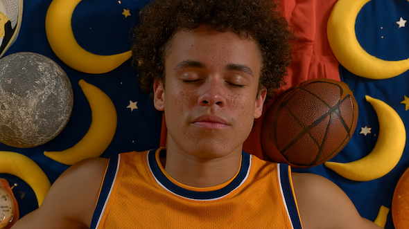

# 4つの最新メタ分析で判明！ 不眠タイプ別・最適エクササイズ大全

「眠れないなら運動しろ！」ってアドバイスは、睡眠の話になると必ず出てくるもの。実際、日中に体を動かしたほうが寝つきはよくなるし、睡眠の質も上がりやすいことは間違いなく、これはほぼ確立した話だと言えるでしょう。

ただし、この手の助言には大きな欠点がありまして、「**で、結局なにを、どのぐらいやればいいの？**」がぜんぜんわからんのですよね。果たして、ぐっすり眠るためには、筋トレがいいのか？ ランニングなのか? ヨガなのか？ さらには、毎日やるべきなのか？ 寝る前は避けるべきなのか? みたいな問題ですね。

さらに言えば、そもそも「よく眠れない」って問題は人によって原因が異なりまして、不眠の原因がストレスなのか、年齢なのか、生活習慣なのかによっても、最適な運動は変わるはずであります。ちょっと考えても、仕事のストレスで頭が冴えて眠れない人と、年齢とともに足腰が弱って眠りが浅くなった人では、対策が違ってきそうですもんね。

そんななか、最近出た4本のネットワーク・メタ分析([R](https://link.springer.com/article/10.1007/s41105-025-00596-7),[R](https://link.springer.com/article/10.1186/s12877-025-06607-z),[R](https://www.sciencedirect.com/science/article/pii/S0965229925001748?via%3Dihub),[R](https://doi.org/10.3389/fpsyg.2025.1704980))が、この問題にかなり具体的な答えを出してくれてまして、こいつがめっちゃ参考になるのでぜひ内容を押さえておきましょう。こいつを読めば、たんに「運動は睡眠にいい！」という結論から一歩進んで、「どんな人に、どんな運動がハマりやすいか？」まで理解できるので、自分の睡眠トラブルに合った運動法を選ぶための、かなり便利なガイドラインとして使えるでしょう。

---

## **ポイント1．睡眠障害がある人には「短時間ヨガ」**

さて、まずは30件のランダム化比較試験、合計2576人分のデータをまとめた結果を見てみましょう。こちらの結論を端的にまとめると、

- **睡眠障害において、もっとも成績がよかったのはヨガだった！**

ここでいう睡眠障害ってのは、単に「昨日はたまたま寝つきが悪かった！」みたいな一時的な不調ではなく、寝つくまでに長くかかったり、夜中に何度も目が覚めたり、朝早く目が覚めて眠れなくなったりと、睡眠の問題がある程度つづいて、日中の集中力や気分にも悪影響が出ている状態を指します。なので、もしあなたがこうした問題に週3回以上、3カ月以上悩まされているようだったら、睡眠障害を疑ってみてもいいかもしれません。

ありがたいことに、この研究では、睡眠障害にヨガを使うための条件も示されてまして、

- 週2回
- 1回30分以内
- 8〜10週間ほど継続
- 強度はやや高め

という感じになります。短時間のパワー系ヨガを週2ぐらいでやるのがいいみたいっすね。

ここで重要なのは、「ヨガを長くやればやるほどいい」ってわけではないところです。いくら睡眠を改善したいからといって、夜に1時間以上のハードなトレーニングを入れると、かえって交感神経が高ぶったり、体温や心拍が上がりすぎたりして、寝つきが悪くなる可能性もありますからねぇ。その点、ヨガは呼吸、姿勢、注意のコントロールをまとめて使うので、頭の中の「まだ警戒中です！」というモードを落ち着かせるのに向いているんでしょうな。

そもそも不眠のときってのは、体が疲れていないというより、脳が寝る許可を出していないことが多いですからね。考えごとが止まらない。体は横になっているのに、神経だけが昼間のまま……みたいな感じですな。ヨガは、こういうタイプの不眠の改善に役立ちやすいんでしょう。

なので、寝る直前にがんばったヨガをやる必要はなくて、夕方〜夜の早めの時間に20〜30分ぐらい入れるのが現実的でしょう。呼吸法だけで無理に落ち着こうとすると、かえって「寝なきゃ！」のプレッシャーが強くなる人もいるので、軽い流れるような動きを中心にしたほうが安全です。

念のため、不眠に効かせるための「30分ヨガルーチン」をお伝えしておくと、以下のようになります。

**1. 軽い準備運動（3分）**：首、肩、背中、股関節をゆっくり回して、身体のこわばりをほぐす。

**2. キャット＆カウ（3分）**：四つんばいになり、背中を丸める→反らすを呼吸に合わせて繰り返す。

**3. ダウンドッグ→前屈→半分起きる動き（5分）**：きつくない範囲で、ゆっくり全身を動かす。

**4. 戦士のポーズI・II（各3分）**：左右それぞれ行い、脚と体幹にほどよく刺激を入れる。

**5. チャイルドポーズ＋仰向けのねじり（8分）**：動きを落ち着かせ、肩・腰・背中の緊張を抜く。

**6. 屍のポーズ（5分）**：仰向けで脱力し、呼吸を無理に操作せず、身体が床に沈む感覚を味わう。

## **ポイント2．高齢者には「歩く＋筋トレ」がいちばん！**

次に、60歳以上の高齢者を対象にした分析では、62件・5005人分のデータを比較して、こんな結論を出しております。

- **高齢者には、有酸素運動と筋トレの組み合わせが最もよく眠れる！**

ということで、60歳以上は「有酸素運動＋筋トレ」をお試しください。有酸素運動ってのは、ウォーキング、サイクリング、水中運動など。筋トレは、ダンベル、マシン、チューブ、自重運動などを意味しております。

この結論はめっちゃ理にかなってまして、高齢になると、以下のように睡眠を邪魔する要因が増えるんですよ。

- 足腰や関節の痛みで目が覚める
- 日中の活動量が減って、眠気が十分にたまらない
- 体温リズムが乱れやすい
- 筋力が落ちて、生活のなかの疲労負荷が減る
- 不安や孤立感が増えやすい

その点で、有酸素運動は心肺機能や体温リズムを整えてくれるし、筋トレは筋力や痛み、身体機能の維持に役立ちますからね。つまり、「有酸素運動＋筋トレ」の組み合わせは、睡眠の邪魔をする複数の要因をまとめて処理してくれるわけです。

このデータによれば、「有酸素運動＋筋トレ」で睡眠を改善する目安としては「**週あたり約990METs・分**」がよかったとのこと。数字だけ見るとわかりにくいですが、ざっくり言いますと、

- 早歩きを30〜40分、週5回
- 早歩きを40分、週3回＋筋トレを週2回

ぐらいの運動量をイメージすれば大きくは外れません。もちろん、いきなりそこまでやる必要はなくて、普段ほぼ運動していない人が急に頑張ると、関節を痛めて睡眠どころじゃなくなるんで注意しましょう。運動ビギナーの方は、まずは10〜20分の早歩き＋週2回の軽い筋トレからスタートしてくださいませ。筋トレは、椅子からの立ち座り、壁腕立て、チューブを引く運動あたりから始めて、少しずつ増やすのが無難です。

念のため、高齢者向けの「有酸素運動＋筋トレ」メニューのサンプルをお伝えしておくと、以下のようになります。

**1. 月曜**：早歩き20〜30分。会話はできるが、少し息が弾むぐらいのペースを目安にする。

**2. 火曜**：椅子からの立ち座り10回×2セット＋壁腕立て10回×2セット。

**3. 水曜**：休み。体調がよければ、買い物ついでに10〜20分ほど歩く。

**4. 木曜**：早歩き20〜30分＋チューブを引く運動を10回×2セット。

**5. 金曜**：休み。肩回し、足首回し、軽いストレッチ程度でOK。

**6. 土日**：どちらか1日に、散歩・自転車・水中歩行などを30〜40分ほど。

## **ポイント3．不安や抑うつで眠れないなら、「筋トレと有酸素を混ぜる」！**

「体は疲れているのに、考えごとが止まらなくて眠れない！」という不眠も、よく耳にするところです。布団に入ってから仕事や人間関係の失敗を何度も思い返しちゃったり、翌日の予定を考えて不安がどんどん膨らんじゃったりと、脳内の反省会や心配ごとが止まらない……みたいなタイプですね。

こういう不眠には、単純な運動不足というより、ストレス反応や感情の問題が大きく絡んでおります。たとえば、

- 不安が強い人は、寝る前になるほど「明日ちゃんと動けるだろうか」「また眠れなかったらどうしよう」と考えやすく、その不安そのものが交感神経を刺激してしまう。
- 抑うつ状態の人は、日中に十分な活動量を確保できず、夜になっても睡眠圧がたまりにくいケースもある。

ということで、いわゆる感情の暴走による不眠みたいなイメージですね。このタイプの不眠を調べた分析によると、ここでもっとも有望だったのが、

- **やはり「有酸素運動＋筋トレ」の組み合わせが強かった！**

って感じだったんだそうな。太極拳のような心身運動や、有酸素運動だけでも不眠の改善効果が出たものの、総合成績では組み合わせ型が上位だったそうな。

これは、運動が単に「疲れるから眠れる」という話ではありませんで、適度な運動には、

- ストレス反応の過剰な立ち上がりを抑える
- 気分を少し持ち上げる
- 「自分で何かできた」という感覚を作る
- 日中の反すう思考を中断する
- 睡眠圧を高める

といった作用がありますからね。特に、筋トレの「きついけど、回数をこなせた」という感覚は、気分が落ちているときに地味に効いたりしまして、これによって脳内でぐるぐる回っていた問題が消えるわけではないけど、「自分の身体には少し働きかけられる」という感覚を取り戻しやすいんですよ。

なので、不安や抑うつの対策をするために「有酸素運動＋筋トレ」をするときは、以下のポイントに注意してくださいませ。

1. 最初から追い込まない。「ちょっと物足りない」ぐらいの強度で始める。

2. 運動の目的を「眠るための義務」ではなく、「頭の中の緊張を少し下げる時間」と考える。

3. 有酸素運動は、20〜30分の早歩きや軽いサイクリングぐらいで十分。

4. 筋トレは、スクワット、腕立て、ローイングなどを1〜2セット行えばOK。

5. 寝る直前の激しい運動は避け、できれば就寝の2〜3時間前までに終える。

6. 運動できなかった日があっても、「睡眠改善が失敗した」と解釈しない。

以上をふまえて、この研究がおすすめするのは、週3〜4回ぐらいの軽めなプログラムで、たとえば、

- 月曜：20〜30分の早歩き
- 水曜：スクワット、腕立て、ローイング系を軽く
- 金曜：20〜30分の早歩き
- 日曜：筋トレか、ゆるいサイクリング

みたいな感じです。

ここでのポイントは、睡眠を改善しようとして運動を義務化しすぎないこと。「今日も眠れないかもしれないから、絶対に運動しなきゃ！」となると、今度は運動が新たなストレスになっちゃうんで注意してくださいませ。あくまで、不眠における運動は、「神経の余計な緊張を少し抜くための手段」ぐらいに考えるのがいいでしょう。

念のため、不安や抑うつ系の不眠に効かせる「有酸素運動＋筋トレ」メニューのサンプルをお伝えしておくと、以下のようになります。

**1. 月曜**：早歩き20〜30分。景色を見ながら、ペースは軽めでOK。

**2. 火曜**：休み。余裕があれば、5〜10分だけ散歩する。

**3. 水曜**：スクワット10回×2セット、壁腕立て10回×2セット、チューブローイング10回×2セット。

**4. 木曜**：休み。身体が重ければ、ストレッチだけでも十分。

**5. 金曜**：早歩き、軽いサイクリング、ダンスなどを20〜30分。

**6. 日曜**：筋トレを軽く行うか、気分に合わせて20分ほど散歩する。

## **ポイント4．健康な女性の睡眠には、「有酸素運動」がシンプルにベスト！**

さらにもうひとつ、健康な成人女性だけを対象にした分析も行われてまして、こちらの結論は、

- **健康な女性の睡眠を最も改善するのは、有酸素運動だった！**

みたいになります。筋トレなどを混ぜた複合型も悪くなかったものの、ウォーキング、ジョギング、サイクリング、ダンス、エアロビクスなどのシンプルな有酸素運動が最有力だったそうな。

その理由としては、運動後の体温変化が大きいみたいでして、

1. 有酸素運動をすると、いったん深部体温が上がる。
2. その後、数時間かけて体温が下がっていく。
3. この深部体温の「上がってから下がる」流れが、夜に自然に体温が下がって眠気が出るプロセスと相性がよい

というメカニズムが働いてるのではないか、と考えられております。深部体温は夕方から夜にかけてゆるやかに下がり、その下降がスムーズであるほど、人間は眠気を感じやすくなります。有酸素運動は、この自然な体温リズムを後押ししてくれる可能性があるわけですな。

まぁ、女性の睡眠ってのは、月経周期、妊娠、更年期などのホルモン変動にも影響されやすいので、すべてが運動だけで片づくわけではないことは念頭に置いといてくださいませ。とはいえ、健康な人が睡眠の底上げを狙うなら、まずは週3〜5回、20〜40分の少し息が弾む運動から始めるのが、もっとも費用対効果が高いんじゃないでしょうか。

ちなみに、女性への不眠のアドバイスと言うと「ストレッチ」が推奨されることもあるんですが、この分析によると、残念ながらストレッチだけでは睡眠への効果は低めだったそうな。ストレッチは柔軟性やこりの軽減には役立つんですが、体温、気分、心肺機能、睡眠圧といった睡眠の重要ポイントには、あまり強く作用しないんでしょうな。まぁ「寝る前ストレッチをしているのに眠れない！」という人は、別にストレッチをやめる必要はないですが、昼間か夕方に有酸素運動を少し足したほうが、話が早いかもしれません。

念のため、健康な女性の不眠に効かせる「有酸素運動」メニューのサンプルをお伝えしておくと、以下のようになります。

**1. 月曜**：早歩き20〜30分。少し汗ばむぐらいのペースを目安にする。

**2. 火曜**：休み。通勤や買い物で歩く量を、普段より10分だけ増やす。

**3. 水曜**：軽いジョギング、サイクリング、ダンスなどを20〜30分。

**4. 木曜**：休み。ストレッチやヨガを補助的に行うのはあり。

**5. 金曜**：早歩き、エアロビクス、階段昇降などを20〜40分。

**6. 土日**：気分に合う有酸素運動を1回。散歩、ハイキング、水泳などでもOK。

## **まとめ：睡眠のための運動は「症状別」に選ぶ**

ということで、今回の話をまとめると、こんな感じになります。

<table style="text-decoration-thickness: auto; text-decoration-style: solid; border-collapse: collapse; width: 784px;"><tbody><tr><th style="border: 1px solid rgb(153, 153, 153); padding: 8px;">状態</th><th style="border: 1px solid rgb(153, 153, 153); padding: 8px;">向きやすい運動</th></tr><tr><td style="border: 1px solid rgb(153, 153, 153); padding: 8px;">不眠症など、明確な睡眠障害がある</td><td style="border: 1px solid rgb(153, 153, 153); padding: 8px;">週2回・30分以内のヨガ</td></tr><tr><td style="border: 1px solid rgb(153, 153, 153); padding: 8px;">高齢で眠りが浅くなった</td><td style="border: 1px solid rgb(153, 153, 153); padding: 8px;">有酸素運動＋筋トレ</td></tr><tr><td style="border: 1px solid rgb(153, 153, 153); padding: 8px;">不安や抑うつで眠れない</td><td style="border: 1px solid rgb(153, 153, 153); padding: 8px;">有酸素運動＋筋トレ、太極拳など</td></tr><tr><td style="border: 1px solid rgb(153, 153, 153); padding: 8px;">健康だが睡眠の質を上げたい女性</td><td style="border: 1px solid rgb(153, 153, 153); padding: 8px;">有酸素運動</td></tr><tr><td style="border: 1px solid rgb(153, 153, 153); padding: 8px;">ストレッチだけで改善を狙っている</td><td style="border: 1px solid rgb(153, 153, 153); padding: 8px;">補助としてはあり。ただし主役にはしにくい</td></tr></tbody></table>

もちろん、運動は睡眠の完全な解決策にはなりませんで、もし強い不眠が続いたり、日中の生活に支障があったり、いびきや無呼吸があったり、気分の落ち込みがひどかったり、といった場合は、医療機関への相談が優先であります。ただ、「睡眠を良くしたいけど、何から手をつけるべきかわからん」という人にとっては、運動はかなり有力な手段になるでしょう。

そこで大事なのは、自分に合わない運動を続けることではなく、自分の不眠がどのタイプなのかを見て、相性のよさそうな運動を選ぶことであります。今回のガイドラインを参考にしつつ、ぜひコツコツと続けてみてくださいませ。
