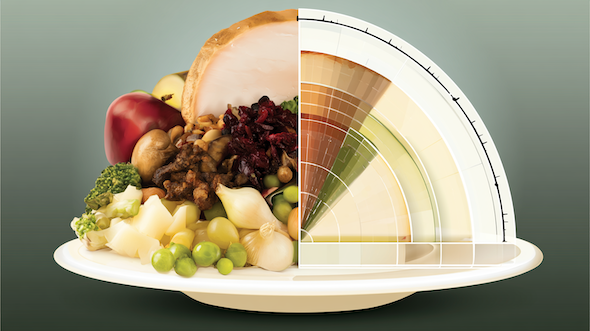

# スーパーエイジャーの科学#4「健康的な食事って個人差があるよねー問題」

「スーパーエイジャーの科学」の続きです！([#1](https://daigovideolab.jp/blog/2233094),[#2](https://daigovideolab.jp/blog/2233222),[#3](https://daigovideolab.jp/blog/2233616))

このシリーズでは、年をとっても脳と体が元気に動きまくる“スーパーエイジャー”の最新研究をもとに、いくつになってもピンピンした状態を保つための知見を考えております。

で、前回は、スーパーエイジャー研究で有名なトポル先生が提唱する『**Lifestyle+（ライフスタイル・プラス）**』の内容をチェックしましたんで、今回はその中でも最も重要である「食事」の話をしてみましょう。

## **同じ食事でも、私たちの反応はさまざまである**

さて、ご存じのとおり、近年の健康界隈では「白米は太る！」「いや、糖質制限こそ健康に悪い！」「朝食は絶対に食べろ！」「むしろ16時間断食！」みたいな話が、延々と続いております。

で、こういう議論を見ていると、どれか一つが真実で、残りは全部まちがいのように思えてくるわけですが、最近のスーパーエイジャーの研究を見ていると、どうも話はそこまで単純ではなかったりします。というのも、近年の調査では、たとえ同じ食べ物を食べたとしても、血糖値の上がり方、満腹感、眠気、体重の変化は人によってかなり違うことがわかっているからです。

このシリーズで何度も名前が出ているトポル先生（スーパーエイジャー研究の大家）いわく、

> これからの食事は「全員に同じ食品ピラミッドを当てはめる」ようなやり方から変わっていくだろう。

とのこと。これまでの栄養指導では、健康にいい食べ物と悪い食べ物を分けて、全員に同じ基準で勧めるのが普通だったのが、実際には食事への反応は個人差が大きく、AIや腸内細菌などのデータを使って、より個別化された食事法へ向かうだろう、ってことですな。つまり、これから必要になるのは、「最強の食事法」を探すことではなく、健康に役立つ共通原則を押さえたうえで、自分に合う形へカスタマイズすることなわけです。

では、私たちの体には、どれぐらいの個人差があるんでしょうか？ たとえば、人間の体ってのは、同じ量の白米を食べたとしても、

- 食後すぐ眠くなる人
- 数時間後に強い空腹感が来る人
- たいして変化を感じない人

がいたりするじゃないですか。このあたり、なかなか一筋縄ではいかないんですよね。

このような現象が起きる原因というと、たいていは「代謝がいい人と悪い人がいるから」みたいに片づけられがちなんですけど、実際にはもう少し細かい要素がからんでおります。食べ物が体に入ったあとってのは、

1. 胃腸でどれぐらい速く消化されるか
2. 血糖値がどれぐらい上がるか
3. インスリンがどれぐらい出るか
4. 筋肉や肝臓がその糖をどれぐらい受け取るか
5. 脳が「もう十分」と判断するか
6. 数時間後に、どれぐらい空腹になるか

みたいな段階がありまして、どのステップでどんな反応が起きるかによって、体の反応は変わってくるんです。このような違いが起きるのには、いろんな原因が絡んでまして、

- 腸内細菌の構成
- インスリン感受性
- 筋肉量
- 前日の睡眠
- 運動量
- 食べた時間
- 食べる順番
- ストレスの強さ
- 普段の食事内容

みたいな要素がいろいろと混ざり合って、複雑な個人差を構成しております。もちろん、従来の栄養アドバイスが悪いとは言わんのですが、人間は食べ物への反応がかなり違うことがわかってきた以上は、将来的には「全員に同じ食事法を勧める」方式から、腸内細菌、遺伝子、生活リズム、検査値などを使って個別に食事を調整する方向へ進むはずであります。これぞ、未来のスーパーエイジャーへの道。

ってことで、なにがこの個人差を生み出すのかを、ざっくりチェックしてみましょうー。

---

## **個人差の理由1. 筋肉量と「糖の置き場所」が違う**

食後に入ってきた糖は、主に筋肉、肝臓、脂肪組織などに処理されますが、このとき、筋肉量が多く、日常的に体を動かしている人は、糖を筋肉に取り込みやすい傾向があったりします。逆に、座り時間が長く、筋肉量が少なく、運動不足が続いていると、同じ糖質を食べても血糖値が上がりやすくなったり、処理に時間がかかりやすくなるんですな。

いわば、筋肉ってのは、糖を一時的に預かってくれる「倉庫」みたいなものでして、倉庫が大きくて出し入れも活発なら、食後に入ってきた糖をさばきやすいわけです。逆に倉庫が小さくて、普段あまり使われていなければ、処理がもたつきやすくなるんですな。

このため、同じ白米を食べたとしても、

- 毎日よく歩く人
- 筋トレをしている人
- 食後に少し動く人

と、

- ほぼ座りっぱなしの人
- 慢性的に運動不足の人
- 食後すぐ座り続ける人

では、反応が変わるわけです。なので、「糖質が合う・合わない」は、食品そのものだけの問題ではなく、あなたの筋肉が、普段どれだけ使われているかが大事になってくるんですな。

## **個人差の理由2. 腸内細菌が、同じ食品を別のものに変えている**

もう一つ大きいのが、腸内細菌であります。私たちは、食べたものを自分の消化酵素だけで処理しているわけではなく、食物繊維や難消化性のでんぷんなどは、腸内細菌が分解してまして、その過程でさまざまな代謝物を作ってるんですよ。そのため、

- ある人には満腹感を助ける食材
- ある人にはお腹が張りやすい食材
- ある人には血糖の安定に役立つ食材
- ある人には特に変化がない食材

みたいな違いが出てくるんですね。たとえば、同じ豆類やオートミールでも、「食べると調子がいい」という人もいれば、「胃腸が重くなる」という人もいるじゃないですか。これは、腸内細菌の構成、消化管の状態、普段の食事内容などが違うせいで起きてることが多いんですよ。

これもまた難しいポイントで、なにせ現時点では「腸内フローラ検査を受ければ、完璧な食事法がわかる！」みたいな技術は確立されてないですからね。腸内細菌の研究は進んでるんだけど、一般向け検査の結果から、個人に最適な食事を高精度で決められる段階とはまだ言いにくいのが現状であります。

なので、現時点では、食物繊維を増やしたら便通、空腹感、睡眠、胃腸の調子がどう変わるかを、自分で観察するほうが実用的でしょうな。

## **個人差の理由3. 寝不足の日は、同じ食事でも食欲が暴れやすい**

「昨日は普通に食べられたのに、今日はなぜか甘いものが止まらない……」という現象もよくあること。ここには睡眠やストレスが影響している可能性がありまして、寝不足や慢性的なストレスが続くと、

- 食欲が強くなる
- 高カロリー食品への欲求が増える
- 食後の満足感が得にくくなる
- 血糖の処理がうまくいきにくくなる
- 運動する気が落ちる

といった変化が起きやすくなったりします。つまり、同じ菓子パンを食べたとしても、よく眠れた朝に食べるのと、睡眠不足で仕事に追われた午後に食べるのでは、その後の空腹感が変わるわけです。

なので、食事を改善したいときに、食事だけを見ても足りないことが多くて、

- 睡眠不足
- 仕事の負荷
- 孤独感
- 運動不足
- 食事の時間の乱れ

みたいな要因もチェックする必要があるわけっすね。

## **個人差の理由4. 食べる「時間」と「前の食事」が違う**

同じ食べ物でも、朝に食べたときと、夜遅くに食べたとき、さらには昼に何を食べたか、食べる前にどれだけ動いたかでも、体の反応が変わるのが難しいところです。たとえば、

- 朝から何も食べず、昼にいきなり丼ものを食べる
- 昼食後に10分歩いてから仕事に戻る
- 夜遅く、疲れた状態で菓子パンを食べる
- 運動後に米とたんぱく質を食べる

って感じでは、同じ炭水化物でも、空腹感、眠気、血糖反応、次の食事量に大きな違いが出てきたりするんですよ。人間の体は、一回ごとの食事に反応するわけではなく、前の食事、前日の睡眠、その日の活動量の続きなもんですから。

だから、たとえばあなたが、ある日「白米を食べたらダルくなった！白米が合わないんだ！」と判断したとしても、実際には、寝不足のまま夜遅くに空腹が強い状態で、大盛りの白米を単独で食べたら合わなかっただけかもしれないんですよね。この条件を無視して判断すると、かなり間違ったことになりかねないわけです。

## **個人差の理由5. 食べる速さと、満腹感の出方が違う**

同じカレーでも、10分で流し込む人と、ゆっくり食べる人では、その後の摂取量が変わることがあります。私たちの脳ってのは「そろそろ満腹だな」と判断するまでには時間がかかるので、食べるスピードが速い人ほど、満腹感が追いつく前に食べすぎやすいんですよ。

さらに、超加工食品ってのは、

- やわらかい
- 噛む回数が少ない
- 早く食べられる
- 味が濃い
- 食後の満足感が弱い

といった特徴があるもので、いきおい満腹にはなりづらくなるわけです。栄養学の世界で超加工食品が悪者扱いされるのも、単に「添加物があるから」という理由だけじゃなくて、近年は超加工食品が食欲や満腹感のシステムを乱し、結果として食べる量を増やしやすいってとこのほうが問題視されることが多いっすね。実際、未加工な食品中心の食事と比べると、超加工食品中心の食事は、参加者の摂取エネルギーが1日あたり約500kcal増えるとされてますんで。

まぁ、ここにも個人差はあるんだけど、超加工食品は多くの人にとって「自制が必要な食品」というより、自制しにくく作られた食品だと考えたほうがよいでしょう。

## **個人差の理由6. 遺伝子も関わるが、全部ではない**

遺伝子も非常に重要でして、

- 食欲の強さ
- 脂肪のつきやすさ
- 血糖や脂質の反応
- カフェインやアルコールの代謝
- 特定の栄養素の利用しやすさ

などに差が出る可能性があったりします。ただし、このシリーズの最初にも書いたとおり、「健康長寿は遺伝子だけでは説明できなかった」ってのも事実なので、とりあえず遺伝子は無視できないものの、食事の反応を決める唯一の原因でもない、ぐらいに考えておくのがいいでしょうね。

ってことで、現実的に私たちの反応は「遺伝子 × 腸内細菌 × 筋肉量 × 睡眠 × ストレス × 食事の時間 × 生活環境」の組み合わせで作られてまして、これを考慮せずに特定の健康的な食事にこだわるのもどうかなーと思うわけです。

## **では、「自分に合う食事」は、どう探せばいいのか？**

というわけで、健康的な食事にはかように個人差があるわけですが、当たり前ながら「じゃあ自分に合うならポテチとコーラでもいいの？」って話にはならないのでご注意ください。スナック菓子、甘い飲料、菓子パン、加工肉などの超加工食品が万人にとって良くないのはかなり実証されてまして、いかに体質の差があろうが「できるだけ減らしたほうがよい」のは間違いありませんので。

なので、まずは、

1. 甘い飲み物を減らす
2. 超加工食品を日常食にしない
3. 食物繊維が多い食品を増やす
4. たんぱく質不足を避ける
5. 野菜、果物、豆類、全粒穀物などを食事の中心に置く

といった共通原則については、個人差に関わらず押さえておきましょう。そのうえで、主食の量や種類、朝食の有無、乳製品との相性、断食時間などを、自分向けに調整していくのが大事になりますんで。まぁ、パレオチャンネルをお読みの方であれば、ここらへんはすでに耳タコだろうし、完全に実践できている人も多いでしょうが。

では、この大前提をふまえたうえで、『**「自分に合う食事」は、どう探せばいいのか？**』をチェックしてみましょう。個人に最適な食事というと、つい高価な遺伝子検査や腸内フローラ検査みたいなものに飛びつきたくなっちゃうかもですが、個人的には、現時点ではまず高額な検査ではなく、自分の反応を記録することをオススメしておきます。もちろん、将来的には高価な検査が食事の個別化に役立つ可能性はありますし、私も腸内細菌や個別データを活用した食事設計にはめっちゃ期待してるものの、いまのところは本当に役立つデータが得られるようなレベルではないんで。

ってことでオススメしたいのは、とりあえず２週間だけでいいんで、以下のような項目を見ることです。

<table style="text-decoration-thickness: auto; text-decoration-style: solid; border-collapse: collapse; width: 784px;"><tbody><tr><th style="border: 1px solid rgb(153, 153, 153); padding: 8px;">見るもの</th><th style="border: 1px solid rgb(153, 153, 153); padding: 8px;">目安</th></tr><tr><td style="border: 1px solid rgb(153, 153, 153); padding: 8px;">食後の眠気</td><td style="border: 1px solid rgb(153, 153, 153); padding: 8px;">食後1〜3時間で強く眠くならないか</td></tr><tr><td style="border: 1px solid rgb(153, 153, 153); padding: 8px;">空腹感</td><td style="border: 1px solid rgb(153, 153, 153); padding: 8px;">次の食事まで無理なく持つか</td></tr><tr><td style="border: 1px solid rgb(153, 153, 153); padding: 8px;">間食</td><td style="border: 1px solid rgb(153, 153, 153); padding: 8px;">午後や夜に強い食欲が出ないか</td></tr><tr><td style="border: 1px solid rgb(153, 153, 153); padding: 8px;">胃腸の調子</td><td style="border: 1px solid rgb(153, 153, 153); padding: 8px;">張り、便通、胃もたれはどうか</td></tr><tr><td style="border: 1px solid rgb(153, 153, 153); padding: 8px;">集中力</td><td style="border: 1px solid rgb(153, 153, 153); padding: 8px;">午前・午後に大きな落ち込みがないか</td></tr><tr><td style="border: 1px solid rgb(153, 153, 153); padding: 8px;">睡眠</td><td style="border: 1px solid rgb(153, 153, 153); padding: 8px;">夜中に空腹・胃もたれで起きないか</td></tr><tr><td style="border: 1px solid rgb(153, 153, 153); padding: 8px;">体重・腹囲</td><td style="border: 1px solid rgb(153, 153, 153); padding: 8px;">日単位ではなく週平均で見る</td></tr></tbody></table>

もちろん、他にもチェックしたほうがいい要素はあるんですけども、最初から記録項目を増やしすぎると、だいたい三日坊主で終わりますんで、とりあえずは「自分の食事が生活にどんな影響を与えているか」がわかる範囲に絞るのがよいでしょう。

たとえば、昼食後の眠気と間食を減らしたい人なら、こんな感じで記録できるでしょう。

<table style="text-decoration-thickness: auto; text-decoration-style: solid; border-collapse: collapse; width: 784px;"><tbody><tr><th style="border: 1px solid rgb(153, 153, 153); padding: 8px;">日にち</th><th style="border: 1px solid rgb(153, 153, 153); padding: 8px;">昼食内容</th><th style="border: 1px solid rgb(153, 153, 153); padding: 8px;">食後の眠気</th><th style="border: 1px solid rgb(153, 153, 153); padding: 8px;">空腹感・間食</th><th style="border: 1px solid rgb(153, 153, 153); padding: 8px;">胃腸の調子</th><th style="border: 1px solid rgb(153, 153, 153); padding: 8px;">集中力</th><th style="border: 1px solid rgb(153, 153, 153); padding: 8px;">睡眠</th><th style="border: 1px solid rgb(153, 153, 153); padding: 8px;">体重・腹囲</th><th style="border: 1px solid rgb(153, 153, 153); padding: 8px;">メモ</th></tr><tr><td style="border: 1px solid rgb(153, 153, 153); padding: 8px;">1日目</td><td style="border: 1px solid rgb(153, 153, 153); padding: 8px;">白米大盛り、唐揚げ、味噌汁</td><td style="border: 1px solid rgb(153, 153, 153); padding: 8px;">14時ごろ強い眠気。20分ほどぼんやり</td><td style="border: 1px solid rgb(153, 153, 153); padding: 8px;">16時にチョコとカフェラテ</td><td style="border: 1px solid rgb(153, 153, 153); padding: 8px;">問題なし</td><td style="border: 1px solid rgb(153, 153, 153); padding: 8px;">午後は低め</td><td style="border: 1px solid rgb(153, 153, 153); padding: 8px;">普通</td><td style="border: 1px solid rgb(153, 153, 153); padding: 8px;">体重のみ記録</td><td style="border: 1px solid rgb(153, 153, 153); padding: 8px;">昼食後に座りっぱなし</td></tr><tr><td style="border: 1px solid rgb(153, 153, 153); padding: 8px;">2日目</td><td style="border: 1px solid rgb(153, 153, 153); padding: 8px;">白米を少なめ、焼き魚、野菜、味噌汁</td><td style="border: 1px solid rgb(153, 153, 153); padding: 8px;">少し眠いが仕事は可能</td><td style="border: 1px solid rgb(153, 153, 153); padding: 8px;">16時に少し空腹。ナッツで済んだ</td><td style="border: 1px solid rgb(153, 153, 153); padding: 8px;">問題なし</td><td style="border: 1px solid rgb(153, 153, 153); padding: 8px;">前日より良い</td><td style="border: 1px solid rgb(153, 153, 153); padding: 8px;">普通</td><td style="border: 1px solid rgb(153, 153, 153); padding: 8px;">―</td><td style="border: 1px solid rgb(153, 153, 153); padding: 8px;">食後10分歩いた</td></tr><tr><td style="border: 1px solid rgb(153, 153, 153); padding: 8px;">3日目</td><td style="border: 1px solid rgb(153, 153, 153); padding: 8px;">白米少なめ、鶏肉、野菜、豆腐</td><td style="border: 1px solid rgb(153, 153, 153); padding: 8px;">眠気はほぼなし</td><td style="border: 1px solid rgb(153, 153, 153); padding: 8px;">間食なし</td><td style="border: 1px solid rgb(153, 153, 153); padding: 8px;">少しお腹が張る</td><td style="border: 1px solid rgb(153, 153, 153); padding: 8px;">安定</td><td style="border: 1px solid rgb(153, 153, 153); padding: 8px;">寝つき良い</td><td style="border: 1px solid rgb(153, 153, 153); padding: 8px;">―</td><td style="border: 1px solid rgb(153, 153, 153); padding: 8px;">野菜を急に増やしすぎたかも</td></tr><tr><td style="border: 1px solid rgb(153, 153, 153); padding: 8px;">4日目</td><td style="border: 1px solid rgb(153, 153, 153); padding: 8px;">白米普通量、納豆、卵、野菜、味噌汁</td><td style="border: 1px solid rgb(153, 153, 153); padding: 8px;">軽い眠気</td><td style="border: 1px solid rgb(153, 153, 153); padding: 8px;">17時に空腹。ヨーグルト</td><td style="border: 1px solid rgb(153, 153, 153); padding: 8px;">問題なし</td><td style="border: 1px solid rgb(153, 153, 153); padding: 8px;">まずまず</td><td style="border: 1px solid rgb(153, 153, 153); padding: 8px;">普通</td><td style="border: 1px solid rgb(153, 153, 153); padding: 8px;">腹囲のみ記録</td><td style="border: 1px solid rgb(153, 153, 153); padding: 8px;">白米を増やしても大崩れなし</td></tr><tr><td style="border: 1px solid rgb(153, 153, 153); padding: 8px;">5日目</td><td style="border: 1px solid rgb(153, 153, 153); padding: 8px;">白米少なめ、豚しゃぶ、野菜、海藻</td><td style="border: 1px solid rgb(153, 153, 153); padding: 8px;">眠気なし</td><td style="border: 1px solid rgb(153, 153, 153); padding: 8px;">間食なし</td><td style="border: 1px solid rgb(153, 153, 153); padding: 8px;">良好</td><td style="border: 1px solid rgb(153, 153, 153); padding: 8px;">高め</td><td style="border: 1px solid rgb(153, 153, 153); padding: 8px;">夜中に目覚めず</td><td style="border: 1px solid rgb(153, 153, 153); padding: 8px;">―</td><td style="border: 1px solid rgb(153, 153, 153); padding: 8px;">この組み合わせが合うかも</td></tr><tr><td style="border: 1px solid rgb(153, 153, 153); padding: 8px;">6日目</td><td style="border: 1px solid rgb(153, 153, 153); padding: 8px;">菓子パン2個、カフェラテ</td><td style="border: 1px solid rgb(153, 153, 153); padding: 8px;">14時に強い眠気</td><td style="border: 1px solid rgb(153, 153, 153); padding: 8px;">15時半に空腹。甘い物を追加</td><td style="border: 1px solid rgb(153, 153, 153); padding: 8px;">胃もたれあり</td><td style="border: 1px solid rgb(153, 153, 153); padding: 8px;">低い</td><td style="border: 1px solid rgb(153, 153, 153); padding: 8px;">寝つきがやや悪い</td><td style="border: 1px solid rgb(153, 153, 153); padding: 8px;">体重のみ記録</td><td style="border: 1px solid rgb(153, 153, 153); padding: 8px;">忙しくて昼食を簡単に済ませた</td></tr><tr><td style="border: 1px solid rgb(153, 153, 153); padding: 8px;">7日目</td><td style="border: 1px solid rgb(153, 153, 153); padding: 8px;">白米少なめ、魚、野菜、味噌汁</td><td style="border: 1px solid rgb(153, 153, 153); padding: 8px;">軽い眠気</td><td style="border: 1px solid rgb(153, 153, 153); padding: 8px;">間食なし</td><td style="border: 1px solid rgb(153, 153, 153); padding: 8px;">良好</td><td style="border: 1px solid rgb(153, 153, 153); padding: 8px;">安定</td><td style="border: 1px solid rgb(153, 153, 153); padding: 8px;">普通</td><td style="border: 1px solid rgb(153, 153, 153); padding: 8px;">週平均を確認</td><td style="border: 1px solid rgb(153, 153, 153); padding: 8px;">食後の散歩も継続</td></tr></tbody></table>

でもって、この場合は、こんなふうに振り返ってみるわけです。

> 白米そのものよりも、「白米大盛り＋野菜少なめ＋食後に座りっぱなし」の組み合わせで眠気と間食が出やすかったな……。
> 白米を少なめにして、たんぱく質と野菜を増やし、食後に10分歩くと、午後の集中力と空腹感が安定するのかもな……。
> ただし、食物繊維を急に増やすとお腹が張ったから、量は少しずつ調整したほうがいいか……。

ここでのポイントは、あせって「自分に白米は合わないのだ！」と結論づけないことでして、この例であれば、データにもとづいたより正確な結論は、

> 自分の場合、大盛りの白米を単独に近い形で食べ、食後に動かないと調子が崩れやすい。ただし、量と組み合わせを調整すれば問題は少ない。

みたいになるはずであります。こんな感じで、あくまで現実的な仮説を立てて、自分の反応を見ながら少しずつ調整していくのが大事っすね。

ここでは、くれぐれも一度に全部を変えないのが最も重要でして、たとえばあなたが「昼食後に眠くて仕事にならない」という人なら、２週間だけ、

- 白米を少し減らす
- そのぶん野菜とたんぱく質を増やす
- 食後に10分歩く

のように、変える要素を絞るのが得策であります。それで眠気や空腹感が改善するなら、その方法は自分に合っている可能性がありますし、変化がなければ「主食を変える」「量を戻す」「食事時間を変える」みたいに、次の仮説を試せばOKであります。このやり方なら、「糖質は悪か善か」みたいな不毛な議論に巻き込まれずにすみますんで。

## **ただし、自己実験にも落とし穴はあるのでご注意**

ってことで、自分の体質に適した食事を探すためには、自己実験がかなり役立つわけです。が、なにごとも完璧な方法はないもんでして、自分の体感だけを信じすぎるのも危険なので、ここも注意しておきましょう。

たとえば、極端な糖質制限を始めた直後は体重が落ちやすいのは有名な話ですが、実際のところ、その多くは水分変化であるケースのほうが多かったりします。また、食事制限によって一時的に「セルフコントロールできてるぞ！」って感覚が出ても、数か月後に反動で食欲が暴走するケースもありますからね。

なので、自己実験をする際は、次の3点を守るようにしてくださいませ。

1. **２週間から４週間は続ける**：基本は2〜4週間で、1日単位の体重や気分に振り回されない。
2. **評価項目を複数持つ**：体重だけでなく、睡眠、空腹、集中力、便通、運動パフォーマンスも見る。
3. **生活が苦しくなる方法は採用しない**： 効果があっても、家族との食事や外食を壊し、常に食べ物のことを考えるような方法は続かないんで。

ここらへんはマストなポイントでして、どんなに自分に適した食事法であっても、家族との食事が壊れる、外食できない、常に食べ物のことを考える、みたいな状態にはまったなら長続きしないですからね。自分が死ぬまで続けられないような食事は、最適な食事とは言えないんで。

というわけで、超加工食品を減らし、食物繊維やたんぱく質を確保し、未加工に近い食品を中心にするってあたりを押さえたら、自分に適した食事を探すフェーズに移ってみてくださいませ。世の中には、白米が合う人もいれば、量を減らしたほうが調子がいい人もいるし、朝食を食べたほうが集中できる人もいれば、軽めにしたほうが楽な人もいるし、豆類や乳製品で胃腸が不調になる人もいますんで。ではまた！
