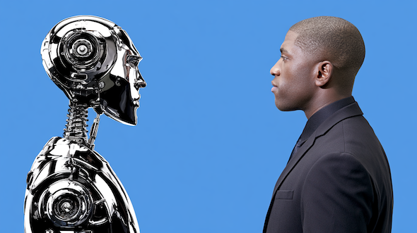

# AI時代にこそ必要な「感情知性」を、あらためて学び直そう！#1「感情に振り回されない」の本当の意味

「**AIの時代に大事なのは感情知性だ！**」みたいな話をよく聞くようになりました。生成AIが文章を書き、画像を作り、コードを組み、企画のたたき台まで出してくれる昨今。「これからは論理力や知識より、感情を扱う能力が大事になる！」と言われるようになったのは、当然っちゃ当然でしょう。

たしかに、AIが多くの作業を高速化するほど、人間には「何を大事にするのか」「相手とどんな関係を作るのか」「不安や怒りが出たときにどう判断するのか」といった仕事が残りやすくなるはず。そう考えれば、AIが進化するほど、単純な知識量や処理スピードだけでは差がつきにくくなり、感情をどう読み取ってどう意思決定に使うかが、以前より重要になるのは間違いないでしょう。

たとえば、あなたが「仕事で大きな方針転換を求められた」としましょう。この時に、AIに相談すれば、現状分析、選択肢の比較、実行計画の作成ぐらいまでは、かなりの精度でやってくれるでしょう。しかし、「この変化を受け入れるべきか」「自分は何に抵抗を感じているのか」「関係者にどのように伝えればいいか」といった部分は、結局のところ自分で考えなければなりません。そこでは、単なる情報処理よりも、不安や怒り、期待、迷いといった感情を把握し、判断に活かす力が必要になってくるんですよ。

が、ひとくちに「感情知性」と言っても、いったい何を指すのか、あまりピンと来ない人も多いでしょう。ちょっと考えると「いつもニコニコしている能力」とか、 「怒らず、落ち込まず、感情を完璧にコントロールする能力」みたいなものを想像しちゃいますが、実際にはそんな話でもないんですよね。

というのも、大事な仕事で失敗したり、身近な人から傷つくことを言われた場合、怒りや不安、悲しみが出るのは、ごく自然なことですからね。こういう時に**むしろ大事なのは、感情をちゃんと感じたうえで、それに支配されず、使えるようになることなわけです。**

## **そもそも感情知性ってなんだろうか？**

では、まず前提を押さえておきましょう。感情知性（Emotional Intelligence）とは、ひとことで言えば、

- **自分や他人の感情を理解し、その情報をもとに行動を選ぶ力のこと**

みたいになります。

第一に、「感情を扱う」ってのは、怒らない、不安にならない、いつも前向きでいる、といった意味ではないので注意しましょう。怒りや不安、悲しみは、誰にでも起こる自然な反応なんで。

そのため、感情知性が高い人も、普通に腹を立てるし、落ち込むし、嫉妬もします。しかし、ここで感情知性が高い人が異なるのは、感情が生じたあとに、それをそのまま事実として受け取らず、「いま自分の中で何が起きているのか」を確認できる点にあるんですよ。

たとえば、仕事で厳しい指摘を受けたとき、「自分は否定された！」と感じて怒りが出たとしましょう。この時に、その怒りのまま反論したり、相手を避けたりすれば、あとで関係が悪化しちゃう可能性が大きいでしょう。

しかし、ここで感情知性が働くと、「自分はいま怒っている。これは、おそらく自分の努力を軽く扱われた感じがしたからだろう」と、いったん反応を言葉にできるんですよ。そのうえで、「相手の言い方には問題があったが、内容の一部は使えるかもしれない」「今日は返事を急がず、明日整理してから話そう」みたいに、冷静な行動を選べるようになるわけです。

では、近年の研究(R)では、具体的に感情知性がどのような能力だと考えられているかを見てみましょう。いまの心理研究では、感情知性を大きく4つの能力に分けております。

---

1. **自分の感情を認識し、理解する力**：自分のなかに起きている感情を、できるだけ正確に把握する能力。たとえば、「なんとなく嫌だ」で終わらせず、「自分はいま腹を立てているのか、不安なのか、恥ずかしいのか、それとも軽く扱われた感じがして傷ついているのか」と細かく見分ける力っすね。また、感情に伴う身体感覚や頭に浮かぶ考え、行動したくなる衝動にも気づけると、感情に飲み込まれにくくなりますんで。
2. **他者の感情を認識し、理解する力**：相手の表情、声のトーン、話す速さ、姿勢、言葉の選び方などから、その人がどのような感情を抱いているかを推測する能力。もちろん、相手の心を完全に読めるわけじゃないんだけど、「いま不安そうだな」「かなり苛立っているかもしれない」「この人は言葉にしないだけで傷ついていそうだ」といった仮説を持てるだけでも、対人関係のすれ違いは減らしやすくなりますんで。
3. **感情を状況に合わせて調整する力**：感情を完全に消すのではなく、その強さや距離感、見方を状況に応じて変える能力。たとえば、怒りが強すぎるときには、いったんその場を離れたり、呼吸や身体感覚に注意を向けたり、翌日まで返事を保留したりする。逆に、落ち込みから何もできなくなっているなら、小さな行動を始めて気分の流れを変える。感情を抑え込むのではなく、目標にとって役立つ形に扱う力みたいなイメージっすね。
4. **感情を人間関係や目標達成に活かす力**：感情を、自分や他人を動かすための情報として使う能力。たとえば、怒りから「自分は公平さや尊重を大切にしている」と気づき、必要な境界線を伝える。仕事への不安から、準備不足や見落としを発見する。喜びや興味が出る活動には積極的に時間を使い、創造性や粘り強さにつなげる。感情をそのまま行動に変えるのではなく、感情の奥にある価値観や欲求を読み取って行動を選ぶわけですね。

ご覧のとおり、いずれも単に「メンタルを強くする」ための能力ではなく、日々の意思決定、人間関係、仕事の進め方など、生活のかなり広い範囲に関係しております。しかも、この4つはバラバラではなく、互いにつながっているのもポイント。自分の感情に気づけなければ適切に調整するのは難しいし、自分の感情の仕組みがわからなければ他人の感情を理解するのも難しくなりますからね。

ということで、自分の感情を理解するには、単に「イライラする」「つらい」で終わらせないことがめっちゃ大事。感情には、頭のなかに浮かぶ考え、身体感覚、行動したくなる衝動、感情の強さといった複数の要素がありますからね。もしあなたが怒ったときも、たんに怒りだけじゃなくて、「軽く見られた」という考え、肩や顎の緊張、言い返したい衝動、心拍数の上昇などが同時に起こってることのほうが多いでしょう。こうした反応を観察できるほど、あなたは感情に飲み込まれにくくなります。

また、感情知性は「ネガティブ感情を減らす技術」でもないので、こちらも注意してください。これは過去にも言ってきたことですが、ネガティブな感情にも一定のメリットがありまして、たとえば、

- 「恐怖」は危険を知らせる
- 「怒り」は境界線や公平さが侵害された可能性を知らせる
- 「悲しみ」は喪失や大切な関係を示す

みたいな感じっすね。つまりネガティブな感情は確かに不快なんだけど、それと同時に価値観や欲求についての情報を含んでいるんですよ。

ここで大切なのは、感情に従って即座に行動することではなく、「この感情は、自分に何を知らせているのか」を考えることです。資料では、この考え方を「感情はデータである」と表現しています。

ただし、ここで逆に感情を考えすぎればよいってわけでもないのが難しいところ。たとえば、感情を抑え込むと、その反動で強まりやすい一方、感情を何度も反すうすると、つらさが長引くことがありますんで。

そこで必要になるのは、感情を避けず、かといって感情と一体化もしないことです。要するに、「私は怒っている！」じゃなくて、「いま怒りが起きている」と少し距離を取って眺めるようなイメージっすね。この余白があると、感情は行動の支配者ではなく、判断材料になってくれますんで。

ということで、AIが多くの情報処理や文章作成をハイスピードでこなしていく時代には、この力の重要性はさらに増すはず。AIはいろんな選択肢や答えを出してくれますが、「自分にとって何が大切か」「相手にどう伝えるべきか」「不安や迷いを抱えたまま何を選ぶか」までは決めてくれないのが難しいところ。言ってみれば、感情知性ってのは、感情を消して合理的になるための技術ではなく、感情を含めた自分全体を使って、より納得できる行動を選ぶための能力だと申せましょう。

## **「感情に振り回されない」は、感情を無視することではないんだぞ**

「感情に振り回されないようになりたい！」と思うと、多くの人はまず、怒りや不安や悲しみを小さくしようと試みたりします。たとえば、腹が立っても我慢する、不安が出ても「気にしすぎだ」と打ち消す、悲しいことがあっても忙しくして考えないようにする、みたいな感じっすね。たしかに、その場を乗り切るだけなら、こうしたやり方が役に立つ場面もあるでしょう。

しかし、「感情を見ない」ことと、「感情に振り回されない」ことは別の話なので注意してください。

というか、自分の中で起きている感情に気づけないほど、私たちはその影響を受けやすくなったりするんですよ。たとえば、

- 本人は「別に怒っていない」と思っていても、声がきつくなったり、他人の一言を必要以上に悪く受け取ったりする。
- 本人は「大丈夫」と思っていても、不安から先延ばしや過剰な確認を繰り返してしまう。

といった感じであります。感情を認めなかったからといって、内面にわきあがる感情が消えるわけじゃないんですよ。

ここでめっちゃ重要なのは、**感情にはそれぞれ、特定の行動を促す力がある**ってところであります。たとえば、

- 怒りが出れば、反論したい、攻撃したい、相手を正したいという衝動が起きやすくなる
- 恐怖や不安が出れば、逃げたい、避けたい、先送りしたいと感じやすくなる
- 悲しみが出れば、人と距離を取りたくなったり、何もしたくなくなったりする

といった感じで、感情はこうした反応を自動的に起こすんですよ。

しかし、このときに本当に大事なのは、感情と行動のあいだに、適切なすき間を作ることです。たとえば、

- **仕事で批判的なフィードバックを受けて腹が立った！**
  - このとき、「自分は怒ってはいけない」と考えて怒りを押し込めるんじゃなくて、「かなり腹が立っているな」「努力を否定されたように感じたのかもしれない」と確認する。さらに、身体にどんな変化が出ているかもチェック。胸が詰まる、肩に力が入る、顔が熱くなる、心拍が速くなる。頭にはどんな考えが浮かんでいるか。「あの人は自分を嫌っている」「全部ダメだと言われた」といった言葉が出ているかもしれないので、これもチェックしておく。

みたいな感じっすね。こうやって感情を観察すると、怒りと自分を少し切り離せるので、めっちゃいい感じであります。「自分は怒っている」から「いま、自分の中に怒りが起きている」という、このわずかな違いがめっちゃ大きいんですよね。後者だと、怒りをひとつの情報として見られるんで。

もちろん、観察したからといって、怒りや不安がすぐ消えるわけじゃないので、そこは誤解なきよう。感情知性ってのは、感情をコントロールする技術ではないんで。

なので、まずは「こんな感情を持ってはいけない」とは思わず、不安があるなら「不安がある」って事実を認めたうえで、「この感情は、自分に何を知らせているのだろう？」と考えてみてくださいませ。いくつか例を挙げると、

- 怒りなら、尊重されたい、公平に扱われたい、境界線を守りたいという気持ちが関係しているかもしれない。
- 不安なら、失敗を避けたい、大切なものを失いたくない、準備不足を補いたいという気持ちがあるかもしれない。
- 悲しみなら、大切なものを失った、つながりを求めている、休息やいたわりが必要だと知らせているかもしれない。
- 嫉妬なら、自分も本当は手に入れたいものや、評価されたい領域があることを知らせているかもしれない。
- 罪悪感なら、自分の行動が大事にしたい価値観からずれている、あるいは誰かとの関係を修復したいと感じているのかもしれない。

といったところです。とにかく、感情に振り回されない人ってのは、感情を感じたあとに、「では、自分はどうしたいのか」と考えられる人だってことを押さえておきましょう。

## **AIが得意になっても、感情知性の問題は消えないんだぞ**

AIと感情知性の絡みも、もうちょっと掘ってみましょう。現代においてAIの素晴らしさは疑いようがなく、こいつを使えば文章の下書きは早くなるし、調べものも、アイデア出しも、会議の要約も、以前よりかなり楽になるのは確実であります。

たとえば、AIが「転職したほうが年収は上がる」と助言してくれたとしても、その選択が自分にとって正しいかどうかは別問題でしょう。収入、自由、安心、成長、家族との時間、職場の人間関係など、何を優先するかによって答えは変わりますからね。

あるいは、AIが作った文章や企画が、自分で考えたものより明らかに出来がよかったとして、「自分はもう必要とされないのでは？」と不安になることもあるでしょう。逆に、AIをうまく使って成果が出たときには、「これは自分の実力と言えるのか」と、微妙な気持ちになる人もいるかもしれないですからね。こうした感情を放置したままでは、AIを便利に使えるようになっても、自分の仕事や生き方への納得感は育たないでしょう。

このように、AIは「どの選択肢があるか」を大量に示してくれんだけど、「自分は何を大事にしたいのか」「この選択に納得できるのか」「この人にどう伝えるべきか」といった問いには、最終的に自分で向き合う必要があるんですよ。AIは選択肢を比較できますが、価値観の優先順位までは決めてくれないんで。

また、AIが簡単にテキストを出力してくれるからこそ、受け手の感情や状況を考えた伝え方も、以前より重要になったりします。「この企画は修正してください」みたいに、同じ内容を伝えるにしても、相手がどんな立場にいて、どこに不安を感じ、何を大切にしているかで、受け取り方は変わりますからね。なので、AIの時代ほど、相手の感情を読み、自分の感情も扱いながら、関係を調整する能力が必要になるのは自明でありましょう。

つまり、AI時代に感情知性が重要になるのは、「AIには感情がないから！」って単純な話ではございません。より大事な理由は、私たちが情報や成果物を簡単に作れるようになればなるほど、人は「何のためにこれをするのか」「自分はどんな働き方をしたいのか」「この変化のなかで、何を失いたくないのか」を考えざるを得なくなるからです。

繰り返しになりますが、ネガティブな感情は、自分にとって重要な価値観や欲求が関わっているってサインのひとつ。感情知性とは、こうした反応を「いま自分は何に反応しているのか」「この感情は何を大事にしているのか」「この状況で、どんな行動を選びたいのか」と考える余地を作ることであります。

AIが答えを出してくれる時代だからこそ、答えを受け取ったあとにどう感じ、どう意味づけし、どう行動するかがめっちゃ大事なのは間違いなし。なので、感情知性ってのは、AI時代に勝つための能力ではなくて、**AIを使いながら自分の人生の方向を定める能力**なのだとお考えください。

## **感情知性が高い人は、感情に従わないんだぞ**

「感情知性が高い人は、感情に従わないんだぞ！」ってのも大事な観点であります。

「感情知性が高い」というと、「いつも冷静な人」や「怒らない人」を思い浮かべるかもですが、実際にはそういうことじゃないんですよ。感情知性が高い人だって、腹は立つし、不安にもなるし、誰かの成功を見て嫉妬することもあるのは当然のこと。しかし、ここで違うのは、そこで起きた感情をまんま行動に移さないってところです。

たとえば、仕事で自分の案を否定されたとします。この時、感情知性が高い人でも「怒り」や「恥ずかしさ」は普通に出まして、「言い返したい！」「この人とはもう仕事をしたくない！」「自分は能力がないのかもしれない……」みたいな考えも浮かんだりします。このとき、素直に感情に従ってしまうと、

- 腹が立った。だから相手を攻撃する。
- 不安になった。だから挑戦をやめる。
- 落ち込んだ。だから自分には価値がない。

といった具合に、感情が出てからすぐに行動しちゃったりするんですよ。まぁ、それが必ずしも悪いとは言わないんですけど、「感情が表してるもの」と「実際の行動」が同じになることが常に正しいわけでもないんで（というか、良くない結果になっちゃうことのほうが多い）。

その点で、感情知性が高い人は、感情を「事実」や「命令」ではなく「情報」として扱うのがいいところ。たとえば怒りが出たときには、

- 自分は何に傷ついたのか。
- 何を不公平だと感じたのか。
- 本当に相手が失礼だったのか、それとも疲れていて反応が強くなっているのか。
- いま必要なのは反論か、距離を取ることか、時間を置いて話すことか。

といった問いを瞬時にはさみこむことができまして、不安が出たときは、

- 何を失うことが怖いのか。
- いま準備できることはあるか。
- 本当に危険なのか、それとも未知だから怖いだけなのか。

みたいに考えることができるんですね。この「問いを挟む」余地があるだけで、感情に振り回される度合いはかなり変わってきますんで。

言ってみれば、感情知性が高い人ほど、むしろ感情をきちんと感じているのだと言えまして、

- 「いま怒っているな」
- 「思ったより傷ついているな」
- 「これは失敗への不安というより、評価を失う怖さかもしれない」

というように、自分の反応を丁寧に把握してたりします。そのうえで、「この感情に従うと、自分が大事にしたい方向へ進めるか？」と考えるわけですな。

たとえば、相手への怒りを感じたとしても、自分が大切にしたいのが「長期的な信頼関係」なら、衝動的に反論をするより、いったん冷静になってから意図を確認するほうがいいかもしんないじゃないですか。もしくは、あなたが不安を抱いたとしても、自分が大切にしたいのが「成長」や「挑戦」なら、不安を消してから始めるのではなく、不安があるまま小さく試すほうが適切かもしれないですからね。

ってことで話をまとめると、感情知性が高い人は、

1. 感情を感じる→
2. 感情が何を知らせているかを見る→
3. そのうえで、自分の価値観や目標に沿った行動を選ぶ

という流れを作れるのだと申せましょう。感情ってのはときに判断を狭める厄介な存在であり、またときには自分が本当に大切にしたいものを教えてくれる存在でもあります。感情知性ってのは、あくまで感情を消す技術ではなく、感情を材料にしながら自分で行動を選ぶ力なんで、この点をふまえて次回は、具体例に感情知性を整える方法を見てみましょうー。
