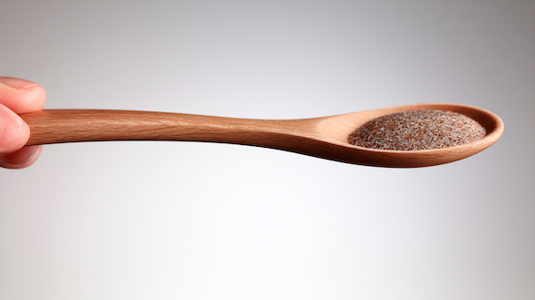

# 【2026年版】オオバコサプリは何を選べばいい？ 効果と鉛の問題から考えるおすすめサプリ

「食物繊維のサプリは何を選べばいいですか？」とよく聞かれるんですけど、私がいまよく使っているのが**オオバコ**であります。

オオバコは、英語では「サイリウム」と呼ばれる植物で、種子のまわりを覆う殻に大量の食物繊維が含まれているんですよ。その約8割が水溶性食物繊維でして、こいつは水を吸うと大きく膨らみ、胃腸の中で粘り気のあるゲルを作るのが特徴。そのおかげで、

- 便をやわらかくして量を増やす
- 食後の血糖値の上昇をゆるやかにする
- 満腹感を高める
- LDLコレステロールを下げる

といった働きがあるんですな。食物繊維サプリの中でも、ここまで幅広い効果が確認されているものは意外と珍しいんですよ。私は生まれつきLDLコレステロールが高くなりがちな体質なんで、この数値を安定させるために使っております（もし水溶性食物繊維を使わなかったら、薬を使わないとヤバいレベルでLDLが上がるレベル）。

## **オオバコは便秘対策だけのサプリではないんだぞ**

さて、オオバコというと、日本では便秘対策のイメージが強いでしょう。実際、慢性的な便秘に対しては、米国消化器病学会もオオバコを第一選択のひとつに挙げております([R](https://pubmed.ncbi.nlm.nih.gov/37211380/))。水分を抱え込んで便をやわらかくしつつ、不溶性食物繊維が便のかさを増やしてくれるんですよね。

ただし、オオバコの働きは「便を出しやすくする」だけではなく、めっちゃいろんなメリットがあるんですよ。いくつか具体的なものを挙げておくと、こんな感じになります。

##### オオバコのメリット1．LDLコレステロールを下げる

オオバコの効果として、便通改善と並んでエビデンスが充実しているのが、LDLコレステロールの低下であります。ざっくりメカニズムを説明すると、

1. オオバコのゲルが腸内で胆汁酸を取り込んで、そのまま便と一緒に排出する
2. 失われた胆汁酸を補うために、身体が血中のコレステロールを材料として使うようになる
3. その結果、LDLコレステロールが低下する！

みたいな感じです。28件のランダム化比較試験をまとめた2018年のメタ分析([R](https://pubmed.ncbi.nlm.nih.gov/30239559/))では、オオバコを1日平均約10g、約3週間以上摂取した場合、プラセボと比べてLDLコレステロールが平均0.33mmol/L、約12.8mg/dL低下したというからたいしたもんです。

また、別の26週間のランダム化比較試験([R](https://pubmed.ncbi.nlm.nih.gov/10837282/))でも、オオバコを摂取したグループは、プラセボ群より総コレステロールが4.7％、LDLコレステロールが6.7％低くなったそうな。こちらもいい感じですね。

もちろん、オオバコだけで高コレステロールを治療できるわけじゃないものの、食事改善や運動、薬物治療のサポートとしては、一定の効果が期待できるでしょう。

##### オオバコのメリット2．血糖値のコントロールを助ける

オオバコのゲルには、食事に含まれる糖質が小腸へ移動するスピードを遅らせる働きもあったりします。そのおかげで、食後に糖が一気に吸収されにくくなり、血糖値の急上昇を抑える働きがあるんですな。

ちなみに、35件の比較試験をまとめた2015年のメタ分析([R](https://pubmed.ncbi.nlm.nih.gov/26561625/))では、オオバコの効果は、もともとの血糖状態によって大きく異なっていたとのこと。健康で血糖値に問題がない人には、ほとんど変化が見られなかった一方、2型糖尿病の人では、空腹時血糖値が平均37mg/dL、HbA1cが約0.97ポイント低下したんだそうな。つまり、血糖値が正常な人をさらに下げるというより、血糖コントロールが乱れている人ほど効果が大きい傾向があったわけっすね。

さらに、19件のランダム化比較試験、計962人をまとめた2024年のメタ分析([R](https://pubmed.ncbi.nlm.nih.gov/38844885/))でも、オオバコの摂取によって、空腹時血糖値、HbA1c、HOMA-IR（インスリン抵抗性の指標）が有意に改善したんだそうな。特に、1日10g前後を50日以上続けた研究で効果が出やすい傾向が確認されてまして、これもなかなか良いですな。

##### オオバコのメリット3．満腹感を高める

オオバコは水を吸うと大きく膨らむため、食後の満腹感が長く続き、空腹を感じにくくなるとも考えられております。健康な成人を対象にしたランダム化比較試験([R](https://pubmed.ncbi.nlm.nih.gov/27166077/))では、朝食と昼食の直前にオオバコを摂取したところ、プラセボと比べて食間の空腹感や「何か食べたい」という欲求が低下し、満腹感が高まったんだとか。なかでも、1回6.8gを摂取した場合に、わりと一貫した効果が見られております。あと、少人数を対象にした試験([R](https://pubmed.ncbi.nlm.nih.gov/9578335/))では、食事にオオバコを加えることで、食後の空腹感と、その後の摂取カロリーがそれぞれ13％と17％低下したって報告も出てますね。

とはいえ、ここは少し注意が必要で、満腹感に関する研究は短期間かつ小規模なものが多いんで、長期的な減量効果については結果が一貫していないんですよ。なので、オオバコは食事量を調整しやすくするための補助ツールと考えると良い感じです。

---

##### オオバコのメリット4．軟便を適度に固める

オオバコは便秘に使われる一方で、便がゆるいときにも役立つことがあったりします。なんだか矛盾しているようですけど、オオバコは腸内の余分な水分を抱え込んでゲル化するんで、硬い便には水分を与え、ゆるい便には適度な形を与える性質があるんですな。

実際、便失禁と軟便がある人を対象にした研究([R](https://pubmed.ncbi.nlm.nih.gov/26347971/))では、1日約5〜14gのオオバコによって、便失禁の回数が減少したんだそうな。一部の試験では、下痢止めとして使われるロペラミドと同程度の改善が見られてまして、これもなかなかすごいもんですな。

##### オオバコの強みは「粘り気」にあり！

ってことで、オオバコにはかように様々なメリットがあるわけですけども、以上の効果に共通しているのが、オオバコが作る粘性の高いゲルであります。イヌリンとか難消化性デキストリンも良い食物繊維なんですけど、オオバコほど強い粘り気を作らないんですよね。そのため、便の形を整えたり、糖や胆汁酸の移動を遅らせたりする作用は、そこまで大きくないんですな。ここ大事。

ってことで、現時点のデータをまとめると、オオバコは、

- 慢性便秘の改善
- LDLコレステロールの低下
- 糖尿病や血糖値が高い人の血糖コントロール
- 短期的な満腹感の向上
- 軟便や便失禁の改善

ってあたりがメリットで、かなり守備範囲が広い食物繊維だと申せましょう。なかでも、証拠として強いのは、便通改善、LDLコレステロールの低下、血糖コントロールの3つ。満腹感や減量についても有望ではあるものの、まだ補助的な効果と考えておいてくださいませ。

## **ただし、オオバコなら何でもいいわけではない**

ただし、ここで注意したいのが、やはり**オオバコ製品の品質問題**であります。毎度おなじみアンダーソン先生（モンタナ州立大学）がオオバコ製品を調べたところ、検査対象の9製品中4製品から、**過剰な量の鉛が検出された**というんですよ。

ご存じのとおり、鉛は少量でも体内に蓄積し、神経系や腎臓、循環器などに悪影響を与える有害な重金属で、体内に溜まると認知機能の低下、高血圧、貧血、腹痛などの健康被害を引き起こすんですよ。

しかも、同じオオバコ製品でも、4gの食物繊維あたりに含まれる鉛の量には約15倍もの差があったそうで、商品選びを間違えるとわりと怖いことになっちゃうんですよ。食物繊維は毎日摂取するものなので、少量の違いでも長期的には無視しにくいところ。オオバコを選ぶ際には、価格や飲みやすさだけでなく、第三者機関による重金属検査の結果もチェックしたいっすね。

ってことで、以上を踏まえて、2026年の時点でおすすめしやすいオオバコ製品をチェックしてみましょうー。

## **1．[Yerba Prima Psyllium Husks Powder](https://jp.iherb.com/pr/yerba-prima-psyllium-husks-powder-12-oz-340-g/15898?rcode=IRO489)**

おそらく、いまいちばん無難なチョイスになるのがこれで、私もこれを買っております。なにが良いかと言いますと、

- ちゃんと表示どおりの食物繊維が含まれている
- 鉛は食物繊維4gあたり約1.6μg
- 細かいパウダーなので飲み物に混ぜやすい
- 香料や砂糖などの余計な成分が入っていない

といったあたりです。これだけ鉛の量が少ないなら、毎日飲んでも安心なレベルでしょう。

注意点として、細かいパウダーは密度が高いため、1回分は大さじ1杯ではなく小さじ1杯程度でお使いください。

## **2．[Yerba Prima Psyllium Whole Husks](https://jp.iherb.com/pr/yerba-prima-organic-psyllium-whole-husks-12-oz-340-g/69202?rcode=IRO489)**

パウダーではなく、粗めの殻が残ったタイプを好むならこちら。こいつの何が良いのかと言いますと、

- ちゃんと表示どおりの食物繊維が含まれている
- 鉛は食物繊維4gあたり約1.6μg
- 原材料がシンプル
- 大さじで量を調整しやすい

といったあたりです。ただし、2021年の検査では鉛が約0.4μgだったのに対し、2024年には約1.6μgまで増えてるのが気になるとこではありますね。まぁ、それでも十分に低レベルなんでいいんですが、天然原料はロットによって品質が変わることを示す例ではあります。

## **3．[Viva Naturals Organic Psyllium Husk Powder](https://jp.iherb.com/pr/viva-naturals-organic-psyllium-husk-powder-24-oz-680-g/113541?rcode=IRO489)**

価格重視なら、こちらが候補になるでしょう。こいつの何が良いのかと言いますと、

- ちゃんと表示どおりの食物繊維が含まれている

- 鉛は食物繊維4gあたり約2.5μg
- オーガニック認証あり
- 4gの食物繊維あたりの価格が最安クラス

みたいになります。上の２つに比べると、鉛は1回分あたり約2.5μgでちょっと多めっすね。これでも鉛の量は低いほうなんですけど、毎日長期間使う前提なら、個人的にはYerba Primaを先に選びますかねぇ。

## **カプセルなら[Swanson Psyllium Husks](https://jp.iherb.com/pr/swanson-vitamins-psyllium-husks-610-mg-300-vegan-capsules/111030?rcode=IRO489)**

粉末を飲むのが苦手なら、Swanson Psyllium Husksのカプセルをお使いください。こちらも鉛はだいぶ低いんで。

ただし、1カプセルに入っているオオバコは約610mgで、実用的な量を取るには何粒も必要になるんでご注意ください。たとえば、オオバコを約5g取るなら、単純計算で8粒前後になっちゃいますからね。なので、

- 外出時だけカプセル
- 自宅では粉末

という使い分けをするといいかもですね。

まぁ、オオバコについては基本的には粉末タイプがおすすめです。オオバコで一定量の食物繊維を取ろうとすると、カプセルでは何粒も飲む必要があるのに対して、粉末ならスプーン1杯程度で済み、価格も安くなりますんで。カプセルは、粉っぽい食感が苦手な方や、外出先で飲みたい方向きでしょう。

## **オオバコの飲み方とか**

ってことで、おすすめのオオバコは以上。最後にオオバコの使い方をチェックしておきましょう。

初めてオオバコを使う場合は、少量からスタートするのが基本でして、目安としては、

- 細かく粉砕されたパウダー：小さじ2分の1
- 殻が粗く残ったホールハスク：大さじ2分の1

ぐらいから始めるとよいでしょう。問題がなければ、数日から1週間ほどかけて、パウダーなら小さじ1杯、ホールハスクなら大さじ1杯程度まで増やします。

ここで最重要なのが水分でして、オオバコは自重の約10倍もの水を吸収するため、1回につき最低でも250〜350mlほどの水と一緒に摂取してください。水に混ぜたら、固まる前にすぐ飲み、さらに水を追加で飲むのが安全です。水分が少ないと、逆に便秘が悪化したり、喉や食道で詰まったりする可能性があるんで、くれぐれもご注意あれー。
