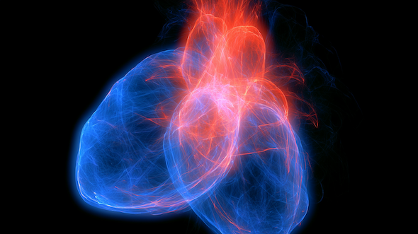

# スーパーエイジャーの科学#11「能力1．心肺機能、能力2．筋力・骨」

「スーパーエイジャーの科学」の続きです！([#1](https://daigovideolab.jp/blog/2233094),[#2](https://daigovideolab.jp/blog/2233222),[#3](https://daigovideolab.jp/blog/2233616),[#4](https://daigovideolab.jp/blog/2233955),[#5](https://daigovideolab.jp/blog/2234026),[#6](https://daigovideolab.jp/blog/2234396),[#7](https://daigovideolab.jp/blog/2234496),[#8](https://daigovideolab.jp/blog/2234796),[#9](https://ch.nicovideo.jp/article/ar2234857),[#10](https://daigovideolab.jp/blog/2235193))

このシリーズでは、年をとっても脳と体が元気に動きまくる“スーパーエイジャー”の最新研究をもとに、いくつになってもピンピンした状態を保つための知見を考えております。

で、そのために本シリーズでは、スーパーエイジャー研究で有名なトポル先生が提唱する『**Lifestyle+（ライフスタイル・プラス）**』を掘り下げてまして、前回から「**運動**」の話に入っております。「スーパーエイジャーレベルの運動を目指すには、どうすればいいのか？」ってポイントですな。

簡単に前回の話をおさらいすると、

- 運動は「やせるため」だけでなく、老後に残したい能力から逆算して考えたほうがいい
- 心肺機能、筋力・骨、バランス、可動性、気分・睡眠では、それぞれ必要な運動が違う
- 自分の年齢、生活、痛み、将来やりたいことを見ながら、優先すべき運動を決める

みたいな感じでした。こういう話になると、ついみんな「正解の運動！」みたいなものを求めちゃうんだけど、自分の生活と年齢によって最適解は変わるんだってことですな。

## **優先したい能力がわかったら、どんな運動をすればいいのか？**

さて、あらためまして、前回のエントリで「自分がどの能力を優先すべきか？」が見えてきたはず。そこで次にすべきは、**実際の運動メニューを考えるステップ**であります。

ここでは、前回お伝えした「**スーパーエイジャーに欠かせない５つの能力**」をベースに、それぞれをいかに効率よく伸ばしていけばいいのかってとこをチェックしていきましょうー。

## **能力1．心肺機能を伸ばしたい人**

心肺機能を伸ばしたい人は、まず**「息が少し上がる運動を、まとまった時間やる」**のが基本。体力をつけるためには、「心拍数がある程度上がる時間を一定の時間だけ続ける」ってのが絶対に必要になりますんで。

よく世間では「週150分の中強度の運動が大事！」ってアドバイスを聞きますけど、これも日常で細切れの運動をするのではなく、心拍数が持続的に上がる“専用の運動時間”を作るほうがベター。

なので、心肺機能を伸ばすときのポイントは、

> **少し息が弾む状態をどれぐらい続けたか？**

に置いてくださいませ。たとえば、買い物や通勤で合計1万歩を歩いていても、信号で止まり、店に入り、エスカレーターに乗り、ゆっくり移動しているだけなら、心肺機能への刺激は弱い可能性が大。一方で、20分だけでも速歩で歩き続ければ、心拍が上がる時間を作れますんで。

ここを踏まえて、心肺機能トレーニングを以下のようにレベル分けしてみましょう。

<table style="text-decoration-thickness: auto; text-decoration-style: solid; border-collapse: collapse; width: 784px;"><tbody><tr><th style="border: 1px solid rgb(51, 51, 51); padding: 8px;">レベル</th><th style="border: 1px solid rgb(51, 51, 51); padding: 8px;">対象</th><th style="border: 1px solid rgb(51, 51, 51); padding: 8px;">運動例</th><th style="border: 1px solid rgb(51, 51, 51); padding: 8px;">目安</th></tr><tr><td style="border: 1px solid rgb(51, 51, 51); padding: 8px;">レベル0</td><td style="border: 1px solid rgb(51, 51, 51); padding: 8px;">ほぼ運動習慣がない人</td><td style="border: 1px solid rgb(51, 51, 51); padding: 8px;">ゆっくり散歩、こまめに立つ、近所を歩く</td><td style="border: 1px solid rgb(51, 51, 51); padding: 8px;">5〜10分から</td></tr><tr><td style="border: 1px solid rgb(51, 51, 51); padding: 8px;">レベル1</td><td style="border: 1px solid rgb(51, 51, 51); padding: 8px;">歩けるが、速歩の習慣がない人</td><td style="border: 1px solid rgb(51, 51, 51); padding: 8px;">速歩、坂の少ない道を歩く</td><td style="border: 1px solid rgb(51, 51, 51); padding: 8px;">10〜20分、週3回</td></tr><tr><td style="border: 1px solid rgb(51, 51, 51); padding: 8px;">レベル2</td><td style="border: 1px solid rgb(51, 51, 51); padding: 8px;">20分の速歩に慣れてきた人</td><td style="border: 1px solid rgb(51, 51, 51); padding: 8px;">速歩、サイクリング、水泳、軽いジョグ</td><td style="border: 1px solid rgb(51, 51, 51); padding: 8px;">20〜30分、週3〜5回</td></tr><tr><td style="border: 1px solid rgb(51, 51, 51); padding: 8px;">レベル3</td><td style="border: 1px solid rgb(51, 51, 51); padding: 8px;">週150分前後の中強度運動を目指す人</td><td style="border: 1px solid rgb(51, 51, 51); padding: 8px;">速歩、ジョグ、サイクリング、坂道歩き</td><td style="border: 1px solid rgb(51, 51, 51); padding: 8px;">合計150分前後／週</td></tr><tr><td style="border: 1px solid rgb(51, 51, 51); padding: 8px;">レベル4</td><td style="border: 1px solid rgb(51, 51, 51); padding: 8px;">体力に余裕が出てきた人</td><td style="border: 1px solid rgb(51, 51, 51); padding: 8px;">坂道歩き、階段、短いインターバル</td><td style="border: 1px solid rgb(51, 51, 51); padding: 8px;">週1〜2回だけ強度を足す</td></tr><tr><td style="border: 1px solid rgb(51, 51, 51); padding: 8px;">レベル5</td><td style="border: 1px solid rgb(51, 51, 51); padding: 8px;">かなり運動に慣れている人</td><td style="border: 1px solid rgb(51, 51, 51); padding: 8px;">長めの速歩、軽いラン、ローイング、登山、スポーツ</td><td style="border: 1px solid rgb(51, 51, 51); padding: 8px;">回復を見ながら増やす</td></tr></tbody></table>

#### レベル0：まず「座りっぱなし」を減らす

ほぼ運動習慣がない人は、いきなり「週150分」を目指さなくてOK。最初の目的は、心肺機能を大きく伸ばすことよりも、**体を動かすことへの抵抗を下げること**になります。5分だけ近所を歩く、コンビニまで歩く、30〜60分に1回立つ、エレベーターではなく1階分だけ階段を使う、ぐらいで十分でしょう。

スーパーエイジャー研究でも、長時間座ることが良くないのはもはや常識。約48万人を13年追跡した研究([R](https://pubmed.ncbi.nlm.nih.gov/38241049/))では、仕事中に座っている時間が長い人は、全死亡リスクが16％高く、心血管死亡リスクが34％高かったとされております。もちろん運動である程度は相殺できるんだけど、座る時間そのものを減らすのが望ましいのは間違いないっすね。

ここでの目安は、

- 1日5〜10分だけ外を歩く
- 30〜60分に1回立つ
- 近場の移動を1つだけ徒歩にする
- 食後に3〜5分だけ歩く

ぐらいであります。この段階では、「運動した感」はなくてもOK。まずは心肺機能の入口として、座ってる時間を減らし、歩く時間を作るのを目的にしましょう。

#### レベル1：10〜20分の速歩をやってみる

少し歩ける人は、次に**速歩の時間**を作りましょう。ここでいう速歩は、

> **少し息が弾むけど、短い会話ならできるぐらい**

であります。この強度なら、多くの人にとって続けやすいし、心拍数もある程度上がりますからね。10〜20分だけ「心肺機能のために歩く時間」を作るわけっすね。

具体的には、

- 10分の速歩を週3回
- 慣れたら15分にする
- さらに慣れたら20分にする
- 膝や腰が不安なら、自転車や水泳にする

ぐらいでOK。この段階で大事なのは、スピードよりも**止まらずに続けること**であります。信号が多い道より、公園、川沿い、住宅街、トレッドミルなどのほうがやりやすいでしょうな。

#### レベル2：20〜30分を週3〜5回にする

20分の速歩に慣れてきたら、次は頻度を増やしましょう。ここからは、健康寿命を延ばすためにかなり大事になってきます。

- 20分 × 週3回 ＝ 60分
- 30分 × 週3回 ＝ 90分
- 30分 × 週5回 ＝ 150分

という感じで、少しずつ週150分の運動に近づくようにしていきましょう。上述のとおり、週150分の中強度運動ってのは、「心拍数が持続的に上がる専用の運動時間を用意する！」って考え方をしたほうがいいので、「今日は買い物で歩いたからOK」とはせず、「今日は20分だけ速歩をした」と分けて考えてくださいませ。

運動の候補は、

- 速歩
- サイクリング
- 水泳
- 軽いジョグ
- ローイング
- エリプティカル
- 坂道歩き

あたりっすね。膝や腰に不安がある人は、ジョグよりも自転車、水泳、エリプティカルのほうが安全に続けやすいでしょう。逆に、外に出ると気分が上がる人は、屋外の速歩を選ぶと、心肺機能だけでなく睡眠や気分にも良い影響が出やすいはず。

#### レベル3：週150分前後の中強度運動を目指す

心肺機能の標準ラインとしては、まず**週150分前後の中強度運動**を目指すのがド定番であります。ここでのエクササイズ例は、たとえば以下のような感じになりますね。

<table style="text-decoration-thickness: auto; text-decoration-style: solid; border-collapse: collapse; width: 784px;"><tbody><tr><th style="border: 1px solid rgb(51, 51, 51); padding: 8px;">パターン</th><th style="border: 1px solid rgb(51, 51, 51); padding: 8px;">内容</th><th style="border: 1px solid rgb(51, 51, 51); padding: 8px;">向いている人</th></tr><tr><td style="border: 1px solid rgb(51, 51, 51); padding: 8px;">毎日少し型</td><td style="border: 1px solid rgb(51, 51, 51); padding: 8px;">20〜25分 × 6〜7日</td><td style="border: 1px solid rgb(51, 51, 51); padding: 8px;">生活リズムを固定したい人</td></tr><tr><td style="border: 1px solid rgb(51, 51, 51); padding: 8px;">平日型</td><td style="border: 1px solid rgb(51, 51, 51); padding: 8px;">30分 × 平日5日</td><td style="border: 1px solid rgb(51, 51, 51); padding: 8px;">仕事前後に習慣化しやすい人</td></tr><tr><td style="border: 1px solid rgb(51, 51, 51); padding: 8px;">週3集中型</td><td style="border: 1px solid rgb(51, 51, 51); padding: 8px;">50分 × 週3回</td><td style="border: 1px solid rgb(51, 51, 51); padding: 8px;">まとまった時間を取りやすい人</td></tr><tr><td style="border: 1px solid rgb(51, 51, 51); padding: 8px;">分割型</td><td style="border: 1px solid rgb(51, 51, 51); padding: 8px;">10〜15分 × 1日2回</td><td style="border: 1px solid rgb(51, 51, 51); padding: 8px;">長時間の運動が負担な人</td></tr></tbody></table>

ここで注意したいのは、最初から「毎日30分やるぞ！」とか決めないことであります。運動習慣がない人がいきなり週150分を目指すと、膝や腰が痛くなったり、疲労が抜けなくなったりしますんで。

まずは週60分やってみて、次に週90分を試し、余裕があれば週150分……ぐらいの順番で負荷を上げるのが現実的でしょう。

#### レベル4：坂道・階段・短いインターバルを足す

週150分前後の運動に慣れてきたら、さらに少しだけ強度を上げます。ここで導入したいエクササイズは、

- 坂道歩き
- 階段上り
- 速歩とゆっくり歩きを交互にする
- 自転車で少し強めにこぐ
- 30秒だけペースを上げる

あたりです。このレベルでは**全部を高強度にしない**のが大事でして、たとえば、

- 5分普通に歩く
- 1分だけ速く歩く
- 2分ゆっくり歩く
- これを3〜5回くり返す

ぐらいで十分っすね。ちなみに、78,000人以上のUK Biobank参加者を追跡した研究([R](https://pubmed.ncbi.nlm.nih.gov/36066874/))では、1日の歩数は9,800歩あたりまで認知症予防との関連が見られ、さらに高強度・高ケイデンスの歩行も重要だったとされております。つまり、ただ歩数を増やすだけでなく、「少し速く歩く」ことにも健康長寿を伸ばすメリットがありそうなんですよ。

#### レベル5：長めの有酸素運動・スポーツ・登山を導入する

かなり運動に慣れてきたら、心肺機能を「生活を守る能力」から「人生後半の自由度を広げる能力」として伸ばしていく段階に移りましょう。このレベルでの候補は、

- 長めのウォーキング
- 軽いランニング
- サイクリング
- ローイング
- 登山
- ハイキング
- ダンス
- テニスや卓球などの軽いスポーツ

などになります。

ここで「人生後半の自由度」って意味で参考になるのが、93歳のリチャード・モーガンさんの事例でしょう。トポル先生の報告([R](https://doi.org/10.1152/japplphysiol.00698.2023))によると、モーガンさんは、70代で初めて本格的な運動を始めたんだけど、毎日平均40分のローイングに加えて、週2回の筋トレを行い続けたおかげで、93歳でも非常に高い体力を保っていたというんですな。もちろん、これは特殊な例なんだけど、「**心肺機能は、年をとってからでも鍛え直せる可能性がある**」という意味では、かなり希望のある話でしょう。

### 強度の見分け方

というわけで、レベル別の運動は以上です。繰り返しになりますが、心肺機能を伸ばすときは、「どれぐらいキツい運動をするか？」が割と大事なんで、エクササイズの負荷に迷ったら、以下のように分けてみてくださいませ。

<table style="text-decoration-thickness: auto; text-decoration-style: solid; border-collapse: collapse; width: 784px;"><tbody><tr><th style="border: 1px solid rgb(51, 51, 51); padding: 8px;">強度</th><th style="border: 1px solid rgb(51, 51, 51); padding: 8px;">感覚</th><th style="border: 1px solid rgb(51, 51, 51); padding: 8px;">使いどころ</th></tr><tr><td style="border: 1px solid rgb(51, 51, 51); padding: 8px;">低強度</td><td style="border: 1px solid rgb(51, 51, 51); padding: 8px;">楽に会話できる</td><td style="border: 1px solid rgb(51, 51, 51); padding: 8px;">運動習慣づくり、回復、気分転換</td></tr><tr><td style="border: 1px solid rgb(51, 51, 51); padding: 8px;">中強度</td><td style="border: 1px solid rgb(51, 51, 51); padding: 8px;">息は弾むが、短い会話はできる</td><td style="border: 1px solid rgb(51, 51, 51); padding: 8px;">心肺機能のメイン</td></tr><tr><td style="border: 1px solid rgb(51, 51, 51); padding: 8px;">高強度</td><td style="border: 1px solid rgb(51, 51, 51); padding: 8px;">会話は難しい</td><td style="border: 1px solid rgb(51, 51, 51); padding: 8px;">慣れた人が週1〜2回だけ使う</td></tr></tbody></table>

健康寿命を目的にするなら、中心は**中強度の運動**で十分。高強度の運動は効率がいい面もありますが、ケガ、疲労、睡眠悪化が出る人もいます。特に、睡眠不足、ストレス過多、膝腰の痛みがある人は、まず速歩や自転車から始めたほうが無難でしょう。

### 2週間の自己実験

でもって、心肺機能を伸ばしたい人は、まず以下のどれかを2週間だけ試してみてくださいませ。

<table style="text-decoration-thickness: auto; text-decoration-style: solid; border-collapse: collapse; width: 784px;"><tbody><tr><th style="border: 1px solid rgb(51, 51, 51); padding: 8px;">タイプ</th><th style="border: 1px solid rgb(51, 51, 51); padding: 8px;">2週間の実験</th><th style="border: 1px solid rgb(51, 51, 51); padding: 8px;">見るポイント</th></tr><tr><td style="border: 1px solid rgb(51, 51, 51); padding: 8px;">運動習慣なし</td><td style="border: 1px solid rgb(51, 51, 51); padding: 8px;">1日5〜10分の散歩を週5回</td><td style="border: 1px solid rgb(51, 51, 51); padding: 8px;">疲労、痛み、外出の抵抗感</td></tr><tr><td style="border: 1px solid rgb(51, 51, 51); padding: 8px;">歩けるが速歩なし</td><td style="border: 1px solid rgb(51, 51, 51); padding: 8px;">10〜15分の速歩を週3回</td><td style="border: 1px solid rgb(51, 51, 51); padding: 8px;">息切れ、気分、睡眠</td></tr><tr><td style="border: 1px solid rgb(51, 51, 51); padding: 8px;">少し慣れている</td><td style="border: 1px solid rgb(51, 51, 51); padding: 8px;">20〜30分の速歩を週3〜5回</td><td style="border: 1px solid rgb(51, 51, 51); padding: 8px;">階段の楽さ、日中のだるさ</td></tr><tr><td style="border: 1px solid rgb(51, 51, 51); padding: 8px;">体力に余裕あり</td><td style="border: 1px solid rgb(51, 51, 51); padding: 8px;">週1回だけ坂道・階段・短いインターバルを足す</td><td style="border: 1px solid rgb(51, 51, 51); padding: 8px;">翌日の疲労、関節痛、睡眠</td></tr></tbody></table>

この運動が正しいのかどうかの判定基準はシンプルでして、

- 息切れが少し楽になる
- 階段が前よりしんどくない
- 日中のだるさが減る
- 寝つきや気分が悪化しない
- 膝・腰・足首が痛くならない

みたいになります。このあたりが良くなっているなら、その運動は自分に合っている可能性があるでしょう。逆に、疲労が抜けない、睡眠が悪くなる、関節が痛む、運動が嫌になってくるなら、量か強度を下げたほうがいいっすね。

## **能力2．筋力・骨を伸ばしたい人**

筋力と骨を伸ばしたい人は、**筋トレ**を中心に考えるのが基本。特に重要なのは、**筋肉量と筋力は50歳ごろから下がり始める**ってところでして、私もビクビクしながら暮らしております。

スーパーエイジャー研究([R](https://pubmed.ncbi.nlm.nih.gov/35599175/))によれば、60〜90歳のあいだに男性は約33％、女性は約26％の筋肉量を失い、筋力もそれに並行して落ちていくとのこと。さらに、体幹の強さは姿勢、腰痛、関節炎症、移動能力、バランスにも関わるため、筋力トレーニングは「見た目を良くするため」だけではなく、健康寿命の土台として重要になるのは間違いないところです。

なので、筋力・骨を伸ばす運動のポイントは、**筋肉に負荷をかけて、立つ・持つ・支える力を残すこと**だとお考えください。具体的には、以下のように進めていくと良いでしょう。

### 筋力・骨トレーニングのレベル分け

<table style="text-decoration-thickness: auto; text-decoration-style: solid; border-collapse: collapse; width: 784px;"><tbody><tr><th style="border: 1px solid rgb(51, 51, 51); padding: 8px;">レベル</th><th style="border: 1px solid rgb(51, 51, 51); padding: 8px;">対象</th><th style="border: 1px solid rgb(51, 51, 51); padding: 8px;">運動例</th><th style="border: 1px solid rgb(51, 51, 51); padding: 8px;">目安</th></tr><tr><td style="border: 1px solid rgb(51, 51, 51); padding: 8px;">レベル0</td><td style="border: 1px solid rgb(51, 51, 51); padding: 8px;">筋トレ習慣がほぼない人</td><td style="border: 1px solid rgb(51, 51, 51); padding: 8px;">椅子スクワット、壁腕立て、階段、軽い荷物運び</td><td style="border: 1px solid rgb(51, 51, 51); padding: 8px;">5〜10分、週2回から</td></tr><tr><td style="border: 1px solid rgb(51, 51, 51); padding: 8px;">レベル1</td><td style="border: 1px solid rgb(51, 51, 51); padding: 8px;">自重運動から始めたい人</td><td style="border: 1px solid rgb(51, 51, 51); padding: 8px;">スクワット、ヒップヒンジ、壁腕立て、チューブローイング</td><td style="border: 1px solid rgb(51, 51, 51); padding: 8px;">8〜12回 × 1〜2セット</td></tr><tr><td style="border: 1px solid rgb(51, 51, 51); padding: 8px;">レベル2</td><td style="border: 1px solid rgb(51, 51, 51); padding: 8px;">週2回の筋トレに慣れてきた人</td><td style="border: 1px solid rgb(51, 51, 51); padding: 8px;">スクワット、ランジ、腕立て、ローイング、軽いダンベル</td><td style="border: 1px solid rgb(51, 51, 51); padding: 8px;">20〜30分、週2回</td></tr><tr><td style="border: 1px solid rgb(51, 51, 51); padding: 8px;">レベル3</td><td style="border: 1px solid rgb(51, 51, 51); padding: 8px;">全身をしっかり鍛えたい人</td><td style="border: 1px solid rgb(51, 51, 51); padding: 8px;">ウエイト、バンド、マシン、プッシュ・プル・スクワット系</td><td style="border: 1px solid rgb(51, 51, 51); padding: 8px;">週2〜3回、合計60分前後</td></tr><tr><td style="border: 1px solid rgb(51, 51, 51); padding: 8px;">レベル4</td><td style="border: 1px solid rgb(51, 51, 51); padding: 8px;">筋力だけでなくパワーも守りたい人</td><td style="border: 1px solid rgb(51, 51, 51); padding: 8px;">少し速い立ち上がり、ステップアップ、軽いジャンプ、軽いメディシンボール</td><td style="border: 1px solid rgb(51, 51, 51); padding: 8px;">週1〜2回だけ追加</td></tr><tr><td style="border: 1px solid rgb(51, 51, 51); padding: 8px;">レベル5</td><td style="border: 1px solid rgb(51, 51, 51); padding: 8px;">運動にかなり慣れている人</td><td style="border: 1px solid rgb(51, 51, 51); padding: 8px;">高負荷の筋トレ、全身分割、ローイング、スポーツ、登山</td><td style="border: 1px solid rgb(51, 51, 51); padding: 8px;">回復を見ながら調整</td></tr></tbody></table>

#### レベル0：まず「立つ・支える・持つ」を取り戻す

筋トレ習慣がない人が、いきなりジムに行く必要はなし。このレベルでは、まず筋肉を追い込むのではなくて、**日常動作に近い負荷を体に思い出させること**であります。このレベルにおける筋トレは、

- 椅子スクワット
- 壁腕立て
- 階段を1〜2階分だけ使う
- 買い物袋を左右均等に持って歩く
- かかと上げ
- 低い台へのステップアップ

あたりで十分であります。特に椅子スクワットは、前回触れた「30秒で何回椅子から立ち上がれるかを見るテスト」と相性がいいっすね。このテストでは、65歳以上では、30秒で11〜12回がひとつの目安なんで、ここらへんを目安にするのもいいでしょう。

なので最初は、

> **椅子から立つ動作を5〜10回、週2回**

ぐらいを目指せばOK。ここでもし膝や腰に痛みが出るなら、回数を減らす、椅子を高くする、手すりを使うなどで調整してください。

#### レベル1：自重で全身の基本動作を学ぶ

少し慣れてきたら、次は自重で全身の筋肉を動かす感覚を学びましょう。ここでの筋トレは、腕、胸、腹部、脚、股関節、背中など、全身の筋肉をカバーすればするほど良くて、とりあえずは以下の4つを基本セットにするとよさそうであります。

<table style="text-decoration-thickness: auto; text-decoration-style: solid; border-collapse: collapse; width: 784px;"><tbody><tr><th style="border: 1px solid rgb(51, 51, 51); padding: 8px;">動作</th><th style="border: 1px solid rgb(51, 51, 51); padding: 8px;">運動例</th><th style="border: 1px solid rgb(51, 51, 51); padding: 8px;">守れる能力</th></tr><tr><td style="border: 1px solid rgb(51, 51, 51); padding: 8px;">しゃがむ</td><td style="border: 1px solid rgb(51, 51, 51); padding: 8px;">スクワット、椅子スクワット</td><td style="border: 1px solid rgb(51, 51, 51); padding: 8px;">立ち上がる、階段を上る、踏ん張る</td></tr><tr><td style="border: 1px solid rgb(51, 51, 51); padding: 8px;">股関節を折る</td><td style="border: 1px solid rgb(51, 51, 51); padding: 8px;">ヒップヒンジ、グルートブリッジ</td><td style="border: 1px solid rgb(51, 51, 51); padding: 8px;">腰を守る、荷物を持ち上げる</td></tr><tr><td style="border: 1px solid rgb(51, 51, 51); padding: 8px;">押す</td><td style="border: 1px solid rgb(51, 51, 51); padding: 8px;">壁腕立て、膝つき腕立て、腕立て</td><td style="border: 1px solid rgb(51, 51, 51); padding: 8px;">体を支える、起き上がる</td></tr><tr><td style="border: 1px solid rgb(51, 51, 51); padding: 8px;">引く</td><td style="border: 1px solid rgb(51, 51, 51); padding: 8px;">チューブローイング、タオルローイング</td><td style="border: 1px solid rgb(51, 51, 51); padding: 8px;">背中、姿勢、荷物を引く力</td></tr></tbody></table>

このレベルにおける筋トレの目安は、

- 8〜12回
- 1〜2セット
- 週2回
- 余力を残して終える

ぐらい。この段階では、「限界まで追い込む」よりも、「自重で筋トレのフォームを覚える」ほうが大事であります。

#### レベル2：週2回、20〜30分の全身筋トレにする

自重の基本動作に慣れてきたら、週2回の全身筋トレに移行しましょう。この段階では、以下のようなメニューがおすすめです。

<table style="text-decoration-thickness: auto; text-decoration-style: solid; border-collapse: collapse; width: 784px;"><tbody><tr><th style="border: 1px solid rgb(51, 51, 51); padding: 8px;">種目</th><th style="border: 1px solid rgb(51, 51, 51); padding: 8px;">回数</th><th style="border: 1px solid rgb(51, 51, 51); padding: 8px;">目的</th></tr><tr><td style="border: 1px solid rgb(51, 51, 51); padding: 8px;">スクワット</td><td style="border: 1px solid rgb(51, 51, 51); padding: 8px;">8〜12回 × 2セット</td><td style="border: 1px solid rgb(51, 51, 51); padding: 8px;">脚力、立ち上がる力</td></tr><tr><td style="border: 1px solid rgb(51, 51, 51); padding: 8px;">ヒップヒンジ</td><td style="border: 1px solid rgb(51, 51, 51); padding: 8px;">8〜12回 × 2セット</td><td style="border: 1px solid rgb(51, 51, 51); padding: 8px;">お尻、背面、腰の保護</td></tr><tr><td style="border: 1px solid rgb(51, 51, 51); padding: 8px;">腕立て、または壁腕立て</td><td style="border: 1px solid rgb(51, 51, 51); padding: 8px;">8〜12回 × 2セット</td><td style="border: 1px solid rgb(51, 51, 51); padding: 8px;">押す力、上半身</td></tr><tr><td style="border: 1px solid rgb(51, 51, 51); padding: 8px;">ローイング</td><td style="border: 1px solid rgb(51, 51, 51); padding: 8px;">8〜12回 × 2セット</td><td style="border: 1px solid rgb(51, 51, 51); padding: 8px;">背中、姿勢</td></tr><tr><td style="border: 1px solid rgb(51, 51, 51); padding: 8px;">プランク、またはサイドプランク</td><td style="border: 1px solid rgb(51, 51, 51); padding: 8px;">10〜30秒 × 2セット</td><td style="border: 1px solid rgb(51, 51, 51); padding: 8px;">体幹、姿勢、バランス</td></tr></tbody></table>

ちなみに、筋力をつけるためには、スクワット、ヒンジ、プッシュ系の動作に加え、２.5kg程度の軽いダンベルから始めるのも十分に有効であります。最初から重い重量を扱う必要はないんで、軽いダンベル、チューブ、自重、階段などを使って、**全身に少しずつ負荷をかける**のが第一歩っすね。

#### レベル3：週60分前後の筋トレを目指す

レベル2に慣れてきたら、次の目安になるのが**週60分前後**であります。これまでの筋トレ研究([R](https://pubmed.ncbi.nlm.nih.gov/35599175/))を見ていると、筋トレってのはだいたい週60分あたりでメリットが頭打ちになると言われてるんですよね。なので、とりあえずはここらへんを目指すのがいいでしょう。

実践の際は、

- 週2回 × 30分
- 週3回 × 20分
- 週4回 × 15分

のように、合計60分前後を目安にするのがいい感じです。この段階では、以下のようなメニューがおすすめ。全身の筋肉を薄く広くカバーするのがいいんじゃないでしょうか。

<table style="text-decoration-thickness: auto; text-decoration-style: solid; border-collapse: collapse; width: 784px;"><tbody><tr><th style="border: 1px solid rgb(51, 51, 51); padding: 8px;">分類</th><th style="border: 1px solid rgb(51, 51, 51); padding: 8px;">種目例</th><th style="border: 1px solid rgb(51, 51, 51); padding: 8px;">最低限ほしいもの</th></tr><tr><td style="border: 1px solid rgb(51, 51, 51); padding: 8px;">下半身</td><td style="border: 1px solid rgb(51, 51, 51); padding: 8px;">スクワット、ランジ、ステップアップ</td><td style="border: 1px solid rgb(51, 51, 51); padding: 8px;">1種目</td></tr><tr><td style="border: 1px solid rgb(51, 51, 51); padding: 8px;">股関節・背面</td><td style="border: 1px solid rgb(51, 51, 51); padding: 8px;">ヒップヒンジ、デッドリフト系、グルートブリッジ</td><td style="border: 1px solid rgb(51, 51, 51); padding: 8px;">1種目</td></tr><tr><td style="border: 1px solid rgb(51, 51, 51); padding: 8px;">押す</td><td style="border: 1px solid rgb(51, 51, 51); padding: 8px;">腕立て、ダンベルプレス、ショルダープレス</td><td style="border: 1px solid rgb(51, 51, 51); padding: 8px;">1種目</td></tr><tr><td style="border: 1px solid rgb(51, 51, 51); padding: 8px;">引く</td><td style="border: 1px solid rgb(51, 51, 51); padding: 8px;">ローイング、チューブ引き、懸垂補助</td><td style="border: 1px solid rgb(51, 51, 51); padding: 8px;">1種目</td></tr><tr><td style="border: 1px solid rgb(51, 51, 51); padding: 8px;">体幹</td><td style="border: 1px solid rgb(51, 51, 51); padding: 8px;">プランク、サイドプランク、デッドバグ</td><td style="border: 1px solid rgb(51, 51, 51); padding: 8px;">1種目</td></tr></tbody></table>

#### レベル4：筋力だけでなく「パワー」を入れる

レベル3に慣れてきた人は、次に**パワー**を意識してみましょう。ここでいうパワーは、アスリートのような爆発力のことじゃなくて、スーパーエイジャーの文脈では、

- 椅子からスッと立つ
- 階段で踏み込む
- つまずいたときに体を立て直す
- 荷物を持ち上げる
- 少し速く方向転換する

みたいに、日常で必要な「素早く力を出す能力」のことです。これらは日常を不自由なく動かすために欠かせない能力なんで、筋力に慣れてきた人ほど少しずつ入れておきたいところであります。

この段階でやってほしい運動は、

- 椅子から少し速く立つ
- ステップアップ
- 軽いジャンプ
- 軽いメディシンボール投げ
- 階段を少しテンポよく上る
- 軽いダンベルを素早く持ち上げる

などが代表的。ただし、ここは無理しないのが大事で、膝、腰、足首に不安がある人は、ジャンプよりもステップアップや椅子立ち上がりからでOK。目安は、

- 週1〜2回
- 1種目だけ
- 5〜8回
- 疲れ切る前に終える

ぐらいっすね。

#### レベル5：運動に慣れている人は「強さを維持する仕組み」にする

すでに運動に慣れている人は、単に種目を増やすより、「**長く続けられるライフスタイルにできるか？」**を意識してくださいませ。私の場合は、筋トレを週6回、1回60分ほど行ってますけども、これは私の生活に合ったパターンであって、全員が同じ頻度をまねする必要はないです。

このレベルでは、

- 週2〜3回の全身筋トレ
- 週4〜5回の短時間筋トレ
- 上半身・下半身で分ける
- 筋トレ＋ローイングや登山を組み合わせる
- たまに高負荷、普段は中負荷にする

などが候補になるでしょう。まぁ、筋トレってのは「増やせば増やすほど良い」って話でもありませんし、上述のとおり筋トレによる死亡リスク低下メリットは週60分あたりで頭打ちになるっぽいですからね。もちろん、私のように筋力や大胸筋の維持のためにそれ以上やる意味はありますが、スーパーエイジャーになるのが目的なら、これぐらいで十分であります。

### 骨を意識するなら「筋トレ＋荷重」を考える

ちなみに、スーパーエイジャーであるためには「骨」も重要な観点であります。骨は筋肉と違って見た目ではわかりにくいんだけど、いったん骨折や転倒が起きると、そこから一気に活動量が落ちることがありますからね。健康寿命を考えるなら、**支えられる体**を作るのが必須なんですよ。

そのため、骨を意識する人は、

- スクワット
- ランジ
- 階段
- ステップアップ
- ウエイトやダンベル
- 荷物を持って歩く
- 軽いジャンプ

など、骨に適度な刺激が入る運動を選ぶようにしてください。私も不定期ですが、骨密度、筋肉量、脂肪量を見るためにDEXAスキャンを受けております。

### 2週間の自己実験

筋力・骨を伸ばしたい人は、まず以下のどれかを2週間だけ試すといいでしょう。

<table style="text-decoration-thickness: auto; text-decoration-style: solid; border-collapse: collapse; width: 784px;"><tbody><tr><th style="border: 1px solid rgb(51, 51, 51); padding: 8px;">タイプ</th><th style="border: 1px solid rgb(51, 51, 51); padding: 8px;">2週間の実験</th><th style="border: 1px solid rgb(51, 51, 51); padding: 8px;">見るポイント</th></tr><tr><td style="border: 1px solid rgb(51, 51, 51); padding: 8px;">筋トレ習慣なし</td><td style="border: 1px solid rgb(51, 51, 51); padding: 8px;">椅子スクワット5〜10回＋壁腕立て5〜10回を週2回</td><td style="border: 1px solid rgb(51, 51, 51); padding: 8px;">膝・腰・肩の痛み、翌日の疲労</td></tr><tr><td style="border: 1px solid rgb(51, 51, 51); padding: 8px;">少し動ける</td><td style="border: 1px solid rgb(51, 51, 51); padding: 8px;">スクワット、ヒップヒンジ、壁腕立て、チューブローイングを週2回</td><td style="border: 1px solid rgb(51, 51, 51); padding: 8px;">立ち上がりやすさ、階段の楽さ</td></tr><tr><td style="border: 1px solid rgb(51, 51, 51); padding: 8px;">週2回できそう</td><td style="border: 1px solid rgb(51, 51, 51); padding: 8px;">全身筋トレ20〜30分を週2回</td><td style="border: 1px solid rgb(51, 51, 51); padding: 8px;">疲労回復、睡眠、関節痛、継続感</td></tr><tr><td style="border: 1px solid rgb(51, 51, 51); padding: 8px;">体力に余裕あり</td><td style="border: 1px solid rgb(51, 51, 51); padding: 8px;">週2回の筋トレ＋週1回だけステップアップや軽いパワー種目</td><td style="border: 1px solid rgb(51, 51, 51); padding: 8px;">翌日の疲労、膝腰の違和感、動きの軽さ</td></tr></tbody></table>

判定基準はシンプルでして、

- 椅子から立ち上がりやすくなる
- 階段が少し楽になる
- 荷物を持つのがつらくない
- 腰や膝の不安が増えない
- 翌日に疲労が残りすぎない
- 睡眠が悪化しない

といったあたりを参考にしてください。このあたりに改善が見られるのであれば、その運動は自分に合っている可能性があるでしょう。逆に、膝・腰・肩が痛む、疲労が抜けない、睡眠が悪くなる、運動が嫌になってくる、みたいな問題が起きるなら、回数、セット数、負荷を下げたほうがいいでしょう。

ってことで、長くなったので今回はこのへんで。次回もこの続きで「バランスを伸ばしたい人」や「姿勢・可動性を伸ばしたい人」に向けた、正しいエクササイズの選び方を見ていきます。ではまた！
